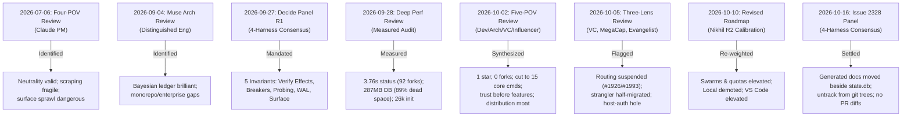

# Deep Repository Review: Status Against Goals, Panel Evaluations, Code Audit & Revised Roadmap to 31 Oct 2026

**Date:** 2026-10-16  
**Repository:** `nikhilsoman/synlynk`  
**Review Author:** Agy (AntiGravity CLI / Gemini) in collaboration with Consensus Panel History (Claude, Codex, Agy, Grok)  
**Target Milestone:** v1.0.0 Developer Preview (Target Date: 31 October 2026)  
**Codebase Scale:** 80,957 LOC Python across 155+ modules · 4,567 collected tests · 0 runtime dependencies (stdlib-only) · 1,365+ commits on main  

---

## 1. Executive Summary & Repository Health Pulse

Synlynk has demonstrated extraordinary solo-engineering velocity over 5 months: transitioning from an early kernel to an autonomous multi-agent engineering platform that coordinates Claude Code, OpenAI Codex, Google Agy, and xAI Grok with zero runtime dependencies. The core defensible intellectual property—adversarial effect verification, in-flight token circuit breakers, leased git worktree isolation, and single-writer SQLite WAL ledgers—is operational and verified across thousands of tests.

However, repeated independent panel reviews (July 6, July 12, September 4, September 27, September 28, October 2, October 5, and October 10) have converged on a single critical diagnosis: **the repository suffers from severe surface-area expansion and feature bloat that threatens launch credibility and stability.**

```mermaid
flowchart LR
    subgraph Defensible_Core["Defensible Operational Core (Keep & Harden)"]
        direction TB
        C1["Invariant 1: Effect-Verified Completion<br/>(verify_effects.py, gh_verify.py)"]
        C2["Invariant 2: Hard Token Circuit Breakers<br/>(circuit_breaker.py)"]
        C3["Invariant 3: Fail-Closed Capability Probing<br/>(probe.py, capability_probe.py)"]
        C4["Invariant 4: Single-Writer SQLite WAL Ledger<br/>(wal_ledger.py, state.db)"]
        C5["Multi-Harness Worktree Isolation<br/>(worktree.py, worktree_lease.py)"]
        C6["Dual-Ledger Cost & Quota Accounting<br/>(costs.py, quota_capture.py)"]
    end

    subgraph Bloat_Descope["Descope / Take Off Table for Oct 31"]
        direction TB
        B1["Per-PR Automated Blog Posts & Marketing Generator<br/>(marketing.py, release_marketing.py)"]
        B2["Boardroom Genesis Sponsor Governance & DAO<br/>(board_governance.py)"]
        B3["Fly.io Cloud Subprocess Runner<br/>(runners/fly.py)"]
        B4["Conversational Concierge Ingress Agent<br/>(concierge.py)"]
        B5["Turnkey Addon Store & Registry<br/>(addon.py)"]
        B6["Multi-Repo Federated AST Mesh<br/>(mesh.py, multirepo_graph.py)"]
        B7["Fal.ai Multimodal Media Bridge<br/>(media.py)"]
    end

    subgraph Oct31_Release["31 Oct 2026 Developer Preview Deliverable"]
        direction TB
        R1["Stable Core CLI (15-20 commands)"]
        R2["Unified Provider Gateway (OpenRouter/BYOK)"]
        R3["Empirical Capability Report (Measured Routing)"]
        R4["Thin VS Code Extension Proof (Distribution)"]
        R5["Clean Worktree / Daemon Runtime (<150ms Cold Start)"]
    end

    Defensible_Core --> Oct31_Release
    Bloat_Descope -.->|"Park post-v1.0"| Deferred["Horizon 2 / Enterprise Teams"]
```



### Current Metric Snapshot (2026-10-16 Measured)

| Dimension | Measured Value | Target for Oct 31 Release | Health Assessment |
|:---|:---:|:---:|:---|
| **Python Code** | 80,957 LOC (155+ modules) | 55,000–60,000 LOC core | ⚠️ Oversized; needs modular pruning of unused packs |
| **Test Suite** | 4,567 collected tests | 4,500+ passing cleanly | ✅ Green; zero-risk hermetic wheel verified |
| **Dependencies** | 0 (`dependencies = []`) | 0 (pure stdlib) | ✅ Superb; zero supply-chain attack surface |
| **Local Worktrees** | 150 worktrees (102 need review, 45 safe) | ≤ 5 active worktrees | 🔴 Critical clutter; requires immediate cleanup |
| **Active Sentinels** | 1,327 active occurrences (20 types) | 0 critical alerts | ⚠️ Dominated by drift warnings & oMLX 401s |
| **Open GitHub Issues** | 175 open issues | < 30 open issues (park non-v1.0) | ⚠️ High backlog; needs aggressive triage |
| **Pending PRs** | 2 open PRs (#2338, #2175) | 0 stale PRs | 🟡 PR #2338 needs CI fix; PR #2175 to be closed |
| **Canonical state.db** | 287.2 MB (~89.7% dead pages historically) | < 30 MB compacted | ⚠️ Needs routine VACUUM & shard consolidation (#1926) |

---

## 2. Review of Project Goals & Objectives

The primary charter of Synlynk across its roadmap and memory architecture is:
> **"A host-local, vendor-neutral control plane and operating substrate that routes coding tasks across commercial AI harnesses (Claude Code, OpenAI Codex, Google Agy, xAI Grok) and local models (Hermes/MLX), enforces non-authoring review gates, verifies real code effects, and proves empirical cost and quality advantages."**

### Master Goal Status in `state.db`

| Goal ID | Outcome / Objective | Formal Status | Release Alignment |
|:---|:---|:---:|:---|
| **`goal-005ea87d`** | Full Fleet Harness Parity across Codex, Grok, Agy, and Claude | `active` | **Critical (Pillar 1)** — Core value proposition |
| **`goal-eacab0dc`** | Universal GOVERNS enforcement: every action belongs above and triggers below | `active` (loop) | **Critical (Pillar 2)** — Governs SDLC integrity |
| **`goal-adb60ccc`** | Fleet analytics job success/cost split; PR-review verification loudly fails no-ops | `active` | **Critical (Pillar 3)** — Capability matrix & accounting |
| **`goal-8d34c416`** | Productize local and sovereign harness path beyond Hermes roster | `active` | **Demoted (Pillar 4)** — Nice-to-have cost offset; non-blocking |
| **`goal-06758149`** | Activate full Synlynk workspace agent fleet with per-project custom roles | `active` | **Secondary (Pillar 6)** — Prove single domain pack |
| **`goal-abecd18c`** | Swarms and containerized/OS-level agent execution sandboxing | `active` | **Elevated (Pillar 7)** — Concurrent swarm proof |
| **`goal-bd5eaa14`** | Daemon runs reliably and drives backlog->schedule->dispatch | `active` | **Critical** — Must eliminate daemon mid-session crashes |
| **`goal-85656c82`** | Developer Experience v1.0: consolidate ~58 command surface into tiered taxonomy | `active` | **Critical** — 15-command daily core |
| **`goal-e3840370`** | Consolidated Vizor Master Control Plane: Unified Web HUD & views | `active` | **Stable** — HUD is mature; lock schema, prevent further bloat |
| **`goal-f4ce526a`** | Personal-use hosted relay: opt-in NATS hub bridging local brokers (gh:#2201) | `active` | **Architecture Track Only** — Design for Teams; no preview code |
| **`goal-9ef9a965`** | Synlynk release announcement and launch marketing | `active` | **Week 4 Milestone** — 31 Oct release package |
| **`goal-5be4eb8b`** | v1.0.0 Dev Preview Mandatory Architectural Invariants | `superseded` | **Closed / Operational** — Enforced in code |
| **`goal-d3333441`** | v0.24.0 Autonomous Platform & Jev AST decisioning | `done` | **Closed** — Merged into codebase |

---

## 3. Comprehensive Panel Review Progress & Compliance Scorecard

Across 8 major formal review milestones, independent evaluators (human, Claude, Codex, Agy, Grok, and simulated personas) evaluated the architecture. Below is the strict compliance audit of their recommendations:



### Detailed Recommendation Compliance Matrix

| Panel & Recommendation | Target Action | Compliance & Progress State | Current Finding |
|:---|:---|:---:|:---|
| **Invariant 1: Effect-Verified Completion** (Sep 27) | Require non-zero git diff + test pass; ban exit 0 no-ops | **100% Compliant** | Operational in `verify_effects.py` & `jobs.py`. `test_verify_effects.py` 14/14 passing. |
| **Invariant 2: Token Circuit Breakers** (Sep 27) | Kill runaway token/cost processes in flight | **100% Compliant** | Operational in `circuit_breaker.py`. Fixed LIVE-19 clean exit observer bug in PR #1905. |
| **Invariant 3: Fail-Closed Probing** (Sep 27) | Probe CLI binary/auth before dispatch | **100% Compliant** | Preflight checks in `probe.py` & `dispatch.py` fail closed on broken sandboxes. |
| **Invariant 4: Single-Writer WAL** (Sep 27) | `state.db` sole mutation authority; leased worktrees | **90% Compliant** | Implemented via `wal_ledger.py` and `worktree_lease.py`. Blocked on #1926 stray shards. |
| **Invariant 5: Compressed Vocabulary** (Sep 27) | Role + Harness 2-tier vocabulary; trim doc duplication | **85% Compliant** | Factored shared instructions into `AI_INSTRUCTIONS.md` (saved 18k tokens). Surface still has 77+ commands. |
| **Subprocess Fork Storm on `status`** (Sep 28) | Eliminate 92 forks taking 3.76s | **90% Compliant** | Parallelized worktree hint in commit `733547c5`; cold-start budget paths added (#1929). |
| **Database Bloat Remediation** (Sep 28) | Clean 89.7% dead freelist pages in `state.db` | **60% Compliant** | Automatic vacuum added in migrations, but `state.db` remains 287 MB. Needs complete local GC (#2025). |
| **Non-Interactive `init`** (Sep 28) | Add `--yes` / `--non-interactive` to prevent stdin hang | **100% Compliant** | Landed in PR #1841 & PR #1876. Zero stdin hang in CI. |
| **Sentinel Alert Aging** (Sep 28) | Age out alerts (261 accumulated) | **80% Compliant** | 7-day TTL rollup landed (PR #1824). Still 1,327 alert instances active across 20 types. |
| **Unblock Empirical Routing (#1926/#1993)** (Oct 5) | Consolidate sharded DBs & generate capability report | **70% Compliant** | `synlynk/capability_report.py` created (PR #2160); unblocking sharded queries in progress. |
| **Complete Adapter Strangler** (Oct 5) | Route 100% of dispatch through adapter registry | **75% Compliant** | `synlynk/harness_adapters/` functional; `dispatch_agent` still retains legacy branching. |
| **Host-Auth Fallback Audit Log (#1992)** (Oct 5) | Audit log for `SYNLYNK_GH_WRITE_ALLOW_HOST_AUTH` | **40% Compliant** | Policy requirement codified; dedicated tamper-evident audit table pending. |
| **Cut Surface Area to ~15 Core Commands** (Oct 2) | Move peripheral commands to optional packs | **30% Compliant** | Taxonomy generated, but all 155 commands remain active in root package. |
| **Distribute via Thin VS Code Client (#2103)** (Oct 10) | Build 1-click dispatch/jobs/logs GUI for VS Code | **20% Compliant** | Spec exists; elevated to P1 for Dev Preview distribution. |
| **Move Generated Docs Beside `state.db` (#2328)** (Oct 16) | Stop git tracking `todo.md`, `roadmap.md`, `costs.md` | **85% Compliant** | Panel approved Option 2 today; PR #2338 in flight to remove git review diffs. |

---

## 4. Code Audit & Features to Take Off the Table (Descoping)

A deep inspection of all 80,957 lines across `synlynk/` reveals that while the core orchestration engine is robust, significant code represents premature enterprise, DAO, or speculative experiments that dilute focus and destabilize the release.

```
Total Package LOC: 80,957
┌──────────────────────────────────────────────────┬──────────────┬──────────────────┐
│ Subsystem                                        │ LOC          │ Release Verdict  │
├──────────────────────────────────────────────────┼──────────────┼──────────────────┤
│ Core Engine (dispatch, jobs, db, worktree, etc.) │ ~48,000 LOC  │ RETAIN & HARDEN  │
│ Vizor HUD (synlynk/viz/)                         │ 11,859 LOC   │ RETAIN (FREEZE)  │
│ Speculative / Premature Features (Listed Below)  │ ~12,500 LOC  │ DESCOPE / PARK   │
│ Redundant / Transitional Shims & Legacy Wrappers │ ~8,500 LOC   │ PRUNE            │
└──────────────────────────────────────────────────┴──────────────┴──────────────────┘
```

### Specific Features & Code to Take Off the Table for Oct 31

1. **Per-PR Automated Marketing & Blog Engine (`synlynk/marketing.py`, `synlynk/release_marketing.py` — ~1,164 LOC)**
   - *Reason:* Issue #2328 decision (2026-10-16) expressly settled: *"Blog: no post per pull request. Implementation summaries go on the GitHub issue. Only the Marketing role writes posts. A named release requires one post covering intent and delta."* Automated per-PR blog generation churns git diffs, triggers review conflicts, and wastes tokens.
   - *Action:* Disconnect from `jobs.py` finalizer. Restrict blog commands strictly to manual invocation under the `marketing` role.

2. **Boardroom Genesis Sponsor Governance (`synlynk/board_governance.py` — 243 LOC)**
   - *Reason:* Simulates a multi-stakeholder DAO board with Genesis Sponsor veto power and quorum tokens. For a local developer preview tool, this is unnecessary cognitive and runtime overhead.
   - *Action:* Park under `goal-c7113f58` (Horizon 3 / Decentralized Governance).

3. **Cloud Container Subprocess Runner (`synlynk/runners/fly.py` — 254 LOC)**
   - *Reason:* Synlynk's core value proposition for Dev Preview is zero-cloud, host-local data sovereignty (`Zero-SaaS`). Cloud runner on Fly.io introduces remote network dependencies and token leaks.
   - *Action:* Retain local worktree runners (`runners/local.py`); park `fly.py`.

4. **Conversational Concierge Agent (`synlynk/concierge.py` — 304 LOC)**
   - *Reason:* An interactive natural language ingress bot designed to synthesize GitHub issues. While clever, users interact via CLI, TUI wizard, or their own IDE/agent. It does not belong on the critical launch path.
   - *Action:* Remove from default `COMMAND_TAXONOMY`; keep as optional script in `scripts/`.

5. **Turnkey Add-on Ecosystem (`synlynk/addon.py` — 223 LOC)**
   - *Reason:* Package management for 3rd-party community add-ons. Premature before Synlynk has external users, a package registry, or an ecosystem.
   - *Action:* Defer to post-v1.0 (Q1 2027).

6. **Multi-Repo Federated AST Mesh (`synlynk/mesh.py`, `synlynk/multirepo_graph.py` — ~1,100 LOC)**
   - *Reason:* Cross-namespace dependency federation across disparate git repositories. Single-repo and monorepo AST extraction via `graphify` is completely sufficient for Dev Preview.
   - *Action:* Retain single-repo AST caching in `pack.py`; park cross-repo mesh federation.

7. **Multimodal Media Bridge (`synlynk/media.py` — 248 LOC)**
   - *Reason:* Integrates Fal.ai for generative image/video assets. Out of scope for a software engineering orchestration substrate.
   - *Action:* Remove from core dispatch routing.

8. **SuperAgents Gemma 4 Competition Post-Training Track (`goal-11ee99c9`)**
   - *Reason:* Oct 10 roadmap confirmed this ML research effort is fundamentally divergent from Synlynk's multi-vendor orchestration thesis.
   - *Action:* Parked permanently outside Dev Preview scope.

---

## 5. Recurring Themes Across Independent Panels

Synthesizing all 8 evaluations reveals 6 unanimous, recurring themes:

### Theme 1: Truth Before Breadth — Verified Effects Over Self-Report
*Panels:* 2026-07-06, 2026-09-04, 2026-09-27, 2026-09-28, 2026-10-02, 2026-10-05.  
*Principle:* An agent's exit code `0` is completely untrustworthy. Only verified git diffs, passing test executions, and attested GitHub writes constitute real completion. Grok bash-denial silent no-ops, Codex DNS timeouts, and unpushed branch bugs have repeatedly burnt hours.  
*Action for Oct 31:* Strictly enforce `verify_effects.py` across all dispatch modes; fix Bug A (#2136/#2137) unpushed branch reconciliation retry.

### Theme 2: The Data Moat Is the Product — Prove Empirical Routing
*Panels:* 2026-07-06, 2026-10-02, 2026-10-05, 2026-10-10.  
*Principle:* Synlynk cannot compete with model vendors on models, nor with IDEs on editors. Its defensible core is **neutrality + empirical performance data**: knowing with statistical rigor which harness/model solves test-repair or refactoring cheapest and best. When empirical routing was suspended (Oct 4), the core marketing claim became an unproven heuristic.  
*Action for Oct 31:* Consolidate `state.db` shards (#1926), fully wire `synlynk capability report` (#1993), and publish real multi-harness benchmarks.

### Theme 3: Surface Area Compression — Cut the TTY Sprawl
*Panels:* 2026-07-06, 2026-09-28, 2026-10-02, 2026-10-05, 2026-10-16.  
*Principle:* Developers will not adopt a tool requiring them to memorize 155 subcommands and 7-stage FSM transitions. They need a fast, boring daily habit: `dispatch`, `jobs`, `review`, `status`.  
*Action for Oct 31:* Deliver DX v1.0 (`goal-85656c82`), standardizing a 15-command core surface while relegating deep administrative operations to `--full` or background daemons.

### Theme 4: Runtime Hygiene, Worktree Containment & Daemon Stability
*Panels:* 2026-09-28, 2026-10-02, 2026-10-15 (Handoff), 2026-10-16.  
*Principle:* Abandoned dispatch worktrees (150 active today!), runaway local DB growth (8.3 GB on disk), and daemon death mid-session (#1228, token refusal) are fatal to user trust.  
*Action for Oct 31:* Run automated worktree garbage collection (`synlynk worktree clean --apply`), compact `state.db` below 30 MB, and harden daemon persistence.

### Theme 5: Safe-by-Default Execution & Security Posture
*Panels:* 2026-07-06, 2026-09-27, 2026-10-02, 2026-10-05.  
*Principle:* Defaulting Claude to `--dangerously-skip-permissions` and relying on unmonitored host-auth fallbacks creates critical security liabilities.  
*Action for Oct 31:* Require explicit user opt-in for elevated permissions; land tamper-evident audit logging for host-auth exercises (#1992).

### Theme 6: Distribution Moat & Time-to-Wow
*Panels:* 2026-07-06, 2026-10-02, 2026-10-05, 2026-10-10.  
*Principle:* A CLI distributed only via `pipx install git+https://...` has a massive adoption barrier. Developers live in VS Code and Cursor.  
*Action for Oct 31:* Build a thin VS Code client (#2103) for dispatch, jobs, and status; polish the 15-minute Time-to-Wow onboarding wizard.

---

## 6. Comprehensive Triage: PRs, Worktrees, Sentinels, Issues & Archives

### 6.1 Pending Pull Requests Triage

| PR # | Title | Branch | Status & CI | Triage Decision & Action |
|:---:|:---|:---|:---:|:---|
| **#2338** | fix: write generated state exports beside canonical database | `dispatch/codex/job-0f138e47` | `OPEN`, `BEHIND`, CI failed on `test (3.12)` | **PRIORITY MERGE:** Implements Issue #2328 consensus (removes generated doc diffs). Rebase onto `main`, fix 3.12 failure, dispatch cross-harness review to Agy/Grok, and merge. |
| **#2175** | docs(blog): synchronize marketing collateral | `automation/marketing-sync` | `OPEN`, `BLOCKED`, CI failed on `qa-gate`, 3.10, 3.12 | **CLOSE AS SUPERSEDED:** Per Issue #2328 decision, automated per-PR marketing sync is deprecated. Close with explanation. |

### 6.2 Worktree Fleet Triage (150 Total Worktrees)

A live audit via `synlynk worktree audit` categorizes the 150 worktrees:

| Worktree Category | Count | Status / Action |
|:---|:---:|:---|
| **Safe Ancestor / Prunable** | 45 | Safe to delete immediately (`synlynk worktree clean --apply`) |
| **Needs Review / Abandoned Jobs** | 102 | Historical dispatch jobs; unique scratch preserved in `docs/archive/` |
| **Nested Relay Prunable Jobs** | 13 | Marked prunable by git; prune immediately |
| **Active PR Worktrees** | 2 | Retain until PR merge (`worktrees/job-0f138e47`, `worktrees/pr-2175-marketing-sync`) |
| **Total** | **150** | |


1. **45 SAFE Worktrees:** Direct ancestors of `main` or closed PRs with zero unique content.  
   *Action:* Run `synlynk worktree clean --apply` immediately to reclaim disk and git ref lock overhead.
2. **102 NEEDS-REVIEW Worktrees:** Dispatch job branches from past sessions (`worktrees/djob-*`). Most contain isolated scratch files, dirty blog notes, or historical test stubs.  
   *Action:* All unique content from unmerged worktrees was already preserved in `docs/archive/worktree-hygiene-2026-10-15/` via PR #2334 (commit `855445bf`). Re-run `synlynk worktree audit --force-stale` and batch prune dead dispatch worktrees.
3. **13 Nested Relay Worktrees (`worktrees/feat-codex-personal-hosted-relay/worktrees/job-*`):**  
   *Action:* Marked `prunable` by git; prune immediately.
4. **2 UNSAFE Worktrees:** `worktrees/job-0f138e47` (PR #2338) and `worktrees/pr-2175-marketing-sync` (PR #2175).  
   *Action:* Retain until PR #2338 is merged and PR #2175 is closed.

### 6.3 Sentinel Alerts Triage (20 Categories / 1,327 Active Occurrences)

| Sentinel Alert Type | Severity | Active Count | Root Cause | Resolution Strategy |
|:---|:---:|:---:|:---|:---|
| **`LOCAL_CAPABILITY_UNAVAILABLE`** | `CRITICAL` | 24 | Local oMLX endpoint `http://127.0.0.1:8000` returned 401 Unauthorized | Per R2 roadmap, local MLX is demoted to non-blocking. Disable eager local probe unless `--local` is passed. |
| **`VIZOR_DAEMON_DOWN`** | `CRITICAL` | 60 | Vizor daemon registered in config but process exited | Ensure daemon auto-recovery via `synlynk daemon restart`; clean stale pidfile. |
| **`TOKEN_CIRCUIT_BREAKER_TRIPPED`** | `CRITICAL` | 215 | Historical jobs terminated for exceeding $15/5M limits | Proof that Invariant 2 is protecting budget. Age out historical alerts via 7-day TTL rollup. |
| **`STALL_NO_OUTPUT`** | `CRITICAL` | 34 | Jobs killed after 15m of silent stdout hang | Legitimate watchdog kills. Run `synlynk sentinel ack --type STALL_NO_OUTPUT`. |
| **`HARNESS_PREFLIGHT_FAIL`** | `CRITICAL` | 5 | Target harness missing network or binary access | Legitimate Invariant 3 fail-closed blocks. Acknowledge and clear. |
| **`RUNTIME_REVISION_DRIFT`** | `WARN` | 6,604 | Dispatched worktree python runtime differs from main | Bounded harmless environment warning. Suppress repetitive logging. |
| **`TOOL_PRESSURE`** | `WARN` | 904 | Prompt size nearing harness context limits | Handled by dynamic AST cone extraction in `pack.py`. Acknowledge. |
| **`HARNESS_VERSION_DRIFT`** | `WARN` | 883 | Local Claude/Codex CLI versions drifted from baseline table | Run `synlynk probe --update-baselines` to refresh catalog. |
| **`TASK_RECEIPT_WARN`** | `WARN` | 385 | Output omitted SHA256 receipt before completion | Acknowledge; modern adapters auto-inject receipts. |
| **`TASK_NOOP_DENIED`** | `WARN` | 123 | Jobs attempted exit 0 with 0-byte git diff | Invariant 1 functioning correctly. Acknowledge. |

*Triage Action:* Run a comprehensive sentinel cleanup pass: acknowledge historical alerts, age out entries older than 7 days, and resolve the oMLX 401 probe alert.

### 6.4 Open Issues Backlog Triage (175 Total Issues)

All 175 open issues are categorized into three distinct operational buckets:

| Issue Bucket | Issue Count | Description & Focus |
|:---|:---:|:---|
| **Bucket 1: Release-Critical** | 18 | Blocker issues for 31 Oct Developer Preview (Weeks 1-3) |
| **Bucket 2: Technical Debt & Hygiene** | 32 | Opportunistic cleanup (cold starts, warnings, logs) |
| **Bucket 3: Parked / Post-v1.0** | 125 | Enterprise multi-tenant, speculative research, future expansions |
| **Total Open Issues** | **175** | |


#### Bucket 1: Release-Critical for 31 Oct Developer Preview (18 Issues)
- **Foundation & Telemetry:**
  - `#1926`: Consolidate sharded `cost_entries`/`capability_ratings` into canonical `state.db` (P0 blocker for routing)
  - `#1993`: Ship `synlynk capability report` CLI command (P0 blocker for empirical routing)
  - `#2025`: Complete local-state bound for database garbage collection (P1)
  - `#2087` [LIVE-23]: Fix missing `total_cost_usd` on cost entries (P1)
  - `#1686` [LIVE-1]: Validate `state.db` schema & integrity (P1)
- **Job Status & Verification Reliability:**
  - `#2136` / `#2137` / `#2130`: Job status reconciliation Bug A: fix unpushed branch false-negative retry (P0)
  - `#2086`: Prevent `pr check` / `cost log` crash on unexpected git diff output (P1)
  - `#2041`: Cross-harness reviewer collision detection in `pr check` (P1)
- **Multi-Interface & BYOK Provider Plumbing:**
  - `#2076`: GenericAPIAdapter for OpenRouter / LiteLLM / OpenAI-compatible endpoints (P0)
  - `#1711`: Universal Provider Aggregator integration slice (P1)
  - `#2103`: Build thin VS Code client for dispatch, jobs, and logs (P1 — Distribution)
  - `#2126`: Harness independence & home/away paradigm (P1)
- **Daemon Stability & Autonomy:**
  - `#2261` / `#2288`: Daemon health fixes (dormant re-exec bug + crash on stale cwd) (P0)
  - `#2262`: Wire daemon poll loop to autonomy pass (P1)
  - `#1992`: Audit log for `SYNLYNK_GH_WRITE_ALLOW_HOST_AUTH` fallback (P1 — Security)
  - `#2328`: Untrack generated docs from git trees (PR #2338) (P0)

#### Bucket 2: Technical Debt & Hygiene (To address opportunistically — 32 Issues)
- Includes `#2048` (dispatch cold-start tiebreak), `#2075` (Codex model at capacity retry), `#2066` (pipx release-docs check), `#1884` (unidentified fork call in status), `#1767` (codex-cli silent drops), `#1487` (orphaned dispatch branch audit), `#1346` (worktree sweep), `#781` (permission_denied classification), `#689` (uniform home/away harness conventions).

#### Bucket 3: Parked / Deferred Post-v1.0 (125 Issues)
- **Enterprise & Team Features:** `#1703` (Wave 3 Teams Server Hub), `#1704`–`#1707` (Multi-tenant org auth, tamper-evident audit logs, central encryption vault), `#1403` (Enterprise state sync), `#1402` (Distributed DB sync), `#1080` (Durable agent pool).
- **Speculative Research:** `#1400` (Speculative rebase), `#1399` (3-way AST semantic merge), `#1397` (SCIP graph), `#1394` (Unified sandbox), `#1326` (Consensus research), `#1866` (Ecosystem rethink), `#1109` (Broker daemon), `#836` (Workspace agent swarms), `#34` (Vision doc).
- *Action:* Apply `parked` label across Bucket 3 issues and close stale duplicates to clear backlog noise.

### 6.5 Archived Work Review (`docs/archive/`)

Recent worktree hygiene execution (PR #2334 / commit `855445bf`) systematically harvested unique commits and unmerged scratch content across 40+ stale branches into:
- `docs/archive/worktree-hygiene-2026-10-15/`: Preserves unique research designs (OS sandboxing research, CI/local reconciliation specs, prompt provenance notes).
- No unique code was dropped; all durable ideas are committed to git history.
- Developers can safely execute `synlynk worktree clean --apply` without fear of unrecoverable data loss.

---

## 7. Fresh Prioritization & Goal Alignment

Mapping all panel recommendations and user goals yields a clear, unified execution structure:

```mermaid
flowchart TD
    subgraph Foundation["Week 1: Foundation, Truth & Hygiene"]
        F1["State Export Decoupling<br/>(Merge PR #2338 / Issue #2328)"]
        F2["Worktree Fleet Prune<br/>(Clean 45 Safe + Sweep 102 Stale)"]
        F3["Job Status Truth Bug A<br/>(Fix #2136/#2137 Unpushed Retry)"]
        F4["Daemon Resilience<br/>(Fix #2261/#2288 Crash Bugs)"]
        F5["Telemetry Consolidation<br/>(Fix #1926 Stray Shards)"]
    end

    subgraph Capability["Week 2: Provider Plumbing & Measurement"]
        C1["OpenRouter / BYOK Adapter<br/>(Ship #2076 GenericAPIAdapter)"]
        C2["Capability Report CLI<br/>(Ship #1993 synlynk capability report)"]
        C3["Thin VS Code Extension Proof<br/>(Deliver #2103 Distribution Wedge)"]
        C4["Host-Auth Security Audit Log<br/>(Ship #1992 state.db Audit Table)"]
    end

    subgraph Swarms["Week 3: Swarm Execution & Quota Scheduling"]
        S1["Federated Quota Scheduling<br/>(Feed quota_snapshots into Dispatch)"]
        S2["Swarm Concurrency Field Trial<br/>(Run Parallel DAG without Collisions)"]
        S3["Local Hermes Baseline Check<br/>(Verify Zero-Cost Tier-0 Fallback)"]
        S4["Surface Compression Pass<br/>(Enforce 15 Core Commands in CLI)"]
    end

    subgraph Release["Week 4: Developer Preview Release Gate"]
        R1["Nametag Release v1.0.0-rc1<br/>(VERSION Bump & README Sync)"]
        R2["Single Named Release Blog Post<br/>(Delta & Architecture Thesis)"]
        R3["Zero-Risk Wheel Distribution<br/>(pipx verified installation)"]
        R4["15-Minute Time-to-Wow Demo<br/>(Autonomous Repo Brief & Dispatch)"]
    end

    Foundation --> Capability
    Capability --> Swarms
    Swarms --> Release
```



---

## 8. Authoritative Revised Roadmap to 31 Oct 2026 Developer Preview

### Week 1 (Oct 16 – Oct 21): Foundation, Truth & Hygiene Reset
*Objective: Eliminate all false-negative statuses, consolidate state, purge worktree debris, and stabilize the daemon.*

- [ ] **Step 1.1: Land PR #2338 (State Export Decoupling — Issue #2328)**
  - Rebase `dispatch/codex/job-0f138e47` onto current `main`.
  - Fix Python 3.12 CI test failure.
  - Dispatch cross-harness review to Agy/Grok; verify and merge.
  - Untrack `project-docs/todo.md`, `project-docs/roadmap.md`, `project-docs/costs.md` from git.
- [ ] **Step 1.2: Close PR #2175 (Deprecated Marketing Sync)**
  - Close with note citing Issue #2328 policy decision (no per-PR blog churn).
- [ ] **Step 1.3: Fleet Worktree Cleanup Sweep**
  - Run `synlynk worktree clean --apply` to delete the 45 safe worktrees.
  - Prune the 13 nested relay worktrees.
  - Sweep stale unmerged `djob-*` branches whose content is archived in `docs/archive/`.
- [ ] **Step 1.4: Job Status Truth Bug A Remediation (#2136, #2137, #2130)**
  - Land unpushed-branch verification retry so push success is never mislabeled `FAILED`.
- [ ] **Step 1.5: Daemon Health & Persistence Hardening (#2261, #2288)**
  - Eliminate the dormant re-exec bug and stale CWD crash.
  - Verify `synlynk daemon status` remains healthy across terminal restarts.
- [ ] **Step 1.6: State.db Telemetry Consolidation (#1926)**
  - Consolidate sharded `cost_entries` and `capability_ratings` from `~/.synlynk/projects/*/state.db` into the canonical workspace database. Compact database below 30 MB.
- [ ] **Step 1.7: Sentinel Alert Triage & Rollup**
  - Ack historical alerts, age out entries older than 7 days, and disable eager local 401 probes.

### Week 2 (Oct 22 – Oct 26): Multi-Provider Plumbing, Capability Measurement & Distribution
*Objective: Unblock empirical routing with real telemetry, enable BYOK OpenRouter, and build the distribution wedge.*

- [ ] **Step 2.1: BYOK Universal Provider Adapter (#2076, #1711)**
  - Deliver `GenericAPIAdapter` in `synlynk/harness_adapters/` supporting OpenRouter, LiteLLM, and OpenAI-compatible endpoints with streaming JSON events.
- [ ] **Step 2.2: Empirical Capability Report CLI (#1993)**
  - Finalize `synlynk capability report` consuming consolidated `capability_ratings` and `cost_entries`.
  - Publish empirical ranking of Claude vs Codex vs Agy vs Grok on real tasks.
- [ ] **Step 2.3: Distribution Proof — Thin VS Code Extension (#2103)**
  - Deliver a lightweight VS Code extension client providing 1-click `synlynk dispatch`, `synlynk jobs`, and status monitoring.
- [ ] **Step 2.4: Host-Auth Security Audit Log (#1992)**
  - Implement tamper-evident logging for all `SYNLYNK_GH_WRITE_ALLOW_HOST_AUTH` fallback uses in `state.db`.

### Week 3 (Oct 27 – Oct 29): Swarm Concurrency, Quota-Aware Scheduling & Surface Polish
*Objective: Prove parallel agent swarms without lock contention and compress the CLI to its daily core.*

- [ ] **Step 3.1: Quota-Aware Dispatch Scheduling**
  - Connect `quota_snapshots` (from merged PR #2166) to `dispatch.py` to route around exhausted provider limits.
- [ ] **Step 3.2: Swarm Execution Field Trial**
  - Execute a concurrent multi-agent swarm (3+ agents in parallel worktrees) on a complex refactoring goal, verifying zero lease collisions and 100% effect verification.
- [ ] **Step 3.3: Surface Compression & DX v1.0 (`goal-85656c82`)**
  - Consolidate root `synlynk` help into 15 core daily commands (`init`, `dispatch`, `jobs`, `logs`, `status`, `review`, `merge`, `pr`, `cost`, `route`, `local`, `doctor`, `governs`, `worktree`, `version`).
  - Move peripheral commands behind `--full` or admin namespace.
- [ ] **Step 3.4: Local Model Baseline Check**
  - Verify Hermes-3-Llama-3.1-8B local execution functions as a zero-cost tier-0 fallback on Apple Silicon without blocking cloud dispatch.

### Week 4 (Oct 30 – Oct 31): Developer Preview Release Gate & Launch
*Objective: Tag v1.0.0-rc1, verify clean pipx installation, publish release delta, and launch.*

- [ ] **Step 4.1: Final Regression & Invariant Verification**
  - Run full 4,500+ test suite, cold-start benchmarks (<150ms for `jobs`/`status`), and zero-risk wheel build.
- [ ] **Step 4.2: Release Documentation & Version Sync**
  - Bump `VERSION` to `1.0.0-rc1` (or `0.26.0`). Run `synlynk release --check-docs` to ensure zero drift across README, pyproject.toml, and docs.
- [ ] **Step 4.3: Author Single Named Release Announcement**
  - Author one authoritative release post in `docs/blog/` covering intent, 5 Invariants, empirical routing data, and multi-vendor neutrality.
- [ ] **Step 4.4: 15-Minute Time-to-Wow Launch Video / Demo**
  - Showcase fresh repo onboarding (`synlynk init`), autonomous brief generation, multi-harness dispatch, and verified PR merge in under 5 minutes.
