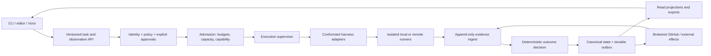

# Synlynk: frontier-lab architecture and product diligence

Date: 2026-10-16. Reviewed commit: `19132dfabd1ecca9de7a9f06b1a8691262d90d1b`.
Author: Codex, acting in the principal architect role requested by Nikhil.
Disposition: independent assessment and proposed roadmap, not an approved implementation spec.

## 1. Executive decision

**Pursue a bounded integration pilot. Do not merge the whole product into a frontier coding platform or recommend a platform acquisition on the available evidence.** Reconsider acquisition after an independently measured pilot demonstrates useful routing, trustworthy outcomes, containment, and repeated developer adoption. Acquisition price cannot be inferred from source volume, test counts, or a panel's enthusiasm.

Synlynk's strongest idea is a vendor-neutral execution control plane whose job is to make coding-agent work accountable: authorize a task, select an eligible execution backend, supply relevant context, isolate its work, observe effects, and retain evidence and costs. This complements a coding platform's model and interactive agent. It could supply a local runner, enterprise policy adapter, portable completion contract, and cross-provider evaluation connector.

The implementation is a substantial, actively evolving orchestration application, with useful safety primitives and extensive regression coverage. It is not yet a dependable trust boundary. The principal gaps are semantic: what counts as approval, what counts as successful work, which component owns terminal state, which execution path enforces policy, and which job a measured cost belongs to. Adding more providers, swarms, or surfaces amplifies those gaps.

My recommended product promise is: **Run approved coding tasks across your chosen agents, with attributable outcomes, explicit costs, and recoverable failures.** Treat selecting the objectively best agent as an experimental capability until measured against realistic baselines.

## 2. Scope, method, and limits

Inspected repository instructions, README, packaging, CI, historical architecture reviews, strategy roadmaps, the September 27 invariant designs, October designs, dispatch and adapters, job verification and projections, scheduling/autonomy, state resolution and WAL, capability reporting, container execution, onboarding, local HTTP authentication, relay credentials, and decision recording. Inventoried all 54 current decision JSON records in the main checkout, including the uncommitted October 16 decision. The companion decision ledger covers each record and separately assesses individual recommendations from the major review panels. Markdown-only triage records are discussed as contextual evidence, not represented as additional panel votes.

The worktree freezes the reviewed commit; the user's pre-existing edits remain in the original checkout. The latest decision on generated documents is an explicit overlay: issue #2328 and its comments were read successfully. Its implementation was reported in PR #2338, but a subsequent GitHub connection failure prevented checking that PR's state. This report does not assume it is merged. Further issue lookups failed; local issue-closure statements are historical reports, not fresh GitHub verification.

Two selected test runs produced **123 passed, 5 expected failures**. This is not a full-suite pass, a live paid-harness trial, a penetration test, a certification, or proof of customer demand. Small isolated reproductions validated specific logic failures without executing agent jobs. No production database, daemon configuration, hosted service, or customer repository was intentionally changed. CLI status probes did enter reconciliation before failing on sandbox restrictions, which is itself a finding.

The current database's operational metrics, full recovery behavior, live provider permissions, release provenance, customer retention, revenue, and contributor IP assignments were not independently audited. Unknown means unknown, not absent. Findings below distinguish reproduced behavior, source inspection, and proposed requirements.

### Measured repository facts

| Fact | Result at reviewed commit |
|---|---:|
| Tracked Python modules under `synlynk/` | 235 |
| Python source lines under `synlynk/` | 95,137 |
| Tracked files under `tests/` | 409 |
| Design specs / implementation plans | 262 / 231 |
| Files under `docs/blog/`, including assets | 317 |
| Largest modules | `jobs.py` 5,677; `dispatch.py` 5,277; `db.py` 5,022 |
| Other central modules | `__init__.py` 3,504; `cli.py` 3,478 |
| `print()` occurrences in package source | 1,444 |
| Five root instruction files combined | 79,787 bytes; not an exact token count |
| Main-checkout sentinel lines | 1,309; historical and repeated alerts, not 1,309 current incidents |

These are inventory measurements, not quality scores. Earlier reviews' LOC and module counts used different snapshots and possibly different counting rules; do not infer productivity from their differences.

## 3. Goals as understood, and validation against the designs

There are four overlapping products in the repository:

1. A local coordination CLI for people using multiple coding agents.
2. An execution and evidence substrate: identity, permissions, worktrees, lifecycle, costs, recovery.
3. An autonomous software organization: GOVERNS goals, durable roles, triage, scheduling, review, maintenance.
4. A future distribution and commercial platform: Vizor, remote relay, swarms, add-ons, domain packs, and sometimes a marketplace.

The first two form a coherent initial product. The third requires stronger authority and correctness guarantees. The fourth should be demand-led and cannot all be a preview prerequisite.

| Asserted goal / source | Design intent | Current evidence | Assessment |
|---|---|---|---|
| README: neutral routing, then prove result | Empirical outcomes and verified effects | Registry and dispatch exist; report joins are unsound; legacy verifier allows weak success | Valid goal, partially realized |
| September 27 invariant 1 | Effect plus verification before success | `verify_effects.py` and `job_truth.py` coexist; default projection mode is shadow | Strong design direction, no universal guarantee |
| Invariant 2 | Hard in-flight token/cost termination | Watchdog and breaker exist; parser-based usage, swallowed evaluator exceptions, PID-only termination | Useful guard, weaker than a hard bound |
| Invariant 3 | Unknown capability prevents unsafe dispatch | Probe and permission logic exist; authorization catches some `ValueError`s and skips the gate | Partial; negative integration tests needed |
| Invariant 4 | Canonical ledger, controlled writers, explicit projections | Canonical resolver and WAL present; legacy JSON and generated Git documents persist | Major improvement; ownership remains fragmented |
| Invariant 5 | Small default surface, role/harness vocabulary | Taxonomy and fast paths exist; large instruction set and ten onboarding stages remain | Partial; learnability unmeasured |
| October 10 preview roadmap | Foundation, measurement, honest claims, then swarm | Several foundations landed; correctness defects remain | Retain dependencies, reduce release scope |
| October 13 charters | Durable PM/TPM/QA/maintainer; dynamic harness choice | Charter and scheduling machinery exists; supervised scheduling contradiction | Mandate is useful; authority must be executable |
| Local/sovereign execution | User-controlled inference and data | Local adapter/model path exists alongside cloud CLI and HTTP providers | Local control-plane storage does not imply local inference |
| Hosted/personal relay | Device-authenticated event transport | NATS optional dependency and scoped device credential implementation | Transport foundation, not validated enterprise tenancy |
| Tokq | Various incompatible marketplace narratives | One October 2 record retires it; another revives token settlement | Conflicting strategy; remove from current critical path |

The invariant-1 design itself is inconsistent: its prose requires verification to run, while its diagram permits "None Declared" and an acceptance test allows a nonempty diff to succeed. Implementation faithfully following the weaker clause still violates the stronger public assurance. Resolve the specification before adding another patch.

## 4. Portfolio fit: integration, merger, acquisition

| Route | Recommendation | Conditions and rationale |
|---|---|---|
| Integration | Start a limited pilot | Integrate task/result contracts, local execution, evidence export, and policy evaluation; retain platform identity and credential services as authorities |
| Code/product merger | Defer | Import selected components only after stable interfaces and conformance; avoid making the existing CLI, global package state, or mutable policy files a platform control plane |
| Acquisition | Conditional diligence option | Evaluate team capability, maintainability, ownership, user adoption, incident burden, and experimentally demonstrated value; do not assign a financial valuation from this audit |
| Independent partnership | Useful default | Preserve vendor neutrality and portable data; a first-party-only fork would weaken the central thesis |

The lab gets leverage from heterogeneous execution evidence, a local/sovereign deployment option, reproducible agent-failure cases, and a reference integration for external harnesses. It should not buy this to obtain generic worktree creation, SQLite storage, or shell dispatch. Those are common building blocks. The potential differentiator is reliable causal evidence across heterogeneous executors, coupled to a workflow developers repeatedly choose.

Run a 90-day pilot with 5-10 external teams using real tasks. Compare Synlynk with each team's existing workflow and with a fixed eligible harness. Measure accepted outcomes, human review time, wall time, retries, attributable actual spend, and retention. Preserve failures in the denominator. Favor incremental integration over importing all 95k lines. Stop the pilot if it cannot establish truthful outcomes or if operational overhead outweighs saved review time.

Prior assertions that no competitor has multi-agent capabilities, a lab can reproduce everything in one quarter, or a CLI can never achieve venture scale are unsupported absolutes. They should not drive this decision. No current market-share, pricing, or acquisition-value claims are made here.

## 5. Prioritized findings and architecture improvements

Severity is impact in the claimed product, not a claim of an exploited vulnerability. P0 blocks unattended or externally trusted execution; P1 blocks reliable broader adoption; P2 is product and maintainability debt.

### F01 / P0: supervised execution is not consistently enforced

Evidence: `autonomy.py:60` denies `can_auto_advance("execute", SUPERVISED)`. `scheduler.py:269` only excludes MANUAL and otherwise calls `cmd_schedule(execute=True)`. A repository-wide search found no production call to `can_auto_advance`. An isolated mock reproduction showed the contradiction directly. `cmd_schedule` enqueues and invokes the dispatch pass. Ready-story selection is not an explicit, task-bound approval receipt.

Require authorization at the enqueue and spawn boundaries, with an approval bound to task, repository, base SHA, requested capabilities, policy revision, and budget. Missing/malformed configuration must not expand authority. Prove supervised mode cannot start unapproved work through CLI, daemon, retry, handoff, or relay paths. Keep manual backlog bookkeeping distinct from permission to execute. Existing ready-state approvals may inform this design, but must not silently stand in for a new task's execution approval.

### F02 / P0: recording a recommendation manufactures an approved status

Evidence: `db.py:3633` constructs and stores decisions with hardcoded `status="approved"`. `team.py:796` asks models for opinions and synthesizes them; the recording call has no human approval argument. A signature authenticates the recorded payload, not the correctness of its claims or a separate human authorization. This is a concrete governance-model defect, not evidence that the user never approved any particular historic decision.

Separate proposed, panel-reviewed, human-approved, implemented, validated, superseded, and revoked states. Record approver identity, authority scope, evidence hashes, dissent, expiry, and supersession. Do not treat model agreement as empirical validation. Release gates must consume independently produced receipts, not synthesis adjectives. Reject changes that let an agent approve its own authority, budget, or verification standard.

### F03 / P0: completion evidence is weaker than the product promise

Evidence: `verify_effects.py` returns verified completion for a mutated file with no verification command (`tests_passed=None`), for analysis with no declared receipt, and for unknown task classes. The isolated reproduction confirmed mutation-without-tests and unknown-class success. Git activity can become a placeholder `(git_activity_verified)`; activity is not acceptance. `job_status_projection.py:23` defaults to shadow; `jobs.py` does not consult `rollout_mode()` directly. The newer pure oracle is useful but does not justify claiming all active paths use one authoritative decision.

Define an immutable effect contract before execution. Explicitly distinguish delivered, independently verified, accepted, and merged. Require applicable checks for each task kind; allow deliberate no-op and analysis success with structured evidence. Unknown contracts remain unknown. Bind receipts and CI results to the exact resulting SHA and expected actor/target. Introduce one authoritative terminal transition API with optimistic revision checks, while keeping late evidence as append-only corrections.

### F04 / P0 for routing claims: capability attribution is incorrect

Evidence: `capability_report.py:36` joins ratings and costs on `story_id` alone. Deduplication keys omit harness and take the first row without deterministic ordering. Multiple executors and retries on one story produce cross-attribution and dropped evidence. The reproduction inserted Codex and Grok ratings plus $1/$20 costs: only the Codex bucket survived, containing both costs and duplicated cycles. The report reads but ignores `quality_verified`; it does not verify merged state. Distinct stories count toward the sample gate even when required metrics are absent.

Repair the data model before promoting report-driven routing. Key execution facts by job/attempt, harness, resolved model, provider, policy version, and effect SHA; aggregate all costs of an outcome including unsuccessful retries and review. Keep quality labels separate and provenance-backed. Stratify by task type and difficulty, report uncertainty and abstain when evidence is insufficient. Five observations are an exploration threshold, not proof of superiority. Avoid manually defining correctness as agreement with the existing preferred-harness belief, as the report spec's manual-verification wording risks doing.

### F05 / P1: adapter migration breaks an approved provider bridge

Evidence: `dispatch.py:3895` now imports the registry and rejects unregistered harnesses at line 3920. `harness_adapters/registry.py` registers six harnesses but not OpenRouter. `_constants.py:269` still advertises an OpenRouter baseline. `get_adapter("openrouter")` raises `KeyError`. The October 11 panel justified deferring a real adapter because dispatch did not consult the registry; that premise is no longer true. Direct gateway use is a separate path and was not shown broken by this reproduction.

Finish migration with a provider/harness compatibility matrix and an end-to-end dispatch test per advertised target. Choose a single command construction, permission translation, spawn, observation, and finalization contract. Current production dispatch uses pipeline resolve/authorize/prepare, then substantial legacy orchestration; it does not call the pipeline's spawn/observe/finalize stages. Keep API inference providers distinct from coding harnesses that supply tool execution.

### F06 / P0 for a hard-budget promise: termination and metering are incomplete

Evidence: `_kill_process_tree` in `circuit_breaker.py:87` terminates a process object or sends signals to one PID; it does not traverse descendants or kill a process group despite its name. Dispatch wraps harnesses in shell commands. The watchdog in `dispatch.py:56` silently retries evaluator exceptions. The evaluator reads the entire log before checking its size and relies on parsable reported token usage. A provider that reports usage only at completion cannot support a true in-flight spend bound through that telemetry alone.

Use an execution supervisor owning a process group/container, verify descendant termination, and reconcile provider request cancellation. Reserve workspace-level budgets transactionally before admission; give each retry a remaining allowance. Specify maximum overshoot using detection interval, provider request cap, and cancellation delay. Missing usage needs a bounded fallback such as elapsed time/request limits and a visible degraded state. Stream usage incrementally and cap log reads before allocation. Do not claim zero overshoot.

### F07 / P1: observation commands mutate and can fail before rendering

Observed: `synlynk status` and `synlynk watch status` crash because `cli.py:2221` calls `_reconcile_jobs()` before dispatching the requested command. Reconciliation reaches a canonical DB write check denied by this environment. Canonical fail-closed resolution is correct; coupling a status read to mutation is the availability defect. This does not prove the normal host has a corrupt DB.

Make status/help/version/log reads side-effect-free. Move reconciliation to an explicit service/command and expose freshness timestamps, last successful reconciliation, and degraded reasons. Provide a read-only recovery view even when writes, GitHub, or a provider are unavailable. The capability report already requests a read-only connection, but its CLI entry must preserve that property end to end.

### F08 / P1: persistence ownership and durability promises need precision

Positive evidence: centralized canonical resolution, product identities, atomic registry writing, recovery tooling, and WAL retry helpers exist. The short 20/50-writer tests passed. These are real advances over old reviews. Remaining concerns: JSON job stores and DB reconciliation coexist; generated state documents remain tracked at this commit; `wal_ledger.py` catches pragma failures and returns degraded values rather than enforcing its stated guarantee. SQLite serialization is not the same as one application writer.

Prefer one local state service owning commands and transactions, with a durable outbox for external effects and revisioned projections. SQLite remains a reasonable local backend; a Postgres rewrite is not justified by this review. Define transaction boundaries, fencing epochs, retry idempotency, backup/restore RPO/RTO, and sidecar regeneration. Implement #2328's accepted export location after its normal review. Do not equate write-through Markdown with a transactional or complete recovery backup.

### F09 / P1: containment is narrower than earlier reviews imply

`container_exec.py` has valuable protections: read-only root, dropped capabilities, no-new-privileges, numeric user, and explicit image selection. It also uses bridge networking and writable Git common-directory mounts. Worktrees share Git metadata; neither a worktree nor these mounts isolate a hostile worker from all repository refs. The container receives selected environment secrets in argv entries, which deserves process-list/log exposure review. No escape or credential theft was attempted.

Use per-job repositories or brokered Git writes for untrusted workloads; restrict egress to approved endpoints; issue short-lived credentials scoped to operations, repositories and effects; keep policy and budget authority outside worker write access. Pin runner images by digest and define who can change them. Evaluate local browser auth, remote relay, provider redirects, symlinks, logs and add-on installation as separate trust boundaries. `sandbox.py` scaffolds a demo and `fencing.py` formats cost displays: neither is the security sandbox claimed in the October 5 review.

### F10 / P1: policy enforcement is incomplete and sometimes descriptive

Current policy places GOVERNS linkage and cross-harness review in observe mode. Host-auth audit code exists (`gh_role.py` invokes `record_host_auth_gh_call`), although policy still says it is unbuilt. `dispatch_agent` and pipeline authorization catch `ValueError` and skip unknown action-shaped cases. `config_schema.py` treats `overrides` as an opaque dict, so validation does not establish correctness of its security-critical nested rules.

Validate policy at startup and activation, version it, and enforce deny-by-default for unknown actions. Make observe/enforce status visible with a precise claim boundary. Test non-authority by immutable identities rather than merely different role strings. Protect the approval and policy store from the executor. An agent editing a local JSON policy must not grant itself privileges in a platform integration.

### F11 / P1: validation often proves components rather than journeys

Adapter conformance exists but has five expected failures: three permission signature mismatches and two local receipt cases. Core fixtures globally permit CWD fallback, stub worktrees, disable graph extraction, and disable staleness threads. Those are reasonable unit-test isolation techniques, but a separate integration suite must use production defaults and real seams. The passing capability tests lack the multi-harness-per-story counterexample.

Keep fast unit tests; add a small mandatory journey matrix using fake executables and isolated real Git repos/DBs. Cover cancellation, lost acknowledgements, duplicate completion, revoked credentials, malformed config, missing usage, policy tampering, stale bases, and replay after restart. Make expected failures owned and time-limited. In `sandbox.py:53`, scaffolding returns `tests_passing=True` without running the generated test; report this as a generated test, not verified success.

### F12 / P2: onboarding, packaging, and documentation overstate simplicity

README promises 60 seconds and a 10-minute quickstart; decision records claim a verified 15-minute win. These can describe different milestones, but no consistent funnel defines them. README says Python 3.9+, while packaging requires >=3.10. The onboarding state engine is a useful shared foundation, but ten stages before a build experience are substantial ceremony. Root instructions remain almost 80 KB in this checkout.

Default to one repo, one chosen eligible harness, one approved task and one visible result. Show topology, fleets, charters and advanced governance when needed. Define installation success, first dispatched task and first accepted result separately. Test noninteractive, interrupted, offline, dirty-repo and uninstall/rollback journeys on supported platforms. A stdlib-only core is valuable for deployment; it does not make installs infallible or eliminate supply-chain risk. The optional hub now has a third-party dependency.

## 6. Target architecture



Use a modular monolith first, with explicit ports and value types. Extract modules by ownership, not by arbitrary line targets. The pure outcome engine should not import job UI or mutate shared package globals. The executor supplies observations; it cannot decide its own success or expand authorization. UI code formats projections and never initiates reconciliation as a hidden read side effect.

Minimum versioned contracts: TaskIntent, ApprovalReceipt, ExecutionPlan, CapabilitySnapshot, BudgetReservation, JobAttempt, EvidenceEvent, OutcomeDecision, and ProjectionCursor. Include schema version, workspace identity, job/attempt IDs, causality/correlation IDs, policy revision, base/result SHA, timestamps and source. Define idempotency and expiration for each external effect. An outbox closes the DB-commit/API-call gap; exactly-once external execution must not be promised where providers lack idempotency.

Keep local and hosted trust boundaries explicit. A relay transports events; it does not automatically become the canonical writer. Teams need identity, conflict resolution, tenancy, revocation and recovery semantics before shared editing. Multiple replicas observing the same job must not independently spend or merge.

## 7. Missed DX and performance opportunities

| Opportunity | Concrete delivery | Measure |
|---|---|---|
| Explain a routing decision | `route --explain --json`: eligibility, excluded providers, sample age, expected cost, uncertainty, fallback | Fewer unexplained reroutes; reproducible selection |
| Truthful progress and repair | Running / awaiting evidence / verified / accepted, with one suggested recovery action | Recovery success and human minutes per failure |
| One coherent automation API | Stable JSON errors/exit codes, pagination, event cursors, cancellation, resumable observation | Clients integrate without scraping terminal text |
| Useful preview | Show capability grants, files/context to be sent, cost bound and effect contract before execution | Approval comprehension and first-task completion |
| Reuse existing tools | Thin editor/GitHub/CI integration over the same API; interoperable tools with explicit auth | External active teams, not number of integrations |
| Incremental context | Cache by repo SHA, policy/charter revision and task scope; show token contributions | Input tokens and quality per accepted outcome |
| Efficient observation | Incremental log offsets, indexed queries, batched Git status and bounded concurrency | CPU, memory, process count and p95 response time |
| Scheduler quality | Fair queues, deadlines, backpressure, bounded retries, starvation detection | Accepted throughput per dollar, queue delay |
| Performance engineering | Separate control-plane overhead from inference and GitHub latency | Repeatable p50/p95/p99 benchmarks |
| Accessible operation | Keyboard-first flows, plain text/no-color, readable errors, screen-reader alternatives to graphs | Completion rates across user environments |
| Portable exit | Export contracts, receipts and costs with schema documentation | No lock-in required for trust or retention |
| Independent evaluation | Paired tasks across fixed and adaptive routing, blind review, held-out repos | Quality-adjusted cost/latency with confidence intervals |

The breaker currently rereads a growing log on each poll. For an approximately linear growing log and a fixed poll interval, cumulative bytes parsed can grow quadratically with job duration. Incremental parsing offers a direct performance improvement while also reducing delayed enforcement. No whole-product speedup is claimed without measurement.

## 8. Safety and AI alignment bar

Alignment here is an engineering contract: the system follows authorized human intent, contains mistakes, reports uncertainty honestly, and can be stopped and corrected. It is not a claim that using multiple frontier models solves alignment.

Required controls before unattended use:

- Treat repo text, issue comments, tool output, web pages, logs and third-party packs as untrusted data, never new authority. Test prompt injection through each surface.
- Separate planner, executor and verifier capabilities. Independent model review can help, but shared prompts and training create correlated errors; deterministic checks and human escalation remain necessary.
- Bind approval to the exact task and permitted effects. Replan, privilege expansion, budget increase, deploy or irreversible action invalidates the prior approval unless already covered explicitly.
- Enforce network/filesystem/credential constraints outside the model. Record revocation and prove it stops queued and running work.
- Verify external effects by actor, object, SHA, time and causal attempt, not by mere existence. Protect verification scripts and tests from being weakened by the worker under evaluation.
- Keep evidence append-only, redact secrets before persistence/export, define retention/deletion, and audit evidence access. Signatures require key custody and provenance; a signed model assertion remains an assertion.
- Evaluate permission escalation, test tampering, reward hacking, fabricated receipts, collusive review, poisoned memory, budget exhaustion, replay, and false terminal outcomes.
- Optimize accepted human value under risk/cost constraints. "No quota sits idle" and "zero open issues" are dangerous primary objectives: both reward needless work. Safe idleness, abstention and stopping are valid outcomes.

Use NIST's [Generative AI Profile](https://nvlpubs.nist.gov/nistpubs/ai/NIST.AI.600-1.pdf) as a risk-management reference, not a certification claim. Use [SLSA provenance](https://slsa.dev/spec/v1.2/provenance) for build evidence and artifact lineage; it does not establish code correctness. External enforcement of filesystem and network boundaries is consistent with [Anthropic's sandboxing architecture](https://www.anthropic.com/engineering/claude-code-sandboxing). For tool integrations, adopt the applicable [MCP authorization contract](https://github.com/modelcontextprotocol/modelcontextprotocol/blob/main/docs/specification/2025-06-18/basic/authorization.mdx), with version pinning and server-specific authorization rather than assuming protocol compatibility grants access.

## 9. Housekeeping register

This is the complete set identified by this audit, not a claim that every file or deployment was exhaustively checked. All items are proposed backlog entries; no issue was posted on the user's behalf.

| ID | Gap | Action / owner / priority |
|---|---|---|
| H01 | README Python 3.9 contradicts package >=3.10 | Generate requirements from packaging; DX / P1 |
| H02 | Policy says capability report and host-auth audit unbuilt | Refresh statements from tested feature status; maintainer / P1 |
| H03 | Approved decisions conflict without supersession links | Add decision lifecycle and conflict checks; architect / P0 |
| H04 | Generated todo/roadmap/costs tracked and union-merged | Follow #2328; verify PR #2338 before duplicating work; maintainer / P1 |
| H05 | Per-PR marketing automation conflicts with latest settled policy | Update workflow and instructions together; marketing / P2 |
| H06 | Static home/role instructions disagree with runtime and policy | One versioned authority map; architect / P1 |
| H07 | Instruction version labels 0.23/0.155 and package 0.25.1 lack clear relationship | Separate product, template, and schema versions; DX / P2 |
| H08 | Large duplicated operational instructions | Generate small entrypoints and scope-loaded guidance; DX / P1 |
| H09 | Sentinel carries extensive historical/repeated warnings | Incident IDs, resolved status, TTL, aggregation, actionable summaries; runtime / P1 |
| H10 | Stale roadmap deadlines and several competing roadmaps | One active milestone baseline plus superseded historical records; PM / P1 |
| H11 | Five expected adapter failures | Assign owners, expiry and explicit unsupported capability flags; runtime / P1 |
| H12 | Global mocks change production-default semantics | Add unmocked seam tests, retain isolated unit tests; QA / P1 |
| H13 | Release-docs tag condition has no tag push trigger in test workflow | Wire a tag/release gate deliberately; release / P1 |
| H14 | Supported Python classifiers include 3.11/3.13; required matrix is 3.10/3.12 | Document tested versus supported and test declared support; release / P2 |
| H15 | CI installs unpinned tools and Actions use mutable major tags | Lock CI tool versions, pin actions, publish build provenance/SBOM; security / P1 |
| H16 | No tracked SECURITY.md or CODEOWNERS found | Add reporting channel, ownership and review boundaries; maintainer / P1 |
| H17 | No lint/type-check/security job observed in inspected workflows | Introduce incremental gates with a documented baseline; QA / P2 |
| H18 | Test inventory badge can imply validation | Publish last validated SHA, results and expected failures; release / P1 |
| H19 | `pip install -e . ... || true` hides fleet-matrix setup failure | Fail or explicitly report skipped matrix; QA / P1 |
| H20 | Short soak not a release durability gate | Add sustained process/crash/recovery tests and receipts; runtime / P1 |
| H21 | Manual state logs and cost ceremony conflict with generated views | Canonical API writes, sidecar exports; do not invent session cost; maintainer / P1 |
| H22 | Status/help read paths can reconcile state | Side-effect-free queries and explicit refresh; DX / P1 |
| H23 | Error/status/JSON contracts inconsistent across commands | Stable versioned machine surface with compatibility tests; DX / P1 |
| H24 | Installation and first-win claims use different milestones | Funnel definitions, anonymized opt-in evidence and fresh-machine receipts; DX / P1 |
| H25 | No proof for current customer/revenue claims | Mark evidence unavailable; design-partner registry with consent; PM / P2 |
| H26 | Local sovereignty phrasing confuses storage and inference | Publish explicit data-flow and egress modes; security / P0 for regulated claims |
| H27 | Archive/spec/plan volume makes active authority hard to locate | Index status, owner, supersedes and implementation SHA; architect / P2 |
| H28 | CLI/application layers depend on global package access | Incremental dependency inversion with import-boundary checks; architect / P2 |
| H29 | Benchmark artifacts lack a unified environment/commit schema | Versioned receipts with hardware, workload, seed and duration; QA / P1 |
| H30 | Runtime logs, worktrees and artifacts lack demonstrated bounded retention | Audit dry-run retention, preserve dirty/unmerged work; maintainer / P1 |
| H31 | Cost attribution and subscription/API-equivalent semantics can diverge | Distinguish marginal, amortized, actual and estimated costs; data / P0 for routing |
| H32 | Demo scaffold declares tests passing without execution | Return generated/unverified and actual test evidence separately; DX / P1 |

## 10. Proposed roadmap with explicit exit gates

Dates are planning windows from 2026-10-16, not shipping commitments. Proposed staffing is a small focused team: runtime/data engineer, safety/identity engineer, DX engineer, QA/reliability owner, and an architect/PM accountable for scope. Parallelize only work whose contracts are agreed. If capacity is one maintainer, extend dates rather than remove gates.

### Immediate: 2026-10-16 to 2026-10-23

| Work package | Owner | Dependencies | Exit evidence |
|---|---|---|---|
| R01: authority and approval correction | Safety + architect | None | Supervised execution denied on every entry path; decisions distinguish recommendation and human approval |
| R02: truthful completion contract | Runtime + QA | Contract decision | Unknown never silently succeeds; explicit no-op/analysis acceptance; evidence tied to SHA |
| R03: attribution repair | Data + QA | Define job/attempt key | Multi-harness/retry examples reconcile exactly; failed attempts retained; report abstains on missing data |
| R04: provider compatibility repair | Runtime | Registry contract | OpenRouter either has verified dispatch integration or is clearly unavailable through that route |
| R05: document truth | Maintainer + PM | #2328 review status | No stale release clearance, no false sovereignty claims, no generated export PR churn |
| R06: reproduce and track findings | QA | None | Minimal regression cases for F01-F07, linked owners and severity, reviewed remediation specs |

Hold new expansion behind these gates. This report is a review and roadmap proposal; implementation specs still need the repository's normal approval process.

### Short term: 2026-10-24 to 2026-11-30

| Work package | Owner | Depends on | Exit evidence |
|---|---|---|---|
| R07: one execution pipeline | Runtime | R01/R02/R04 | All advertised backends traverse the same authorization, supervision, evidence and finalization boundaries; no unexplained conformance xfails |
| R08: single terminal decision rollout | Runtime/data | R02/R03 | Shadow comparisons across harness/effect classes; independent adjudication; zero unexplained false success; rollback tested |
| R09: bounded supervision | Safety/runtime | R07 | Process descendants terminate; unreadable usage is bounded; workspace reservations survive restart; overshoot measured |
| R10: observation API | DX/runtime | R08 | Status works with read-only storage and no network; stable JSON/exit/error contract; freshness exposed |
| R11: recoverable local state | Data/QA | R08 | Sustained multi-process contention, crash injection, outbox replay and verified restore; no lost accepted effects |
| R12: minimal first win | DX | R07/R10 | Five external fresh workspaces complete a bounded task without maintainer intervention; rollback and noninteractive paths work |

The October 31 preview may ship only as a narrower, explicitly limited preview if its gates pass. The calendar must not force seven pillars into a release. Mandatory security enforcement cannot be replaced by an observe-mode disclosure where the user relies on containment.

### Medium term: 2026-12-01 to 2027-02-28

| Work package | Owner | Depends on | Exit evidence |
|---|---|---|---|
| R13: lab/design-partner pilot | PM + eval owner | R07-R12 | 5-10 external teams; paired workload results; repeat usage and intervention metrics |
| R14: calibrated routing | Data/eval | R03/R13 | Held-out tasks; fixed-harness comparison; uncertainty and drift detection; prospective improvement with quality noninferiority |
| R15: one thin client | DX | R10/R12 | Editor or GitHub workflow selected by pilot demand; no duplicated orchestration logic |
| R16: sovereign deployment profile | Safety/runtime | R09/R11 | Explicit egress-denied mode, dependency inventory, local model smoke and task-quality evidence |
| R17: restricted team relay | Identity/runtime | R01/R11 | Authenticated device enrollment/revocation, tenant isolation, replay/idempotency and recovery tests |
| R18: decision and audit evidence service | Architect/safety | R01/R08 | Approver, evidence, dissent, supersession and expiry queryable; tamper evidence and retention policy |

Choose an integration or acquisition diligence checkpoint after these results. Success means a useful improvement to developer outcomes, not a larger agent fleet.

### Long term: 2027-03-01 onward

Expand to managed execution only after reliable local and team operation. Introduce server storage when measured contention, availability or multi-host requirements warrant it. Add enterprise federation, organization identity, policy distribution, regional data handling and contractual support with explicit ownership. Broaden local model pools and domain packs only after the first domain demonstrates acceptance-quality gains. Add swarms with bounded fan-out, speculative-work accounting, merge-conflict budgets and a serial baseline comparison.

Keep commercial memory markets, token settlement, P2P compute rental and sub-20ms learned AST decision systems outside the committed roadmap until a customer problem and a measured bottleneck justify them. Signed, inspectable packs may be useful without a marketplace. No blockchain or financial-settlement recommendation is made here.

### Proposed service and release objectives

These are targets to negotiate after baseline collection, not measured achievements:

- Warm local status p95 <=250 ms for a defined 1,000-job workspace; help/version cold p95 <=300 ms on documented reference hardware.
- Control-plane admission p95 <=1 s excluding provider/network work, with explicit queueing under overload.
- No false success in the adversarial acceptance corpus; publish sample size and confidence limits rather than claiming universal zero defects.
- Workspace stop prevents new starts immediately and terminates owned local execution within a measured target, initially 5 s; document provider-side residual requests.
- First accepted bounded task p75 <=15 minutes for supported fresh setups; report install and provider-auth time separately.
- Restore drill meets an explicitly chosen RPO/RTO; start with RPO <=5 minutes and RTO <=15 minutes for local control-plane state, then verify feasibility.
- Demonstrate either >=20% lower accepted-outcome cost or materially lower human intervention at noninferior quality against the selected baseline before advertising routing value. The threshold is a pilot target, not a statistically established result.

## 11. Verification receipts

Run from the isolated review worktree:

```text
python3 -m pytest tests/test_harness_adapter_registry.py tests/test_adapter_conformance.py tests/test_verify_effects.py tests/test_job_truth.py tests/test_capability_report.py tests/test_config_schema.py tests/test_container_exec.py -q
96 passed, 5 xfailed in 3.31s

python3 -m pytest tests/test_circuit_breaker.py tests/test_circuit_breaker_live19.py tests/test_wizard_onboarding_engine.py tests/test_unified_onboarding_e2e.py tests/test_doctor_config_schema.py tests/soak/test_state_db_concurrent_writers.py -q
27 passed in 12.24s
```

Short WAL test: 20 threads x 8 transactions, 160 successful, zero lock failures, p95 transaction latency 10.7 ms. 50 threads x 8, 400 successful, zero lock failures, p95 39.8 ms. Each transaction adds cost/rating/job rows and updates a job; post-run integrity checks passed. These are in-process threads and brief workloads, not a multi-host or long-running soak. Initialization is outside the reported per-transaction timing.

Isolated reproductions: (a) shared-story costs cross-attributed and second harness dropped; (b) OpenRouter registry lookup rejected; (c) mutating/unknown legacy contracts returned verified completion without test evidence; (d) supervised autonomy called scheduling with execute=True. No live provider execution was used for these probes.

`status` and `watch status` both exited with a canonical DB permission traceback in the current sandbox. Live status and burn rate therefore remain unavailable; no estimate of actual review cost is fabricated.

See the companion [decision reassessment](2026-10-16-decide-recommendation-ledger.md) for the per-recommendation review and all panel-record dispositions. The proposed priorities here are advisory and have not been installed as policy or dispatched for implementation.
