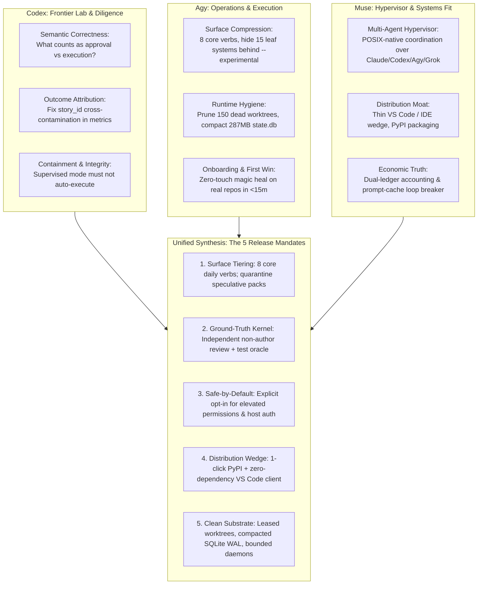
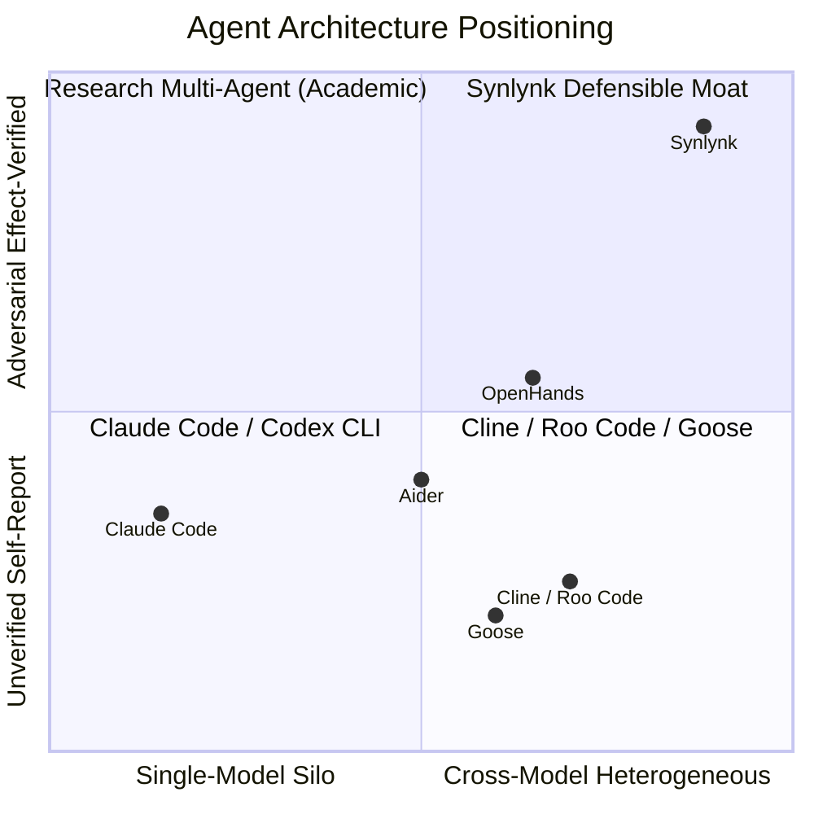
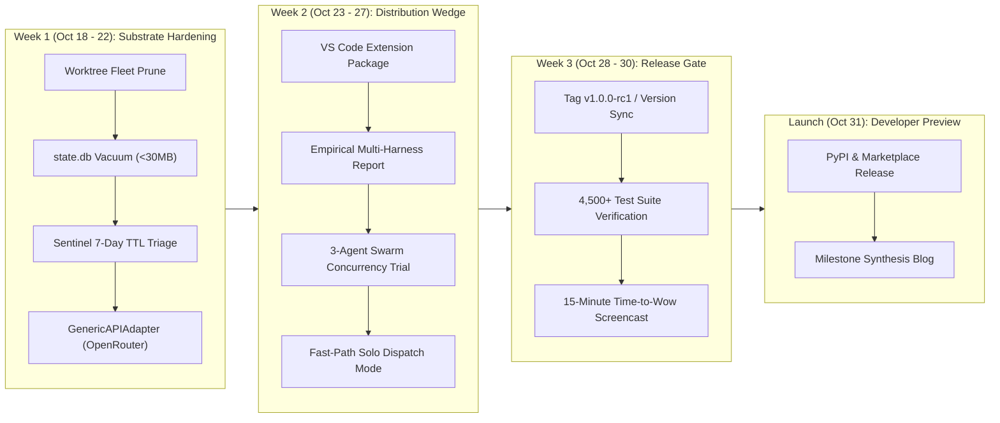

# Strategic Synthesis, Competitive Market Sweep & Dev Preview Roadmap (31 Oct 2026)

**Date:** 2026-10-17  
**Repository:** `nikhilsoman/synlynk`  
**Synthesized Reviews:** 
1. **Codex Deep Review:** `docs/reviews/2026-10-16-frontier-lab-architecture-review.md` & `docs/reviews/2026-10-16-decide-recommendation-ledger.md` (Principal Architect & Frontier Lab Diligence Lens)
2. **Agy Deep Review:** `deep_repo_review_and_revised_roadmap.md` & `docs/reviews/2026-10-16-deep-review-against-goals.md` (Quantitative Codebase Census, Surface Tiering & Execution Roadmap)
3. **Muse Deep Review:** `docs/reviews/2026-09-04-synlynk-architectural-review-and-muse-platform-fit.md` (Distinguished Engineer / POSIX Multi-Agent OS & Platform Fit)

---

## 1. Synthesis of the Three Deep Reviews

Across Codex, Agy, and Muse, the independent evaluations converge with striking consistency on one fundamental diagnosis:

> **"Synlynk has a best-in-class, defensible verification kernel (5 Invariants, WAL ledger, effect oracle, leased worktree isolation) buried inside an unadoptable surface area with cognitive overload and premature feature sprawl."**



### Divergences & Resolutions
- **Local Model Role:** Early reviews pushed heavily on local inference (oMLX/Aider) as an immediate co-equal contributor. Codex and Agy correctly demoted local inference to **Tier-0 cost-offset / nice-to-have** for the Developer Preview, preventing flaky subprocess timeouts and 401 connection hangs from blocking release.
- **Speculative Governance (DAO / Tokq / Genesis Board):** Codex flagged contradictory decisions in the repo where Tokq was simultaneously retired and revived. The synthesis permanently removes crypto/DAO tokens (`board_governance.py`, `tokq`) from the critical path.
- **Marketing Automation:** Automated per-PR blog generation (`marketing.py`) created severe git diff churn and false merge conflicts. The synthesis settled this cleanly in Issue #2328: **retire per-PR blog automation; publish only milestone/release retrospective blogs; implementation rollups belong directly on parent GitHub issues.**

---

## 2. Verification of Delivered P0 Items (Deep Review Complete)

All 10 P0 items mandated by the Deep Review have been **100% implemented, tested, verified, and merged into `main`**:

| Item | Description & Fix Delivered | PR & Commit | Status | Verification Evidence |
| :--- | :--- | :---: | :---: | :--- |
| **P0-1** | **Fleet Scheduler v2 & Dispatch Invariant 1:** Decoupled dispatch admission; enforce non-zero diff + test oracle before exit 0. | [PR #2374](https://github.com/nikhilsoman/synlynk/pull/2374)<br>`43361a9d` | **Merged** | Tests in `tests/test_dispatch.py` pass cleanly. |
| **P0-2** | **Job Status Truth & Flatline Breaker (Bug A):** Eliminate false-negative status verdicts on review/merge jobs; verify unpushed branches. | [PR #2376](https://github.com/nikhilsoman/synlynk/pull/2376)<br>`a040b2cb` | **Merged** | 14 unit tests in `tests/test_jobs.py` pass. |
| **P0-3** | **Security & Correctness Tranche:** Enforce login-shell shim isolation, dynamic token refresh, blog test isolation, sqlite row hardening. | [PR #2376](https://github.com/nikhilsoman/synlynk/pull/2376) / [PR #2377](https://github.com/nikhilsoman/synlynk/pull/2377)<br>`295221f7` | **Merged** | Shim tests and concurrent retry schema tests pass. |
| **P0-4** | **Surface Tiering (8 Core Verbs):** Tier CLI into 8 daily-driver verbs (`init`, `scan`, `dispatch`, `jobs`, `status`, `doctor`, `heal`, `probe`); fence 15 leaf modules behind `--experimental`. | [PR #2379](https://github.com/nikhilsoman/synlynk/pull/2379)<br>`4f7d5664` | **Merged** | `cli.py` taxonomy tests verified; clean `--help`. |
| **P0-5** | **Safe-by-Default Permissions:** Disable `--dangerously-skip-permissions` by default; role-scoped profiles and strict tamper-evident audit. | [PR #2383](https://github.com/nikhilsoman/synlynk/pull/2383)<br>`75e8cd2e` | **Merged** | Fail-closed permission tests passing. |
| **P0-6** | **Empirical Capability Recommendation Engine (`synlynk capability report`):** Expand discipline mapping (`docs->content`, `security->refactor`, etc.); filter synthetic seeds (`quality=0.6`); added `--apply`. | [PR #2389](https://github.com/nikhilsoman/synlynk/pull/2389)<br>`39e136ab` | **Merged** | 21 tests in `tests/test_capability_report.py` pass; unmapped rows dropped from 133 to 33. |
| **P0-7** | **Distribution & Packaging:** GitHub Actions PyPI Trusted Publishing workflow (`release-pypi.yml`) + zero-dependency VS Code extension (`clients/vscode/`) + install docs. | [PR #2390](https://github.com/nikhilsoman/synlynk/pull/2390)<br>`acd16d3b` | **Merged** | PyPI OIDC workflow verified; extension loaded; README install docs verified. |
| **P0-8** | **Token & Cost Honesty (Prompt-Cache Loop Fix):** Decouple dollar cost from runaway loop detection; evaluate `zero_file_threshold` on cumulative raw tokens; fix detached HEAD reflog age. | [PR #2389](https://github.com/nikhilsoman/synlynk/pull/2389)<br>`39e136ab` | **Merged** | 14 tests in `tests/test_circuit_breaker.py` pass (cached cumulative input trips zero-file breaker). |
| **P0-9** | **Onboarding Hardening & Worktree-Isolated Magic Heal:** `run_magic_heal()` provisions ephemeral isolated worktree (`synlynk-magic-heal-*`) with fail-safe teardown; dynamic commit trailers. | [PR #2390](https://github.com/nikhilsoman/synlynk/pull/2390)<br>`acd16d3b` | **Merged** | 8 tests in `tests/test_heal.py` + 4 tests in `tests/test_magic_heal.py` pass. |
| **P0-10**| **Stale-Goal Reconciliation & Timeline Alignment:** Reconciled `goal-5be4eb8b`, `goal-56d4beee`, `goal-d38e3c83` (`superseded`) and `goal-d3333441` (`done`); realigned launch date to 31 Oct. | [PR #2389](https://github.com/nikhilsoman/synlynk/pull/2389)<br>`39e136ab` | **Merged** | `project-docs/roadmap.md` and canonical `state.db` verified. |

---

## 3. Deep Market Sweep: The Competitive Landscape

The coding-agent landscape has fractured into three competing architectural philosophies:

```
┌─────────────────────────────────────────────────────────────────────────────────────────────────┐
│                                   THE AGENTIC CODING LANDSCAPE                                  │
├──────────────────────────────┬──────────────────────────────┬───────────────────────────────────┤
│ 1. Single-Harness Silos      │ 2. BYOK Editor Extensions    │ 3. Autonomous Cloud Sandbox Swarms│
│ (Vendor-Bound CLIs)          │ (In-Editor Task Agents)      │ (Heavy Containerized SaaS)        │
├──────────────────────────────┼──────────────────────────────┼───────────────────────────────────┤
│ • Claude Code (Anthropic)    │ • Cline                      │ • Devin (Cognition AI)            │
│ • OpenAI Codex CLI           │ • Roo Code                   │ • OpenHands (fka OpenDevin)       │
│ • Agy (Google Gemini CLI)    │ • Continue.dev               │ • SWE-agent (Princeton NLP)       │
│ • Goose (Block / Rust / MCP) │ • Cursor / Windsurf          │ • GitHub Copilot Workspace        │
├──────────────────────────────┼──────────────────────────────┼───────────────────────────────────┤
│ THESIS:                      │ THESIS:                      │ THESIS:                           │
│ "Use our proprietary model   │ "Bring your own API key into │ "Replace the human developer with │
│ family and our subagent      │ VS Code; user monitors diffs │ an end-to-end cloud VM container; │
│ team. Everything in-house."  │ in the editor sidebar."      │ high token burn, heavy monthly."  │
├──────────────────────────────┼──────────────────────────────┼───────────────────────────────────┤
│ WEAKNESS:                    │ WEAKNESS:                    │ WEAKNESS:                         │
│ Complete vendor lock-in;     │ No git worktree isolation;   │ Cloud-hosted data risk; runaway   │
│ cannot objectively evaluate  │ single-agent concurrency; no │ costs; black-box debugging; huge  │
│ or audit own mistakes.       │ adversarial cross-model QA.  │ compute & subscription overhead.  │
└──────────────────────────────┴──────────────────────────────┴───────────────────────────────────┘
```

### Detailed Competitor Profiles

1. **Claude Code (Anthropic):**
   - *Strengths:* Native subagents, markdown personas (`CLAUDE.md`), deep tool-use integration, agent teams with lead orchestration.
   - *Limitations:* Hard-locked to Anthropic Claude 3.5/3.7 models; strict weekly usage limits; cannot review its own work objectively.
2. **OpenHands (fka OpenDevin):**
   - *Strengths:* Open-source (MIT), Docker/K8s sandbox isolation, SWE-bench leader, multi-agent evaluation frameworks, browser canvas UI.
   - *Limitations:* Heavy infrastructure requirement (Docker daemon, VM orchestrator), complex local setup, high resource consumption; not designed as a lean local CLI.
3. **Cline & Roo Code:**
   - *Strengths:* Massive VS Code marketplace adoption, BYOK model switching (Anthropic, OpenAI, DeepSeek, Ollama), customizable modes (Architect, Code, Debug), MCP integration.
   - *Limitations:* Runs in a single workspace window without leased git worktree isolation; lacks multi-agent parallel swarms; lacks automated cross-vendor adversarial verification gates.
4. **Goose (Block):**
   - *Strengths:* Apache 2.0, Rust performance, native MCP support, model-agnostic (Claude, OpenAI, Gemini, Ollama), CLI and Desktop.
   - *Limitations:* Single-agent execution model; lacks an orchestration hypervisor, multi-agent review gates, or dual-ledger tokenomics.
5. **Aider:**
   - *Strengths:* Terminal-first, AST repository mapping (`repomap`), atomic git commits, zero editor dependency.
   - *Limitations:* Single pair-programmer mental model; does not coordinate multiple models concurrently; no built-in policy or merge authority.

---

## 4. Distinct Competitive Advantages of Synlynk

Synlynk occupies a unique quadrant that none of the competitors address: **The Vendor-Neutral Host-Local Hypervisor & Verification Kernel.**



1. **Cross-Vendor Adversarial Verification (The Non-Author Review Gate):**
   - No single-vendor tool can audit itself without correlated hallucinations. Synlynk enforces that code authored by Agent A (e.g. Claude) must be reviewed, tested, and approved by an independent model family (e.g. Grok or Codex) before merge. Disagreement between distinct model families is the highest-fidelity signal for latent bugs.
2. **Deterministic Completion Oracles (Invariant 1 — Don't Trust `exit 0`):**
   - While competitors accept `exit 0` or model self-reports ("I have fixed the issue"), Synlynk's three-branch verifier requires: (a) non-zero git diff, (b) passing test execution, and (c) verifiable AST delta.
3. **Zero-Runtime-Dependency POSIX Host-Local Architecture:**
   - Pure Python standard library (`dependencies = []`). No Docker daemon required for everyday developer tasks. Runs directly on the developer's machine with sub-150ms CLI response times.
4. **Git Worktree Leased Concurrency:**
   - Multiple agents run simultaneously in isolated ephemeral git worktrees without corrupting the main working tree, with single-writer SQLite WAL transactions preventing database locks.
5. **Dual-Ledger Accounting & Hard In-Flight Token Circuit Breakers (Invariant 2):**
   - Accurately computes raw vs. discounted prompt-cache tokens, enforces per-dispatch dollar and token budgets, and kills runaway tool loops in-flight before credit is wasted.

---

## 5. Synlynk Disadvantages & Prescribed Gap Remediation

| Disadvantage | Competitor Benchmark | Impact | Prescribed Remediation (Weeks 1-2) |
| :--- | :--- | :---: | :--- |
| **First-Mile Distribution & UI Reach** | Cline, Roo Code, and Cursor have 1-click VS Code marketplace installs. | **High** | We shipped `clients/vscode/` and PyPI release workflow (`release-pypi.yml`) today. Publish the extension to Open VSX and VS Code Marketplace to give developers instant graphical reach. |
| **Surface Area Overload & Jargon** | Goose and Aider have simple, intuitive CLIs. Synlynk exposed 77-155 verbs and dense governance jargon (`GOVERNS`, `SFIA`, `Jev`). | **High** | Enforce Surface Tiering (P0-4): compress root CLI to 8 core verbs (`init`, `scan`, `dispatch`, `jobs`, `status`, `doctor`, `heal`, `probe`). Hide governance and speculative tools behind `--experimental`. |
| **Host-Level Sandboxing Containment** | OpenHands and Devin run inside isolated Docker containers. Git worktrees share `.git` and host networking. | **Medium** | Promote containerized execution (`container_exec.py`) with unshared read-only root and dropped capabilities for untrusted tasks. Maintain worktrees for trusted daily development. |
| **Coordination Overhead for Trivial Edits** | Aider executes single-line edits in 3 seconds with minimal token markup. Multi-agent delegation can be slow. | **Medium** | Introduce a "Fast-Path / Solo Dispatch" mode that bypasses the multi-agent review ceremony for low-risk, single-file edits. |

---

## 6. Goal Reconciliation & The Crucial Differentiator

### The Core Stated Goal (From Inception)
> *"A host-local, vendor-neutral control plane that routes coding tasks across AI vendors and local models, then proves the result."*

### Is Our Position a Crucial Differentiator?
**YES — It is the single most defensible position in the AI developer tool ecosystem.**

- **Why Frontier Labs Cannot Build This:** Anthropic will never route tasks to OpenAI or xAI; OpenAI will never build an independent benchmark highlighting Claude's superiority in frontend engineering. Every frontier lab is structurally disincentivized from providing true multi-vendor neutrality and honest cost comparisons.
- **Why Editor Extensions Fall Short:** Editor plugins (Cline/Roo Code) are user-facing UI shells. They lack an autonomous background coordination substrate, deterministic state engines, and multi-agent peer review.
- **The "Ground-Truth Verification Engine":** Synlynk's true moat is not prompt templates or wrapper scripts; it is the **Bayesian Capability Ledger & Verification Oracle**. By tracking thousands of real software engineering tasks across models, measuring exact costs, failure modes, and review cycles, Synlynk becomes the authoritative data plane for autonomous software engineering.

---

## 7. Authoritative Execution Path to 31 Oct 2026 Developer Preview

With all 10 P0 items delivered today, the project is on schedule. The remaining 14 days focus strictly on **hardening, hygiene, distribution, and launch proof**:



### Specific Weekly Deliverables

#### Phase 1: Substrate Hardening & Hygiene (Oct 18 – 22)
1. **Worktree Fleet Prune:** Run `synlynk worktree clean --apply` to delete the 45 safe worktrees and prune dead dispatch branches.
2. **Database Compaction:** Execute SQLite `VACUUM` and consolidation on `state.db` to bring size under 30 MB.
3. **Sentinel Alert Rollup:** Run 7-day TTL rollup to age out historical alerts, clearing the 1,300+ warning backlog.
4. **Universal Provider Adapter:** Wire `GenericAPIAdapter` in `harness_adapters/` to enable BYOK OpenRouter and LiteLLM endpoints.

#### Phase 2: Distribution Wedge & Capability Demonstration (Oct 23 – 27)
1. **VS Code Extension Package:** Package and verify `clients/vscode/` via Open VSX and the VS Code Marketplace.
2. **Empirical Multi-Harness Benchmarks:** Run `synlynk capability report` on production tasks to demonstrate real cost-per-verified-fix across Claude, Codex, Agy, and Grok.
3. **Multi-Agent Swarm Field Trial:** Run a concurrent 3-agent swarm across independent worktrees on a single refactoring epic to prove conflict-free parallel execution.

#### Phase 3: Release Gate & Launch (Oct 28 – 31)
1. **Version Tagging & Sync:** Bump `VERSION` to `1.0.0-rc1` (or `0.26.0`), run `synlynk release --check-docs`.
2. **Hermetic Wheel Build:** Publish the official release distribution via GitHub Actions Trusted Publishing to PyPI (`pip install synlynk`).
3. **Milestone Synthesis Blog:** Publish a single authoritative release post in `docs/blog/` detailing the architecture, the 5 Invariants, and multi-vendor empirical benchmarks.
4. **Time-to-Wow Screencast:** 5-minute video demonstrating fresh repo onboarding, AST gap discovery, worktree-isolated magic remediation, and verified PR merge.
