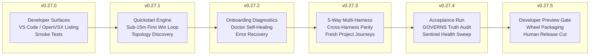

# Milestone v0.27.x: Developer Preview Operationalization & Verification Plan

> **Authority:** Roadmap parent #2458, Canonical Release Execution Schedule (`docs/strategy/2026-10-20-canonical-release-execution-schedule.md`), and decisions `dec-f8835ba3` / `dec-3d240c05`.
> **Scope:** Operationalize, test, and evidence-gate the entire `v0.27.x` milestone sequence delivering the public Developer Preview.

---

## 1. Intent & Architectural Overview

The `v0.27.x` release train is the culminating milestone delivering the first public **Developer Preview** of Synlynk.
Its primary objective is transforming Synlynk from an internal multi-agent orchestrator into an instantly installable, self-healing, evidence-verified daily driver across all supported harnesses (Claude, Codex, Agy, Grok, Muse).

### Core Delivery Invariants
1. **Zero External Runtime Dependencies:** Pure Python 3.10–3.14 standard library only (`sqlite3`, `subprocess`, `json`, `pathlib`).
2. **Deterministic Governance (GOVERNS):** Every delivery story links to a goal, belongs to a roadmap phase, and satisfies verified effect contracts.
3. **Sub-15-Minute First Win:** A greenfield or brownfield repository journey must progress from `pipx install synlynk` / `synlynk quickstart` to a verified, truthful agent dispatch in under 15 minutes.
4. **Independent Non-Author Review:** PRs must be verified and merged exclusively by the `qa` role (`can_merge: ["qa"]`).
5. **Human Release Authority:** Cutting the final `v0.27.5` Developer Preview tag requires explicit human operator sign-off (`release_authority.requires_human_approval: true`).

---

## 2. Milestone Release Train Structure

The `v0.27.x` release arc consists of 6 sequential delivery gates:

---

## 3. Detailed Gate Breakdown & Testing Specifications

### Gate 1: v0.27.0 — Developer Surfaces & Extension Distribution
- **Objective:** Verify distribution packages, manifest integrity, and marketplace listing for the Synlynk extension.
- **Scope:**
  - Build and validate `.vsix` package for VS Code & OpenVSX (`vscode-synlynk`).
  - Automated smoke test: install extension, detect workspace `.synlynk/` ledger, and trigger dispatch command palette.
  - Manifest validation: check schema versions, command contributions, and LSP/socket fallback behavior.
- **Verification Contract:**
  - `tests/test_cli_distribution_e2e.py` passes hermetic wheel build.
  - Extension package smoke script verifies clean activation without unbound socket errors.
- **Target Role:** `dev` (Codex) | Reviewer: `qa` (Claude)

### Gate 2: v0.27.1 — Quickstart Engine & Verified 15-Minute First Win
- **Objective:** Ensure fresh-project onboarding reaches a verified, evidence-backed first dispatch in under 15 minutes.
- **Scope:**
  - Wire dead onboarding modules (`synlynk.probe_binding`, `synlynk.first_win_loop`, `synlynk.topology_discovery`) into live CLI entry points.
  - Interactive onboarding wizard (`synlynk quickstart`): automatic VCS root discovery, harness probe, default charter generation, and initial goal linking.
  - First-win dispatch test: automatic execution of a starter story with verified receipt.
- **Verification Contract:**
  - `pytest tests/test_wizard.py tests/test_onboarding_safety.py` passes.
  - Automated headless onboarding test in `/tmp/test-fresh-repo` finishes in <120s with a green story receipt.
- **Target Role:** `dev` (Codex) | Reviewer: `qa` (Agy)

### Gate 3: v0.27.2 — Diagnostics, Prerequisite Auditing & Self-Healing Doctor
- **Objective:** Make all setup failure paths completely transparent, diagnostic, and self-healing.
- **Scope:**
  - Implement doctor health checks for PATH shadowing, missing harness binaries, invalid auth tokens, and stale worktrees (`synlynk doctor --fix`).
  - Actionable error formatting: clear failure explanations with exact copy-paste remediation commands.
  - Graceful degradation: fall back to interactive shell when harness daemons or socket relays are unavailable.
- **Verification Contract:**
  - `pytest tests/test_doctor_identity_roles.py` passes with 100% coverage on remediation hooks.
  - Injection of simulated PATH collision resolves cleanly with `synlynk doctor --fix cli`.
- **Target Role:** `maintainer` (Agy) | Reviewer: `qa` (Codex)

### Gate 4: v0.27.3 — 5-Way Multi-Harness Journey Verification
- **Objective:** Validate that all 5 supported harnesses (Claude, Codex, Agy, Grok, Muse) successfully complete end-to-end tasks in isolated worktrees.
- **Scope:**
  - Execute five independent fresh-project test journeys across Claude, Codex, Agy, Grok, and Muse.
  - Verify token accounting and capability ratings are recorded truthfully into `cost_entries` and `capability_ratings`.
  - Validate non-author review handoffs (e.g., Codex implements -> QA reviews under Claude).
- **Verification Contract:**
  - Test matrix execution across all 5 harnesses produces 5 green PR verification receipts.
  - No capability rating drift or unmetered token usage in `costs.md`.
- **Target Role:** `qa` (Claude) | Reviewer: `architect` (Claude)

### Gate 5: v0.27.4 — Full Developer Preview Acceptance Matrix & Preflight Audit
- **Objective:** Execute the comprehensive Developer Preview acceptance test run across all subsystems.
- **Scope:**
  - GOVERNS lifecycle enforcement: zero unlinked goals, zero unphased stories.
  - Model catalog & cost truth: `models.py` catalog entries verified against upstream endpoints.
  - State database integrity: foreign keys, WAL checkpointing, and shadow DB detection.
  - Sentinel alert triage: zero unresolved CRITICAL or ERROR sentinel alerts.
- **Verification Contract:**
  - Full serial test suite (`pytest -m "not slow"`) passes with 0 failures across Python 3.10 and 3.12.
  - `synlynk selftest --full` returns exit code 0.
- **Target Role:** `qa` (Codex) | Reviewer: `qa` (Agy)

### Gate 6: v0.27.5 — Developer Preview Release Gate & Packaging
- **Objective:** Cut the official, evidence-backed Developer Preview release.
- **Scope:**
  - Version bump to `0.27.5` in canonical `VERSION` file.
  - Changelog generation and release documentation aggregation (`docs/releases/v0.27.5.md`).
  - Hermetic distribution wheel build (`pipx install dist/*.whl` smoke verification).
  - Human release authority checklist signoff (`release_authority.requires_human_approval: true`).
- **Verification Contract:**
  - `python3 -m synlynk release cut --version 0.27.5` executes cleanly with human authorization token.
  - Clean tag push `v0.27.5` to origin.
- **Target Role:** `pm` (Claude) | Operator Sign-off: `@nikhilsoman`

---

## 4. Operational Execution Sequence & Dependencies

1. **Trigger Phase:** Operator approves kickoff via parent GitHub epic.
2. **Decomposition Phase:** TPM translates gates into ready stories in `state.db`.
3. **Execution Phase:** Dispatches flow through isolated worktrees using Test-Driven Development.
4. **Verification Phase:** QA executes non-author verification (`synlynk pr check`) and merges PRs.
5. **Rollup Phase:** Long-form conversational status rollup comments posted to parent issue after each gate.
