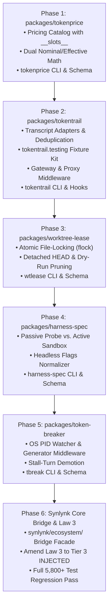

# Implementation Plan: Synlynk Modular Ecosystem (The Standalone Developer Tooling Suite)

**Document ID:** `PLAN-MODULAR-01`  
**Date:** 2026-11-23  
**Status:** RATIFIED & READY FOR FINAL OPERATOR APPROVAL  
**Governing Spec:** [2026-11-23-synlynk-modular-ecosystem-standalone-packages-design.md](file:///Users/nikhilsoman/dev/synlynk/docs/superpowers/specs/2026-11-23-synlynk-modular-ecosystem-standalone-packages-design.md)  
**Target Milestone:** Sequence B Execution  

---

## 1. Overview & Monorepo Packaging Strategy

This plan breaks down the phased implementation of all 5 standalone packages in `packages/`:
- `packages/tokenprice`
- `packages/tokentrail`
- `packages/worktree-lease`
- `packages/harness-spec`
- `packages/token-breaker`

### Packaging & Workspace Invariant
- Every package is managed via `uv workspaces` with its own `pyproject.toml` and isolated test suite.
- AST import linter tests in every package enforce **zero `synlynk` dependencies**.
- Synlynk core integrates through the `synlynk/ecosystem/` bridge facade.

---

## 2. Phased TDD Implementation Schedule

---

### Phase 1: `packages/tokenprice` (Model Pricing & Valuation Engine)
- [ ] **Task 1.1: Package Scaffolding & Pyproject**
  - Create `packages/tokenprice/pyproject.toml` (PEP 621, zero external dependencies).
  - Setup AST import-linter in `packages/tokenprice/tests/test_modularity.py`.
- [ ] **Task 1.2: Pricing Catalog & Rate Data Structures (TDD)**
  - Implement `ModelRates` with `__slots__` covering prompt, output, cache-write, and cache-read rates per million tokens.
  - Implement dynamic model alias resolver (`sonnet`, `claude-3-5`, `gemini-2.0`).
- [ ] **Task 1.3: Cost Math & Billing Mode Engine (TDD)**
  - Implement `calculate_cost()` returning `CostResult(nominal_usd, effective_usd, billing_mode)`.
  - Add tests verifying subscription amortization and custom discount schedules.
- [ ] **Task 1.4: Configuration Tooling & CLI (`tokenprice`)**
  - Implement 4-tier config resolver (CLI > ENV > `./.tokenprice.json` > `~/.config/tokenprice/config.json`).
  - Implement `tokenprice init`, `tokenprice update --online`, `tokenprice set-rate`, and publish `config.schema.json`.

---

### Phase 2: `packages/tokentrail` (Universal Session & Gateway Transcript Extractor)
- [ ] **Task 2.1: Package Scaffolding & Testing Fixture Kit**
  - Create `packages/tokentrail/pyproject.toml` (depends only on `tokenprice` and optional `rich`).
  - Create `tokentrail.testing` package shipping real anonymized transcript fixtures from Claude Code, Agy, and Codex.
- [ ] **Task 2.2: Chunk Collapse & Claude Code Adapter (TDD)**
  - Implement `ClaudeCodeAdapter` parsing `~/.claude/projects/**/*.jsonl`.
  - Write test asserting streaming progress chunks collapse to exact terminal `message.id` usage (resolving the 2× overcounting bug).
- [ ] **Task 2.3: Agy & Codex CLI Adapters (TDD)**
  - Implement `AgyAdapter` parsing `.system_generated/logs/transcript*.jsonl`.
  - Implement `CodexCLIAdapter` parsing `~/.codex/sessions/**/*.jsonl`.
- [ ] **Task 2.4: Gateway & Proxy Interceptors (TDD)**
  - Implement `GatewayAdapter` parsing OpenAI-compatible completion usage, OpenRouter responses, and LiteLLM response headers.
  - Implement ASGI middleware helper.
- [ ] **Task 2.5: Configuration Tooling & CLI (`tokentrail`)**
  - Implement `tokentrail init`, `tokentrail summary --last`, `tokentrail watch`, `tokentrail hooks install`, and publish `config.schema.json`.

---

### Phase 3: `packages/worktree-lease` (Atomic Git Worktree Manager)
- [ ] **Task 3.1: Package Scaffolding & Flake Isolation**
  - Create `packages/worktree-lease/pyproject.toml` (zero external dependencies).
  - Setup AST import-linter.
- [ ] **Task 3.2: Atomic Worktree Lease Manager (TDD)**
  - Implement `WorktreeLeaseManager` with OS-level file locking (`fcntl.flock` on Unix, `msvcrt` on Windows).
  - Add support for detached HEAD checkouts and custom worktree base directories.
- [ ] **Task 3.3: Pre-Delete PID Guards & Prune Logic (TDD)**
  - Implement handle check blocking worktree deletion if active processes hold open handles.
  - Implement `prune()` with `--dry-run` and configurable TTL.
- [ ] **Task 3.4: Configuration Tooling & CLI (`wtlease`)**
  - Implement `wtlease init`, `wtlease list`, `wtlease prune`, `wtlease acquire`, and publish `config.schema.json`.

---

### Phase 4: `packages/harness-spec` (Universal Agent CLI Discovery & Sandboxing Protocol)
- [ ] **Task 4.1: Package Scaffolding & Pyproject**
  - Create `packages/harness-spec/pyproject.toml`.
- [ ] **Task 4.2: Harness Discovery & Passive Probe Engine (TDD)**
  - Implement `probe_installed_harnesses()` detecting installed binaries (`claude`, `codex`, `agy`, `grok`, `cursor`) via benign `--version` probing.
  - Generate normalized `HarnessContract`.
- [ ] **Task 4.3: Sandbox Profiles & Flag Normalization (TDD)**
  - Implement execution flag mapper (mapping prompt strings to `-p` vs `--prompt`).
  - Implement sandbox profile verifiers (`strict_sandbox`, `network_only`, `unrestricted`).
- [ ] **Task 4.4: Configuration Tooling & CLI (`harness-spec`)**
  - Implement `harness-spec probe`, `harness-spec test <harness>`, `harness-spec register <custom>`, and publish `config.schema.json`.

---

### Phase 5: `packages/token-breaker` (In-Flight Token & Spend Circuit Breaker)
- [ ] **Task 5.1: Package Scaffolding & Pyproject**
  - Create `packages/token-breaker/pyproject.toml`.
- [ ] **Task 5.2: Dual Supervisor Engine (TDD)**
  - Implement Mode 1: OS Process Supervisor monitoring streaming subprocess PIDs with SIGTERM/SIGKILL escalation.
  - Implement Mode 2: Python Generator Iterator Middleware raising `CircuitBreakerError` on chunk threshold breach.
- [ ] **Task 5.3: Stall Turn & Repetition Demotion (TDD)**
  - Implement consecutive error loop detection.
- [ ] **Task 5.4: Configuration Tooling & CLI (`tbreak`)**
  - Implement `tbreak init`, `tbreak run --max-cost 2.50 -- <cmd>`, `tbreak status`, and publish `config.schema.json`.

---

### Phase 6: Synlynk Integration Facade & Constitutional Law 3 Amendment
- [ ] **Task 6.1: Build `synlynk/ecosystem/` Bridge Facade**
  - Implement internal adapters in `synlynk/ecosystem/` wrapping all 5 packages.
  - Update `synlynk/costs.py`, `synlynk/worktree.py`, `synlynk/probe.py`, and `synlynk/circuit_breaker.py` to route through the facade.
- [ ] **Task 6.2: Constitutional Law 3 Tier 3 Amendment**
  - Update `synlynk/constitution.py`: promote `law-3` to `DeliveryTier.INJECTED`.
  - Add `check_cost_provenance_gate()` to `synlynk/pr_check.py`.
- [ ] **Task 6.3: Full E2E Verification & CI Regression Pass**
  - Run full test suite (5,800+ tests) verifying zero regressions.
  - Verify `synlynk doctor` checks all 5 standalone packages and their configuration schemas.
