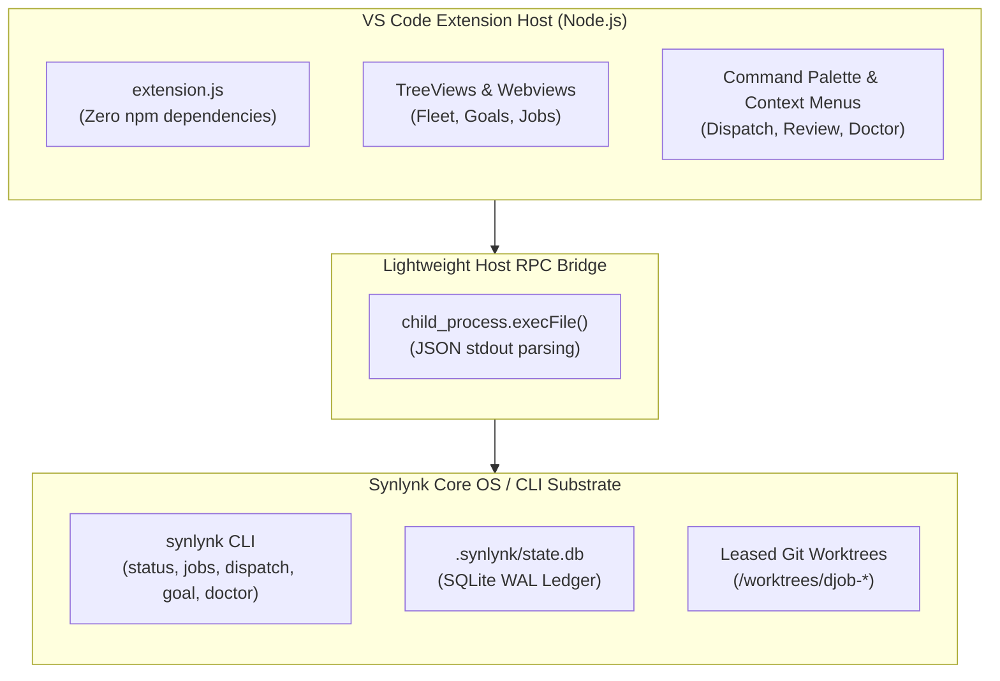
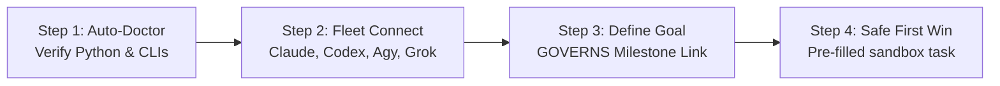
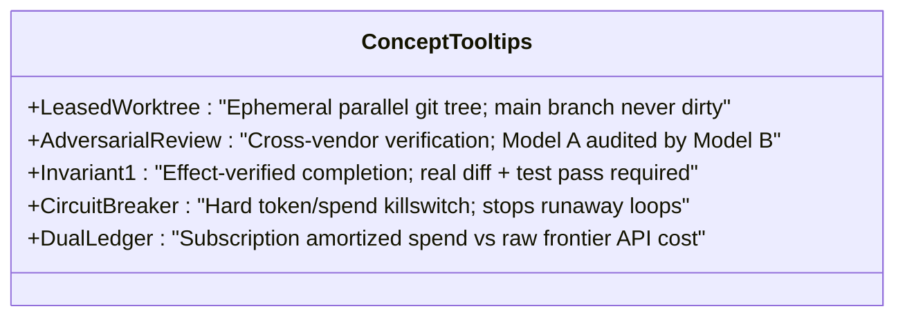

# Design Specification: Synlynk VS Code Client (`synlynk-vscode`)

**Date:** 2026-10-18  
**Author:** Agy (AntiGravity CLI / Gemini)  
**Stakeholder & Signoff:** Nikhil Soman  
**Milestone:** Phase 2: Distribution Wedge & Capability Demonstration (Runway to 31 Oct 2026 Developer Preview)  
**Target Package:** `clients/vscode/` (`synlynk-vscode-0.1.0.vsix`)  

---

## 1. Executive Summary & Market Intent

### 1.1 The VS Code Distribution Opportunity
VS Code commands **75%–82%** market share among professional software developers. Combined with its direct engine derivatives (Cursor, Windsurf, VSCodium, Positron), the Monaco/VS Code extension host reaches over **90%** of modern developers.

While the Synlynk CLI provides a defensible multi-agent kernel (5 Invariants, leased worktree isolation, SQLite WAL transactions, and dual-ledger economics), terminal-only distribution creates severe first-mile friction:
- Developers must discover the CLI, install package managers (`brew`, `pipx`), configure PATH variables, and learn command flags.
- In contrast, the VS Code Marketplace and Open VSX Registry offer **zero-friction 1-click installation**, background updates, and instant visual discovery.

### 1.2 Competitive Positioning: The Defensible Core
Existing AI developer extensions (GitHub Copilot, Cline, Roo Code, Continue.dev) suffer from structural architectural flaws that Synlynk solves natively:

| Dimension | GitHub Copilot | Cline / Roo Code | Continue.dev | Synlynk VS Code |
| :--- | :--- | :--- | :--- | :--- |
| **Execution Safety** | In-buffer cloud edits | **Mutates active working tree directly** | In-buffer code replacement | **Leased background git worktree**; active editor never touched |
| **Multi-Model Verification** | Single-vendor lock-in | Single-model prompt loops | Single-model chat | **Adversarial non-author review** (e.g. Codex writes, Grok verifies) |
| **Verification Gate** | None (trusts output) | Terminal command checks | None | **Invariant 1:** Real git diff + passing test oracle + AST delta |
| **Cost & Token Honesty** | Subscription opaque | Raw API tokens only | Raw API tokens only | **Dual-Ledger Accounting:** Raw frontier API value vs. subscription spend |
| **Strategic Continuity** | Ephemeral chat history | Session history | Markdown session logs | **GOVERNS Linkage:** Every dispatch binds to durable project goals |

---

## 2. Core Architecture & Design Principles



### 2.1 The Zero-Dependency Thin RPC Bridge
1. **Zero npm Runtime Dependencies:** `dependencies: {}`. The extension contains no bulky frontend frameworks, bundling tools, or node modules that bloat disk or introduce supply-chain vulnerabilities.
2. **CLI Delegation:** The extension communicates with the host `synlynk` binary using Node's standard `child_process.execFile` passing `--json` flags.
3. **Graceful Degradation:** If `synlynk` CLI is not installed on the system PATH, the extension activates in "Bootstrap Mode", providing 1-click installation via `pipx` or `pip`.

### 2.2 Non-Disruptive Worktree Concurrency
Unlike single-agent extensions that hijack the developer's open editor, Synlynk dispatches run in **leased background git worktrees**:
- The developer's open file buffers, cursor positions, and terminal sessions remain **100% untouched** while agents execute.
- When an agent completes and passes Invariant 1 verification, the extension opens a native side-by-side **Diff Editor** (`vscode.diff`) comparing the active branch with the worktree branch.
- The developer approves and merges with one click.

---

## 3. First-Time User Experience (FTUE)

### 3.1 Welcome View (`viewsWelcome`)
For repositories where Synlynk has not been initialized (`.synlynk/` missing), the sidebar presents a focused Welcome View rather than an empty tree:

```
┌──────────────────────────────────────────────┐
│ SYNLYNK WORKSPACE                            │
├──────────────────────────────────────────────┤
│                                              │
│  Autonomous Multi-Agent Engineering          │
│  Orchestrate Claude, Codex, Agy, and Grok    │
│  with worktree isolation & test verification.│
│                                              │
│  [⚡ Initialize Repository (synlynk init)]    │
│                                              │
│  [📖 Take the 2-Minute Interactive Tour]     │
│                                              │
└──────────────────────────────────────────────┘
```

### 3.2 Native Interactive Walkthrough (`contributes.walkthroughs`)
Triggered automatically on first install (and available via `Welcome: Open Walkthrough`):



1. **Step 1: Environment Health Check:** Runs `synlynk doctor --json`. Shows green checkmarks for detected agent CLIs (Claude Code, Codex CLI, Agy, Grok).
2. **Step 2: Connect Agent Fleet:** Explains the multi-vendor paradigm with an illustrated card: *Model A authors, Model B audits*.
3. **Step 3: Set Your First Goal (GOVERNS):** Prompts the user to name today's milestone (e.g. `Release v1.0`).
4. **Step 4: Safe First Win Dispatch:** Provides a pre-filled, non-destructive sample dispatch:
   > *"Scan `sample.py`, detect edge-case test gaps, and verify the patch in an isolated worktree."*  
   Includes a 1-click `[Run First Dispatch]` button.

---

## 4. Visual Panes & Sidebar Architecture

The extension contributes a primary container to the VS Code Activity Bar with three collapsible TreeView panes:

```
┌───┬───────────────────────────────────────────┐
│   │ SYNLYNK WORKSPACE CONTROL PLANE           │
│   ├───────────────────────────────────────────┤
│ 🔌│ ▼ FLEET HEALTH ℹ️                         │
│   │   ● Claude Sonnet  Ready (Limit: Oct 19)  │
│ 📁│   ● OpenAI Codex   Ready (Reset: Oct 22)  │
│   │   ● Google Agy     Active (Driving)       │
│ 🔍│   ● xAI Grok       Recharge Needed        │
│   │   Weekly Spend: $18.47 (Net Savings: $72) │
│ ⚙️│                                           │
│   │ ▼ PROJECT GOALS & MILESTONES (GOVERNS) ℹ️  │
│   │   ▼ 🎯 v1.0.0 Developer Preview (Oct 31)  │
│   │     ├─ ✓ Hardening & GenericAPIAdapter    │
│   │     └─ 🚧 VS Code Extension Packaging     │
│   │                                           │
│   │ ▼ ACTIVE & RECENT DISPATCHES ℹ️            │
│   │   ▶ djob-8f2a: implement extension.js     │
│   │     ├─ Author: Agy · Verifier: Codex      │
│   │     ├─ Worktree: /worktrees/djob-8f2a     │
│   │     └─ [Review Diff]  [Accept & Merge]    │
└───┴───────────────────────────────────────────┘
```

### 4.1 Pane 1: Fleet Health & Quotas (`FleetTreeDataProvider`)
- Shows live status of all 4 commercial harnesses + local inference.
- Displays weekly quota reset timestamps and subscription burn rate.
- Actions: `[Refresh Status]`, `[Run Diagnostics]`.

### 4.2 Pane 2: Project Goals & Milestones (`GoalsTreeDataProvider`)
- Surfaces the active goals from `synlynk/db.py` (`goals` and `stories` tables).
- Displays progress bars and accumulated dollar spend per milestone.
- Actions: `[+ Add Milestone]`, `[Link Story]`.

### 4.3 Pane 3: Dispatched Jobs & Reviews (`JobsTreeDataProvider`)
- Lists in-flight and recent jobs from `synlynk jobs --json`.
- State icons:
  - 🟢 **Verified & Complete:** Author and Verifier attested.
  - 🟡 **In-Flight:** Animated spinner showing elapsed time.
  - ⚡ **Circuit Breaker Tripped:** Bounded spend protection triggered.
  - 🔴 **Failed:** Error details with 1-click remediation.
- Inline item actions:
  - `[Review Diff]`: Opens `vscode.diff`.
  - `[Merge]`: Squashes worktree into active branch.
  - `[View Log]`: Streams `synlynk logs --job <id>`.

### 4.4 Status Bar Item (`synlynk.statusBar`)
- Resides on the bottom status bar:
  - Idle state: `$(circuit-board) Synlynk: Ready ($18.47)`
  - Active dispatch: `$(sync~spin) Synlynk: [djob-8f2a] Codex running (32s)`
  - Verification stage: `$(shield) Synlynk: [djob-8f2a] Grok verifying...`
- Clicking toggles the Synlynk sidebar or opens the active job log.

---

## 5. Demystifying the Kernel: Progressive Disclosure & "ℹ️" Microcopy

To eliminate cognitive overload without hiding Synlynk's structural superpowers, the extension embeds contextual tooltips (`MarkdownString`) across all visual items:



1. **Leased Git Worktree (`ℹ️`):**
   > *"Synlynk never edits your open workspace files directly. Dispatches run in an ephemeral parallel git worktree. If the agent makes a mistake, your active code is completely untouched."*
2. **Adversarial Non-Author Verification (`ℹ️`):**
   > *"Single-model tools hallucinate their own correctness. Synlynk requires code authored by one model family (e.g. Codex) to be reviewed and verified by an independent model family (e.g. Grok or Claude) before merge."*
3. **Invariant 1 — Effect-Verified Completion (`ℹ️`):**
   > *"Synlynk never trusts 'exit 0' or agent self-reports. A task is only marked complete when it proves: (1) non-zero git diff, (2) passing test suite execution, and (3) verified syntax changes."*
4. **In-Flight Circuit Breaker (`ℹ️`):**
   > *"Protects your wallet. Automatically terminates runaway tool loops, repetition hangs, or token blowups before credit is wasted."*
5. **Dual-Ledger Accounting (`ℹ️`):**
   > *"Compares your real subscription-amortized cost ($20/mo flat fee) against raw frontier API equivalent value, showing your net monthly savings."*

---

## 6. Project Goals (GOVERNS) Integration

### 6.1 Demystifying GOVERNS into "Milestones & Goals"
The extension drops dense governance terminology (`SFIA`, `Jev AST`, `GOVERNS stage`) in favor of clear product language:
- In the UI, GOVERNS is simply **"Project Goals & Milestones"**.
- Under the hood, it maintains full compatibility with Synlynk's state database schema (`goals`, `stories`, `goal_stories`).

### 6.2 Goal-Bound Dispatch Flow
When initiating a task via `Cmd+Shift+P` -> `Synlynk: Dispatch Task`:
1. **Prompt Input:**
   > *"Describe the task, bug fix, or test to implement:"*
2. **Goal Association Picker (QuickPick):**
   > *"Link to Project Goal / Milestone:"*
   - `🎯 [Active] v1.0.0 Developer Preview (Target: 31 Oct 2026)` *(Recommended)*
   - `🎯 [Active] Phase 1 Substrate Hardening`
   - `➕ Create new Project Goal...`
   - `⏩ Skip (Ad-hoc exploratory task)`
3. **Execution & Tracking:**
   Upon dispatch, the task is tagged with `--story` and auto-associated with the selected goal in `state.db`. Completed PRs update the goal's completion percentage and spend ledger.

---

## 7. Technical Implementation Details

### 7.1 Directory Layout (`clients/vscode/`)
```
clients/vscode/
├── package.json              # Extension manifest (commands, views, walkthroughs)
├── extension.js              # Activation entrypoint & command registration
├── src/
│   ├── cli.js                # Thin child_process wrapper over synlynk CLI
│   ├── providers/
│   │   ├── fleetProvider.js  # TreeDataProvider for Fleet Health
│   │   ├── goalsProvider.js  # TreeDataProvider for Goals / GOVERNS
│   │   └── jobsProvider.js   # TreeDataProvider for Dispatched Jobs
│   ├── commands/
│   │   ├── dispatch.js       # Dispatch dialog & goal association
│   │   ├── diff.js           # Native vscode.diff viewer for worktrees
│   │   └── doctor.js         # Environment diagnostics & 1-click install
│   └── ui/
│       └── statusBar.js      # Animated status bar item
├── media/
│   ├── synlynk-icon.svg      # Activity Bar icon (vector SVG)
│   └── walkthrough/          # Illustrative SVGs for FTUE steps
└── README.md                 # Marketplace user documentation
```

### 7.2 RPC Protocol Specification
All CLI calls execute with `--json` for robust structured parsing:

```javascript
// Example src/cli.js invocation
const { execFile } = require("child_process");

function runSynlynk(subcommand, args = []) {
  return new Promise((resolve, reject) => {
    execFile("synlynk", ["--experimental", subcommand, ...args, "--json"], (err, stdout, stderr) => {
      if (err) return reject(new Error(stderr || err.message));
      try {
        resolve(JSON.parse(stdout));
      } catch (parseErr) {
        resolve({ raw: stdout });
      }
    });
  });
}
```

### 7.3 Packaging & Open VSX / Marketplace Distribution
1. **Packaging Tool:** Use `@vscode/vsce package` to bundle the extension into `synlynk-vscode-0.1.0.vsix`.
2. **Automated CI Workflow (`.github/workflows/vscode-package.yml`):**
   - Triggers on PR changes to `clients/vscode/**` and on release tags.
   - Runs `npm install --dry-run` to ensure zero runtime dependencies.
   - Executes `npx @vscode/vsce package --no-dependencies`.
   - Uploads the `.vsix` bundle as an artifact for release testing.

---

## 8. Verification & Acceptance Criteria

| ID | Requirement | Verification Method |
| :--- | :--- | :--- |
| **AC-1** | Zero runtime dependencies | `npm list --depth=0` shows 0 production dependencies |
| **AC-2** | Activation cold start | Extension activates in `< 50ms` (measured via `Developer: Startup Performance`) |
| **AC-3** | Auto-Doctor FTUE | Missing CLI triggers non-blocking 1-click installer prompt |
| **AC-4** | Worktree Diff Review | Clicking `[Review Diff]` opens native side-by-side diff against worktree path |
| **AC-5** | GOVERNS Linkage | Dispatches correctly record `goal_id` in `state.db` stories |
| **AC-6** | VSIX Packaging | Clean `.vsix` build under 2MB without packaging warnings |
