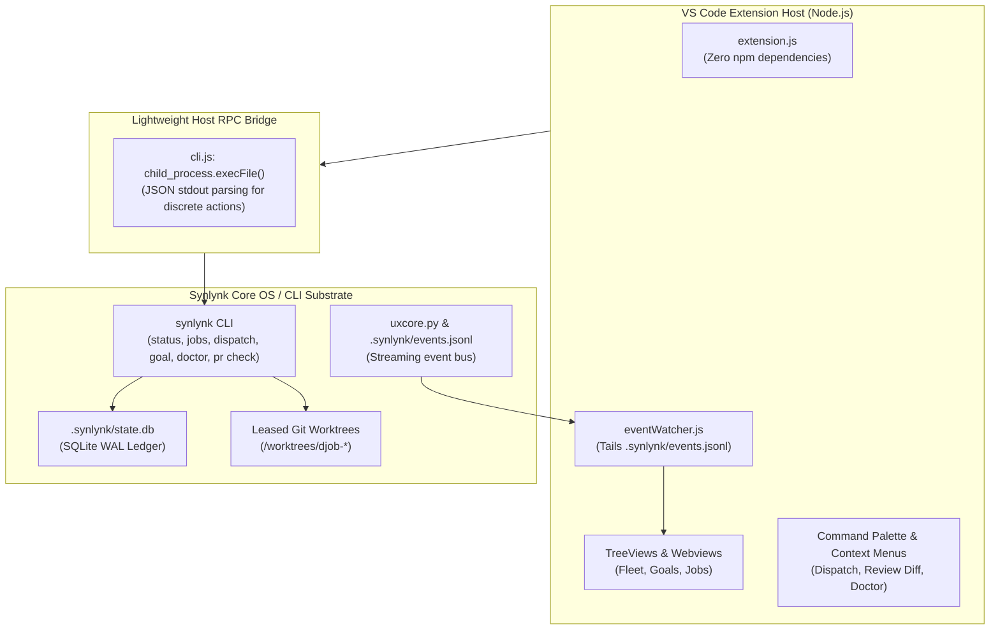
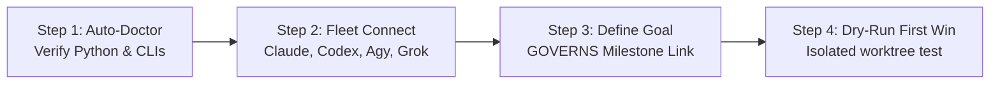
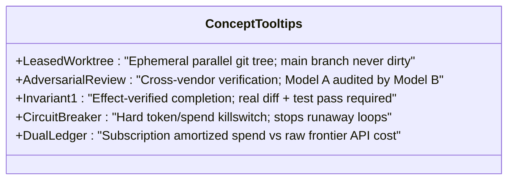

# Design Specification: Synlynk VS Code Client (`synlynk-vscode`)

**Date:** 2026-10-18  
**Author:** Agy (AntiGravity CLI / Gemini)  
**Stakeholder & Signoff:** Nikhil Soman  
**Milestone:** Phase 2: Distribution Wedge & Capability Demonstration (Runway to 31 Oct 2026 Developer Preview)  
**Target Package:** `clients/vscode/` (`synlynk-vscode-0.1.0.vsix`)  
**Status:** Approved by Consensus Decision Panel (`dec-7dabb36d`) — Final Specification  

---

## 1. Executive Summary & Market Intent

### 1.1 The VS Code Distribution Opportunity
VS Code commands **75%–82%** market share among professional software developers. Combined with its direct engine derivatives (Cursor, Windsurf, VSCodium, Positron), the Monaco/VS Code extension host reaches over **90%** of modern developers.

While the Synlynk CLI provides a defensible multi-agent kernel (5 Invariants, leased worktree isolation, SQLite WAL transactions, and dual-ledger economics), terminal-only distribution creates severe first-mile friction:
- Developers must discover the CLI, install package managers (`brew`, `pipx`), configure PATH variables, and learn command flags.
- In contrast, the VS Code Marketplace and Open VSX Registry offer **zero-friction 1-click installation**, background updates, and instant visual discovery.

### 1.2 Competitive Positioning: The Defensible Core
Existing AI developer extensions (GitHub Copilot, Cline, Roo Code, Continue.dev) suffer from structural architectural flaws that Synlynk solves natively:

| Dimension | GitHub Copilot | Cline / Roo Code | Continue.dev | Synlynk VS Code |
| :--- | :--- | :--- | :--- | :--- |
| **Execution Safety** | In-buffer cloud edits | **Mutates active working tree directly** | In-buffer code replacement | **Leased background git worktree**; active editor never touched |
| **Multi-Model Verification** | Single-vendor lock-in | Single-model prompt loops | Single-model chat | **Adversarial non-author review** (e.g. Codex writes, Grok verifies) |
| **Verification Gate** | None (trusts output) | Terminal command checks | None | **Invariant 1:** Real git diff + passing test oracle + AST delta |
| **Cost & Token Honesty** | Subscription opaque | Raw API tokens only | Raw API tokens only | **Dual-Ledger Accounting:** Frontier token value vs subscription spend |
| **Strategic Continuity** | Ephemeral chat history | Session history | Markdown session logs | **GOVERNS Linkage:** Every dispatch binds to durable project goals |

### 1.3 Launch Timing & Operational Verification Gate
The panel consensus establishes a strict **Operational Verification Gate** rather than an inflexible calendar deadline:
- **Primary Target:** Launch the VS Code extension during the same week as the Hacker News Developer Preview announcement post, featuring the Marketplace listing as the primary conversion anchor.
- **Operational Gate:** Concurrency with HN is executed **if and only if** the **Core 3 Flow** passes automated and manual verification reliably:
  1. **Doctor FTUE:** Clean environment probe and 1-click bootstrap.
  2. **Goal-Linked Dispatch:** Dispatch executes in a background leased worktree without touching active buffers.
  3. **Native Diff Review:** Worktree diff renders cleanly in `vscode.diff`.
- **Contingency Gate:** If any component of the Core 3 Flow shows flakiness or fails verification during preflight testing, publish the HN post against the stable CLI/PyPI path first, and release the Marketplace extension days later once fully hardened. A broken first impression from HN traffic is far more damaging than a phased rollout.

---

## 2. Core Architecture & Design Principles



### 2.1 The Zero-Dependency Thin RPC Bridge & Event-Tailing Substrate
1. **Zero npm Runtime Dependencies:** `dependencies: {}`. The extension contains no bulky frameworks, bundling bloat, or external node modules that increase attack surface or delay cold starts.
2. **Event-Tailing Over Process Polling:** 
   - Polling `child_process.execFile("synlynk", ...)` every 3–5 seconds creates unnecessary process spawning and causes SQLite WAL lock contention on `state.db`.
   - Instead, the extension uses `eventWatcher.js` to tail `.synlynk/events.jsonl` (emitted by `uxcore.py`). State changes in the fleet, jobs, and goals trigger reactive TreeView re-renders immediately upon event emission, with debouncing (200ms).
   - `child_process.execFile` is reserved strictly for discrete user-initiated actions (dispatching a job, running doctor, creating a goal, running PR check).
3. **CLI Handshake & Version Compatibility:**
   - On activation, the extension runs `synlynk --version --json` to verify CLI availability and version compatibility (`>= 0.23.0`).
   - If the CLI version is incompatible or missing, the extension enters "Bootstrap Mode" with clear guidance.
4. **VS Code Workspace Trust:**
   - Full compliance with `vscode.workspace.isTrusted`.
   - In Untrusted Workspaces, the extension runs in restricted mode: all execution actions (dispatch, bootstrap, worktree operations) are disabled. The UI displays an informative security banner explaining that agent dispatch requires workspace trust.

### 2.2 Non-Disruptive Worktree Concurrency & Safe Review Gate
Unlike single-agent tools that mutate open editor files:
- Dispatches execute in **leased background git worktrees**. The developer’s active buffers, cursor positions, and terminals remain **100% untouched**.
- When an agent completes and passes Invariant 1 verification, the extension opens a native side-by-side **Diff Editor** (`vscode.diff`) comparing the active branch with the worktree branch.
- **Merge Safety Gate (v0.1 Scope Pruning):** 
  - To prevent accidental bypass of non-author review policies and Invariant 1 verifications, **1-click in-editor merge is held back from v0.1**.
  - The UI presents `[Review Diff]` and `[Check Policy / PR Check]`. Merging remains securely gated behind `synlynk pr check` and the repository's configured merge authority (`.synlynk/policy.json`).

### 2.3 Multi-IDE Boundary & Core Contract
To ensure clean portability to Cursor, Windsurf, JetBrains, and Zed:
- The shared multi-IDE foundation is strictly the CLI's typed JSON schema contracts and the `.synlynk/events.jsonl` event stream.
- No premature shared UI framework is built for v0.1. `clients/vscode/` is a pure presentation layer using VS Code native APIs (`vscode.window.createTreeView`, `vscode.commands`, `vscode.diff`, `vscode.walkthroughs`).

---

## 3. First-Time User Experience (FTUE)

### 3.1 Welcome View (`viewsWelcome`)
For repositories where Synlynk has not been initialized (`.synlynk/` missing), the sidebar presents a focused Welcome View:

```
┌──────────────────────────────────────────────┐
│ SYNLYNK WORKSPACE                            │
├──────────────────────────────────────────────┤
│                                              │
│  Autonomous Multi-Agent Engineering          │
│  Orchestrate Claude, Codex, Agy, and Grok    │
│  with worktree isolation & test verification.│
│                                              │
│  [⚡ Initialize Repository (synlynk init)]    │
│                                              │
│  [📖 Take the 2-Minute Interactive Tour]     │
│                                              │
└──────────────────────────────────────────────┘
```

### 3.2 Native Interactive Walkthrough (`contributes.walkthroughs`)
Triggered automatically on first install (and available via `Welcome: Open Walkthrough`):



1. **Step 1: Environment Health Check:** Runs `synlynk doctor --json`. Shows clear checkmarks for detected agent CLIs (Claude Code, Codex CLI, Agy, Grok).
2. **Step 2: Connect Agent Fleet:** Explains multi-vendor capability routing: *Model A authors, Model B audits*.
3. **Step 3: Set Your First Goal (GOVERNS):** Prompts the user to name the active milestone (e.g. `Release v1.0`).
4. **Step 4: Safe Dry-Run First Win:** Runs a non-destructive dry-run dispatch:
   > *"Run doctor diagnostics and generate an effect verification test in an isolated worktree."*  
   Includes a 1-click `[Run First Dispatch]` button.

---

## 4. Visual Panes & Sidebar Architecture

The extension contributes a primary container to the VS Code Activity Bar with three collapsible TreeView panes:

```
┌───┬───────────────────────────────────────────┐
│   │ SYNLYNK WORKSPACE CONTROL PLANE           │
│   ├───────────────────────────────────────────┤
│ 🔌│ ▼ FLEET HEALTH ℹ️                         │
│   │   ● Claude Sonnet  Ready (Limit: Oct 19)  │
│ 📁│   ● OpenAI Codex   Ready (Reset: Oct 22)  │
│   │   ● Google Agy     Active (Driving)       │
│ 🔍│   ● xAI Grok       Recharge Needed        │
│   │   Spend (Session): $4.12 | Fleet: $18.47  │
│ ⚙️│                                           │
│   │ ▼ PROJECT GOALS & MILESTONES (GOVERNS) ℹ️  │
│   │   ▼ 🎯 v1.0.0 Developer Preview (Oct 31)  │
│   │     ├─ ✓ Hardening & GenericAPIAdapter    │
│   │     └─ 🚧 VS Code Extension Packaging     │
│   │                                           │
│   │ ▼ ACTIVE & RECENT DISPATCHES ℹ️            │
│   │   ▶ djob-8f2a: implement extension.js     │
│   │     ├─ Author: Agy · Verifier: Codex      │
│   │     ├─ Worktree: /worktrees/djob-8f2a     │
│   │     └─ [Review Diff]  [Check Policy]      │
└───┴───────────────────────────────────────────┘
```

### 4.1 Pane 1: Fleet Health & Quotas (`FleetTreeDataProvider`)
- Live status of commercial harnesses + local inference.
- Quota reset countdowns and session/aggregate spend metrics.
- Actions: `[Refresh Status]`, `[Run Diagnostics]`.

### 4.2 Pane 2: Project Goals & Milestones (`GoalsTreeDataProvider`)
- Surfaces active goals from `synlynk/db.py` (`goals` and `stories` tables).
- Displays progress bars and story counts per milestone.
- Actions: `[+ Add Milestone]`, `[Link Story]`.

### 4.3 Pane 3: Dispatched Jobs & Reviews (`JobsTreeDataProvider`)
- Lists in-flight and recent jobs from `synlynk jobs --json` updated via event tailing.
- State representations:
  - 🟢 **Verified & Complete:** Author and Verifier attested; tests pass.
  - 🟡 **In-Flight:** Animated spinner showing elapsed duration and active agent.
  - ⚡ **Circuit Breaker Tripped:** Bounded spend protection triggered.
  - 🔴 **Failed:** Error details with 1-click log viewing.
- Item actions:
  - `[Review Diff]`: Opens native `vscode.diff` comparing active branch with worktree.
  - `[Check Policy]`: Runs `synlynk pr check` to verify Invariant 1 and non-author signoff.
  - `[View Log]`: Opens output channel displaying job execution log.

### 4.4 Status Bar Item (`synlynk.statusBar`)
- Resides on the bottom status bar:
  - Idle state: `$(circuit-board) Synlynk: Ready ($18.47)`
  - Active dispatch: `$(sync~spin) Synlynk: [djob-8f2a] Codex running (32s)`
  - Verification stage: `$(shield) Synlynk: [djob-8f2a] Grok verifying...`
- Clicking toggles the Synlynk sidebar or opens the active job log.

---

## 5. Demystifying the Kernel: Progressive Disclosure & "ℹ️" Microcopy

To eliminate cognitive overload without hiding Synlynk's structural superpowers, the extension embeds contextual tooltips (`MarkdownString`) across all visual items:



1. **Leased Git Worktree (`ℹ️`):**
   > *"Synlynk never edits your open workspace files directly. Dispatches run in an ephemeral parallel git worktree. If the agent makes a mistake, your active code is completely untouched."*
2. **Adversarial Non-Author Verification (`ℹ️`):**
   > *"Single-model tools hallucinate their own correctness. Synlynk requires code authored by one model family (e.g. Codex) to be reviewed and verified by an independent model family (e.g. Grok or Claude) before merge."*
3. **Invariant 1 — Effect-Verified Completion (`ℹ️`):**
   > *"Synlynk never trusts 'exit 0' or agent self-reports. A task is only marked complete when it proves: (1) non-zero git diff, (2) passing test suite execution, and (3) verified syntax changes."*
4. **In-Flight Circuit Breaker (`ℹ️`):**
   > *"Protects your wallet. Automatically terminates runaway tool loops, repetition hangs, or token blowups before credit is wasted."*
5. **Dual-Ledger Accounting (`ℹ️`):**
   > *"Tracks real subscription-amortized expenditure alongside raw frontier API value, maintaining verifiable token economics across your fleet."*

---

## 6. Project Goals (GOVERNS) Integration

### 6.1 Demystifying GOVERNS into "Milestones & Goals"
The extension uses clear product terminology:
- In the UI, GOVERNS is simply **"Project Goals & Milestones"**.
- Fully backed by Synlynk's state database schema (`goals`, `stories`, `goal_stories`).

### 6.2 Goal-Bound Dispatch Flow
When initiating a task via `Cmd+Shift+P` -> `Synlynk: Dispatch Task`:
1. **Prompt Input:**
   > *"Describe the task, bug fix, or test to implement:"*
2. **Goal Association Picker (QuickPick):**
   > *"Link to Project Goal / Milestone:"*
   - `🎯 [Active] v1.0.0 Developer Preview (Target: 31 Oct 2026)` *(Recommended)*
   - `🎯 [Active] Phase 1 Substrate Hardening`
   - `➕ Create new Project Goal...`
   - `⏩ Skip (Ad-hoc exploratory task)`
3. **Execution & Tracking:**
   Upon dispatch, the task is tagged with `--story` and auto-associated with the selected goal in `state.db`.

---

## 7. Technical Implementation Details

### 7.1 Directory Layout (`clients/vscode/`)
```
clients/vscode/
├── package.json              # Extension manifest (commands, views, walkthroughs)
├── extension.js              # Activation entrypoint, handshake & command wiring
├── src/
│   ├── cli.js                # child_process.execFile wrapper for discrete actions
│   ├── eventWatcher.js       # File watcher & debounced tailer for .synlynk/events.jsonl
│   ├── providers/
│   │   ├── fleetProvider.js  # TreeDataProvider for Fleet Health
│   │   ├── goalsProvider.js  # TreeDataProvider for Goals / GOVERNS
│   │   └── jobsProvider.js   # TreeDataProvider for Dispatched Jobs
│   ├── commands/
│   │   ├── dispatch.js       # Dispatch dialog & goal association
│   │   ├── diff.js           # Native vscode.diff viewer for worktrees
│   │   └── doctor.js         # Environment diagnostics & bootstrap guidance
│   ├── ui/
│   │   └── statusBar.js      # Status bar controller
│   └── util/
│       └── errorBoundary.js  # Graceful offline and malformed JSON handler
├── media/
│   ├── synlynk-icon.svg      # Activity Bar icon (vector SVG)
│   └── walkthrough/          # Illustrative SVGs for FTUE steps
└── README.md                 # Marketplace user documentation
```

### 7.2 RPC Protocol & Event-Tailing Specification
Discrete actions invoke `synlynk <subcommand> --json`:

```javascript
// src/cli.js invocation
const { execFile } = require("child_process");

function runSynlynk(subcommand, args = [], options = {}) {
  return new Promise((resolve, reject) => {
    execFile("synlynk", [subcommand, ...args, "--json"], { timeout: 30000, ...options }, (err, stdout, stderr) => {
      if (err) {
        return reject(new Error(stderr || err.message));
      }
      try {
        resolve(JSON.parse(stdout));
      } catch (parseErr) {
        reject(new Error(`Malformed JSON output from synlynk ${subcommand}: ${stdout}`));
      }
    });
  });
}
```

Reactive updates tail `.synlynk/events.jsonl`:
```javascript
// src/eventWatcher.js
const fs = require("fs");
const path = require("path");

function watchEvents(workspaceRoot, onEvent) {
  const eventsFile = path.join(workspaceRoot, ".synlynk", "events.jsonl");
  if (!fs.existsSync(eventsFile)) return { dispose: () => {} };

  let fileSize = fs.statSync(eventsFile).size;
  const watcher = fs.watch(eventsFile, (eventType) => {
    if (eventType === "change") {
      const newSize = fs.statSync(eventsFile).size;
      if (newSize > fileSize) {
        const stream = fs.createReadStream(eventsFile, { start: fileSize, end: newSize });
        let buffer = "";
        stream.on("data", (chunk) => { buffer += chunk.toString(); });
        stream.on("end", () => {
          fileSize = newSize;
          buffer.split("\n").filter(Boolean).forEach((line) => {
            try { onEvent(JSON.parse(line)); } catch (_) {}
          });
        });
      }
    }
  });
  return { dispose: () => watcher.close() };
}
```

### 7.3 Packaging & Open VSX / Marketplace Distribution
1. **Packaging Tool:** Use `@vscode/vsce package` to bundle the extension into `synlynk-vscode-0.1.0.vsix`.
2. **Automated CI Workflow (`.github/workflows/vscode-package.yml`):**
   - Triggers on PR changes to `clients/vscode/**` and on release tags.
   - Runs `npm install --dry-run` to ensure zero runtime dependencies.
   - Executes `npx @vscode/vsce package --no-dependencies`.
   - Uploads the `.vsix` bundle as an artifact for release testing.

---

## 8. Verification & Acceptance Criteria

| ID | Requirement | Verification Method |
| :--- | :--- | :--- |
| **AC-1** | Zero runtime dependencies | `npm list --depth=0` shows 0 production dependencies |
| **AC-2** | Activation cold start | Extension activates in `< 50ms` (measured via `Developer: Startup Performance`) |
| **AC-3** | Auto-Doctor FTUE | Missing CLI triggers non-blocking bootstrap guidance |
| **AC-4** | Worktree Diff Review | Clicking `[Review Diff]` opens native side-by-side diff against worktree path |
| **AC-5** | GOVERNS Linkage | Dispatches correctly record `goal_id` in `state.db` stories |
| **AC-6** | VSIX Packaging | Clean `.vsix` build under 2MB without packaging warnings |
| **AC-7** | Event-Tailing Concurrency | Zero SQLite WAL contention; live updates consume `.synlynk/events.jsonl` |
| **AC-8** | Workspace Trust | In untrusted workspaces, execution actions are disabled safely |
| **AC-9** | Offline Error Boundary | Network timeouts or offline commercial APIs surface clean inline alerts |
| **AC-10** | Version Handshake | Extension rejects mismatched CLI major versions with actionable upgrade prompts |
