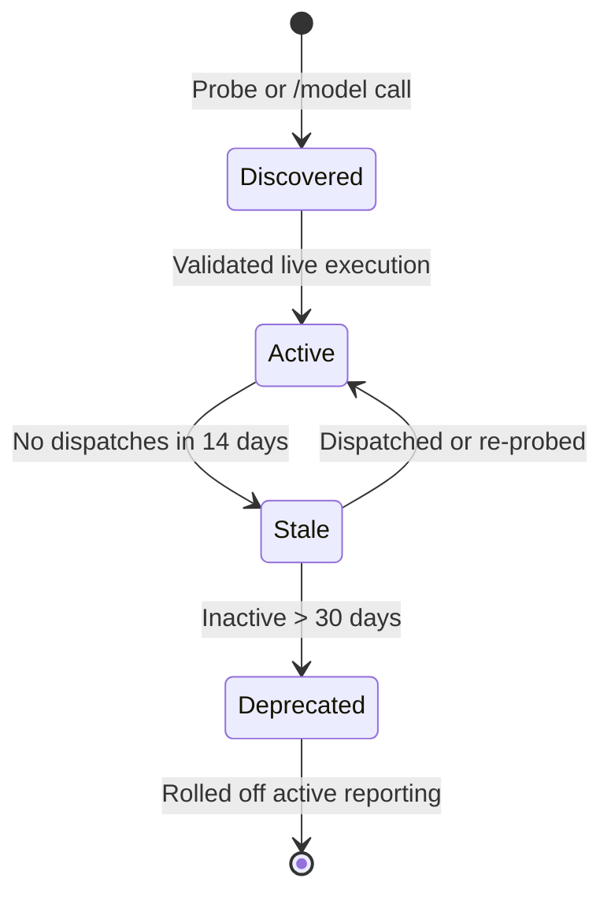
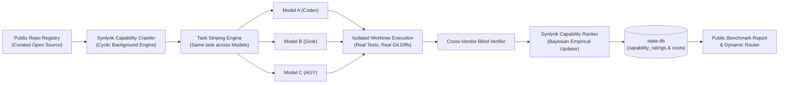

# Real Capability & Cost Metrics: Dynamic Model Catalog Window, Open SFIA (>1% Attribution) Taxonomy, and Public Repo Capability Crawler

**Design Specification · GOVERNS Goal: `goal-aa48c456`**  
**Authors:** Synlynk Architecture Working Group & Fleet Engineering  
**Date:** 2026-10-19  
**Status:** Approved by Decide Panel (`dec-026ffa30`)

---

## 1. Executive Summary & Problem Statement

### The "Synthetic Mirage" of LLM Benchmarks
Current software engineering benchmarks (SWE-bench, HumanEval, BigCode) test models under artificial conditions: clean prompt buffers, static environments, and isolated single-turn completions. In production multi-agent engineering workflows, these scores fail because:
1. **Narrow Domain Bias:** They test only algorithmic coding, ignoring 90% of real tech operations: design systems, multimedia assets, audio/video scripting, interactive VR/AR, product management, customer research, and security compliance.
2. **Catalog Stagnation:** Models evolve continuously. Hardcoded lists of 1–2 flagship models hide the cost-efficiency of fast-tier models (`o4-mini`, `gemini-3.8-flash`, `grok-code-fast`) and zero-cost on-device inference (`local` oMLX).
3. **Zero Economic Signal:** Synthetic benchmarks do not meter real token in/out consumption, real API dollar spend, real git merge conflicts, real CI execution time, or real review iterations.
4. **Self-Attestation Inflation:** Models grading their own output inflate quality scores by up to +45%.

### Architectural Solution
This specification establishes a permanent architectural subsystem to **"keep the capability & cost metric real"**, driven by four core pillars:
1. **Dynamic Model Catalog Sliding Window:** Track all models discoverable via `/model` calls across public frontiers (OpenAI Codex, Anthropic Claude, Google AGY, xAI Grok, Meta Muse) and local oMLX, with active 30-day retention.
2. **Open SFIA 8/9 Taxonomy:** Expand beyond core software coding into adjacent creative, multimedia, audio/video, VR, and business operations disciplines.
3. **$\ge 1\%$ Task Attribution Sliding Window:** Any SFIA discipline accounting for at least 1% of task volume dynamically enters the active capability rating matrix.
4. **Public Repo Contribution Program (Capability Crawler & Ranker):** Cyclic background execution engine striping tasks across real public repositories to measure authentic tokens, costs, and CI/git friction.

---

## 2. Pillar 1: Dynamic Multi-Model Catalog Sliding Window

### 2.1 Multi-Vendor Discovery & Model Registry
Rather than hardcoding 1–2 model IDs per harness, Synlynk maintains a dynamic model inventory in `state.db` populated via:
- Native CLI discovery (`claude --help`, `codex --help`, `grok --help`, `agy --help`, `muse --help`).
- Runtime API probe `/model` endpoints (including OpenAI `/v1/models`, OpenRouter, Anthropic, and local oMLX).
- Live execution capture from job receipts (`model_at_completion`).

### 2.2 Model Sliding Window Lifecycle
Each model record in `harness_models` tracks:
- `first_seen_at` & `last_seen_at` (ISO 8601 UTC timestamps).
- `status`: `active`, `superseded`, or `deprecated`.
- `complexity_tier`: `flagship` (reasoning/architecture), `fast` (high-velocity implementation), or `local` (on-device zero cost).
- `sliding_window_eligible`: Boolean flag computed from `last_seen_at >= NOW() - 30 days`.

---

## 3. Pillar 2: Open SFIA 8/9 Taxonomy Expansion

### 3.1 Beyond Core Software Engineering
Modern technology startups and digital businesses require competencies far beyond backend Python/TypeScript programming. Synlynk incorporates the standardized **Skills Framework for the Information Age (SFIA 8/9)** covering 121+ professional skills across 6 domains:

| Category | SFIA Code | Discipline Label | Real-World Application / Artifacts |
| :--- | :--- | :--- | :--- |
| **Development** | `PROG` | Programming / Software Development | Core backend, algorithms, APIs, systems plumbing |
| | `TEST` | Testing & Verification | Unit/integration tests, invariant checks, compliance |
| | `DESN` | Systems Design | Component architectures, interface definitions |
| | `DBDS` | Database Design | Relational schemas, migrations, indexing, WAL tuning |
| | `DTAN` | Data Analysis | Analytics pipelines, telemetry transforms, aggregations |
| **Creative & Media** | `MUDI` | Multimedia Design | Video reframing, interactive assets, demo reels |
| | `ANIM` | Animation Development | Canvas animations, CSS keyframes, motion design |
| | `GRAP` | Graphic Design & Visuals | Vector icons, SVG diagrams, presentation layouts |
| | `SNDD` | Sound & Audio Design | Audio scripting, sound effects, voice synthesis |
| | `ICDV` | Interactive Content & AR/VR | 3D scenes, WebGL, spatial computing interfaces |
| **Strategy & Design** | `ARCH` | Solution Architecture | System topology, cross-boundary protocols |
| | `REQM` | Requirements Definition | User stories, PRDs, acceptance criteria |
| | `BUSA` | Business Analysis | Domain modeling, financial metrics, ROI models |
| | `UNAN` | User Experience Analysis | User journeys, wireframes, accessibility auditing |
| **Operations & Security**| `DEPL` | Software Deployment | Release automation, packaging, marketplace publishing|
| | `SCTY` | Information Security | Vulnerability remediation, permissions, sandboxing |
| | `ITOP` | IT Infrastructure Operations | Daemon management, system supervision, networking |
| **Business Operations** | `PROD` | Product Management | Roadmap planning, backlog grooming, release gating |
| | `COMM` | Communications & PR | Technical writing, developer blogs, documentation |
| | `MKTG` | Marketing & Growth | Landing page copy, value narratives, launch posts |

---

## 4. Pillar 3: Dynamic $\ge 1\%$ Task Attribution Inclusion Window

### 4.1 Data-Driven Taxonomy Thresholding
Static taxonomies suffer from two failure modes:
1. Being too restrictive (leaving out critical work like CSS, docs, or devops).
2. Being overly cluttered (displaying 120 empty rows for skills never utilized).

Synlynk implements a **dynamic 1% attribution threshold**:
$$\text{Attribution Share}(S_i) = \frac{\text{Dispatched Tasks with Skill } S_i \text{ in last 90 days}}{\text{Total Dispatched Tasks in last 90 days}}$$

### 4.2 Inclusion Rule
- If $\text{Attribution Share}(S_i) \ge 0.01$ (1%):
  - Skill $S_i$ is promoted to the **Active Reference Matrix**.
  - Models are continuously calibrated and scored on $S_i$.
  - $S_i$ is published in the canonical benchmark report.
- If $\text{Attribution Share}(S_i) < 0.01$:
  - Skill remains dormant in the extended catalog, avoiding noise in executive reporting.

---

## 5. Pillar 4: Public Repo Contribution Program (Capability Crawler & Ranker)

### 5.1 The Engine: Moving from Synthetic Prompts to Real Work
Rather than prompting models with "Write a small Python function demonstrating X", Synlynk deploys a **Capability Crawler & Ranker**:
- **Capability Crawler:** An autonomous background daemon that pulls open-source tasks from a curated registry of real public repositories (libraries, web apps, tools, documentation).
- **Task Striping:** Tasks are cloned into isolated temporary worktrees and striped across candidate models:
  - Task $T_1$ on Repo $R_A$ $\rightarrow$ Dispatched to Model $M_1$ (e.g. `grok-4.5`).
  - Task $T_1$ on Repo $R_A$ $\rightarrow$ Dispatched to Model $M_2$ (e.g. `gpt-5.6-terra`).
  - Review & Verification $\rightarrow$ Dispatched to Model $M_3$ (e.g. `claude-fable-5`).
- **Authentic Telemetry Capture:**
  - Real token consumption (prompt AST expansion vs. generated code).
  - Real financial costs (metered down to the fraction of a cent).
  - Real test execution results (`pytest`, `npm test`, `cargo test`).
  - Real git friction (merge base diff cleanliness, merge conflicts, rework cycles).
- **Capability Ranker:** Aggregates empirical task receipts using Bayesian updating into `capability_ratings` in `state.db`.

---

## 6. Architecture & Implementation Roadmap

### 6.1 Database Schema Additions (`state.db`)
1. `model_sliding_window`: Tracks first seen, last seen, active window status, and complexity tier.
2. `public_repo_registry`: Registry of target calibration repositories, primary SFIA classifications, and task generators.
3. `crawler_runs`: Ledger of cyclic crawler task runs, striped model assignments, execution durations, and test suite outcomes.

### 6.2 CLI Tooling Surface
- `synlynk capability sweep --sliding-window`: Sweep all models active within the 30-day window.
- `synlynk capability backfill`: Ingest and reclassify historical `state.db` task completions into the open SFIA taxonomy.
- `synlynk capability crawl --repos <config>`: Run cyclic contribution crawls against public repos.
- `synlynk capability rank`: Recompute empirical capability rankings and publish updated matrix.

### 6.3 GOVERNS Alignment
- Parent Goal: `goal-aa48c456` (`Keep the capability & cost metric real`).
- Decision Record: `dec-026ffa30` (`project-docs/decisions/2026-10-19-real-capability-cost-metrics-dynamic-mod.md`).
