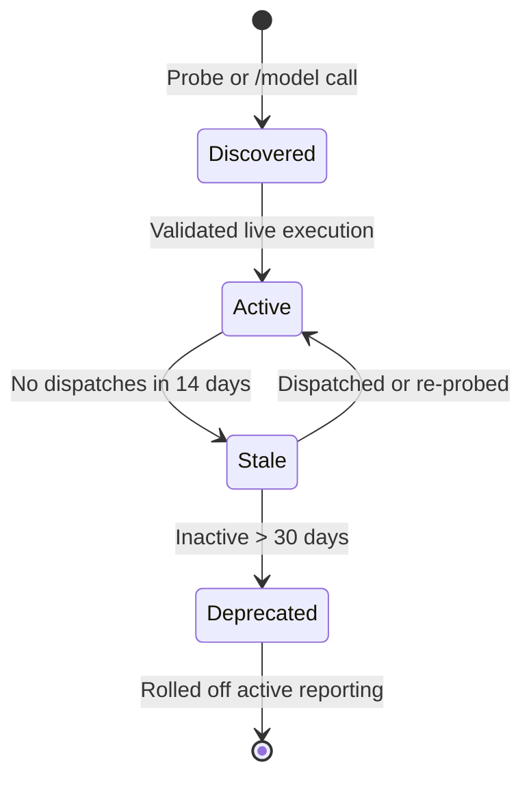
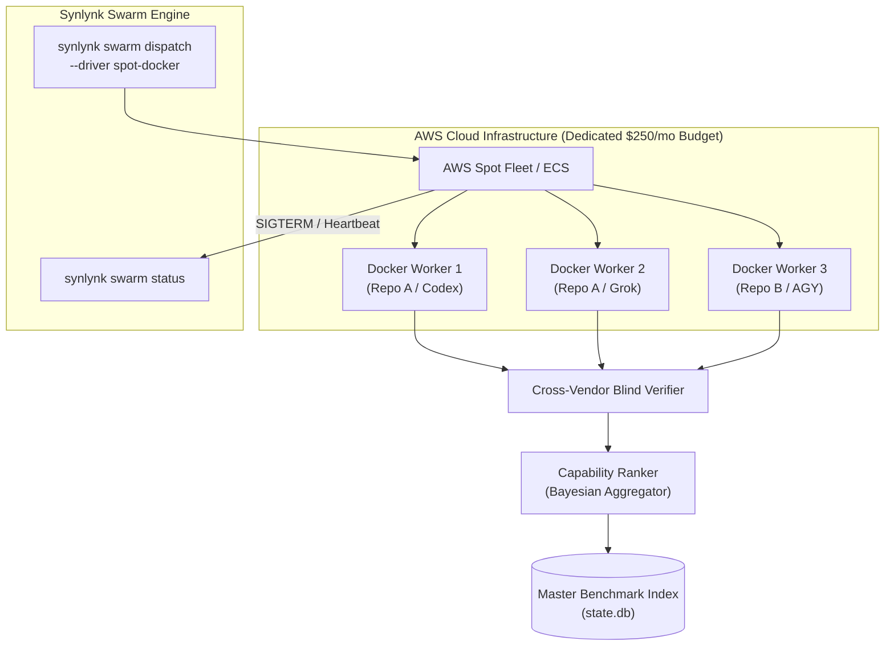
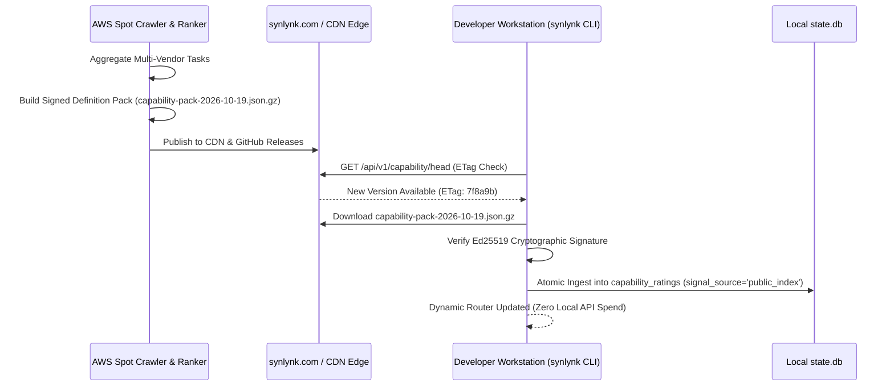
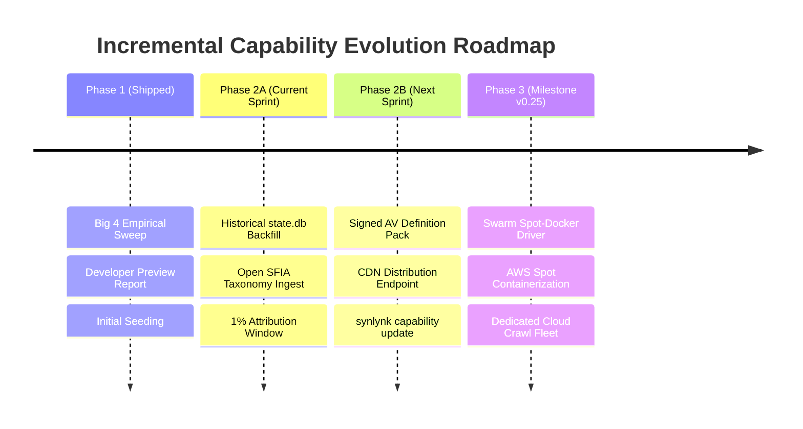

# Real Capability & Cost Metrics: Dynamic Model Catalog Window, Open SFIA (>1% Attribution) Taxonomy, Public Repo Crawler, and AV-Style Definition Packs

**Design Specification · GOVERNS Goal: `goal-aa48c456`**  
**Authors:** Synlynk Architecture Working Group & Fleet Engineering  
**Date:** 2026-10-19  
**Status:** Approved by Decide Panels (`dec-026ffa30` & `dec-26ffa31`)

---

## 1. Executive Summary & Problem Statement

### The "Synthetic Mirage" of LLM Benchmarks
Current software engineering benchmarks (SWE-bench, HumanEval, BigCode) test models under artificial conditions: clean prompt buffers, static environments, and isolated single-turn completions. In production multi-agent engineering workflows, these scores fail because:
1. **Narrow Domain Bias:** They test only algorithmic coding, ignoring 90% of real tech operations: design systems, multimedia assets, audio/video scripting, interactive VR/AR, product management, customer research, and security compliance.
2. **Catalog Stagnation:** Models evolve continuously. Hardcoded lists of 1–2 flagship models hide the cost-efficiency of fast-tier models (`o4-mini`, `gemini-3.8-flash`, `grok-code-fast`) and zero-cost on-device inference (`local` oMLX).
3. **Zero Economic Signal:** Synthetic benchmarks do not meter real token in/out consumption, real API dollar spend, real git merge conflicts, real CI execution time, or real review iterations.
4. **Self-Attestation Inflation:** Models grading their own output inflate quality scores by up to +45%.
5. **Local Machine & Personal Quota Contention:** Continuous background calibration running locally starves developer hardware and consumes personal interactive subscription rate limits (e.g. Claude weekly limits).

### Architectural Solution
This specification establishes an autonomous, cloud-offloaded subsystem to **"keep the capability & cost metric real"**, driven by five core architectural pillars:
1. **Dynamic Model Catalog Sliding Window:** Track all models discoverable via `/model` calls across public frontiers (OpenAI Codex, Anthropic Claude, Google AGY, xAI Grok, Meta Muse) and local oMLX, with active 30-day retention.
2. **Open SFIA 8/9 Taxonomy:** Expand beyond core software coding into adjacent creative, multimedia, audio/video, VR, and business operations disciplines.
3. **$\ge 1\%$ Task Attribution Sliding Window:** Any SFIA discipline accounting for at least 1% of task volume dynamically enters the active capability rating matrix.
4. **Swarm-Driven Public Repo Crawler & Ranker:** Standalone Docker container running off AWS EC2 Spot instances with a dedicated budget, acting as the inaugural workload for Synlynk Swarm execution mode.
5. **Antivirus-Style Definition Pack Distribution:** Immutable, cryptographically signed index update packs (`capability-pack-YYYY-MM-DD.json.gz`) distributed via CDN edge mirrors for zero-friction client updates (`synlynk capability update`).

---

## 2. Pillar 1: Dynamic Multi-Model Catalog Sliding Window

### 2.1 Multi-Vendor Discovery & Model Registry
Rather than hardcoding 1–2 model IDs per harness, Synlynk maintains a dynamic model inventory in `state.db` populated via:
- Native CLI discovery (`claude --help`, `codex --help`, `grok --help`, `agy --help`, `muse --help`).
- Runtime API probe `/model` endpoints (including OpenAI `/v1/models`, OpenRouter, Anthropic, and local oMLX).
- Live execution capture from job receipts (`model_at_completion`).

### 2.2 Model Sliding Window Lifecycle
Each model record in `harness_models` tracks:
- `first_seen_at` & `last_seen_at` (ISO 8601 UTC timestamps).
- `status`: `active`, `superseded`, or `deprecated`.
- `complexity_tier`: `flagship` (reasoning/architecture), `fast` (high-velocity implementation), or `local` (on-device zero cost).
- `sliding_window_eligible`: Boolean flag computed from `last_seen_at >= NOW() - 30 days`.



---

## 3. Pillar 2: Open SFIA 8/9 Taxonomy Expansion

### 3.1 Beyond Core Software Engineering
Modern technology startups and digital businesses require competencies far beyond backend Python/TypeScript programming. Synlynk incorporates the standardized **Skills Framework for the Information Age (SFIA 8/9)** covering 121+ professional skills across 6 domains:

| Category | SFIA Code | Discipline Label | Real-World Application / Artifacts |
| :--- | :--- | :--- | :--- |
| **Development** | `PROG` | Programming / Software Development | Core backend, algorithms, APIs, systems plumbing |
| | `TEST` | Testing & Verification | Unit/integration tests, invariant checks, compliance |
| | `DESN` | Systems Design | Component architectures, interface definitions |
| | `DBDS` | Database Design | Relational schemas, migrations, indexing, WAL tuning |
| | `DTAN` | Data Analysis | Analytics pipelines, telemetry transforms, aggregations |
| **Creative & Media** | `MUDI` | Multimedia Design | Video reframing, interactive assets, demo reels |
| | `ANIM` | Animation Development | Canvas animations, CSS keyframes, motion design |
| | `GRAP` | Graphic Design & Visuals | Vector icons, SVG diagrams, presentation layouts |
| | `SNDD` | Sound & Audio Design | Audio scripting, sound effects, voice synthesis |
| | `ICDV` | Interactive Content & AR/VR | 3D scenes, WebGL, spatial computing interfaces |
| **Strategy & Design** | `ARCH` | Solution Architecture | System topology, cross-boundary protocols |
| | `REQM` | Requirements Definition | User stories, PRDs, acceptance criteria |
| | `BUSA` | Business Analysis | Domain modeling, financial metrics, ROI models |
| | `UNAN` | User Experience Analysis | User journeys, wireframes, accessibility auditing |
| **Operations & Security**| `DEPL` | Software Deployment | Release automation, packaging, marketplace publishing|
| | `SCTY` | Information Security | Vulnerability remediation, permissions, sandboxing |
| | `ITOP` | IT Infrastructure Operations | Daemon management, system supervision, networking |
| **Business Operations** | `PROD` | Product Management | Roadmap planning, backlog grooming, release gating |
| | `COMM` | Communications & PR | Technical writing, developer blogs, documentation |
| | `MKTG` | Marketing & Growth | Landing page copy, value narratives, launch posts |

---

## 4. Pillar 3: Dynamic $\ge 1\%$ Task Attribution Inclusion Window

### 4.1 Data-Driven Taxonomy Thresholding
Static taxonomies suffer from two failure modes:
1. Being too restrictive (leaving out critical work like CSS, docs, or devops).
2. Being overly cluttered (displaying 120 empty rows for skills never utilized).

Synlynk implements a **dynamic 1% attribution threshold**:
$$\text{Attribution Share}(S_i) = \frac{\text{Dispatched Tasks with Skill } S_i \text{ in last 90 days}}{\text{Total Dispatched Tasks in last 90 days}}$$

### 4.2 Inclusion Rule
- If $\text{Attribution Share}(S_i) \ge 0.01$ (1%):
  - Skill $S_i$ is promoted to the **Active Reference Matrix**.
  - Models are continuously calibrated and scored on $S_i$.
  - $S_i$ is published in the canonical benchmark report.
- If $\text{Attribution Share}(S_i) < 0.01$:
  - Skill remains dormant in the extended catalog, avoiding noise in executive reporting.

---

## 5. Pillar 4: Swarm-Driven Public Repo Crawler (AWS Spot Docker Deployment)

### 5.1 Dedicated Cloud Infrastructure & Budget Isolation
To prevent background calibration loops from competing with user dev machines or exhausting personal subscription quotas:
- **Dedicated Budget Ledger:** Calibrations are billed against a dedicated corporate/project API allocation (`crawler_budget_usd`), tracked separately from personal developer quotas.
- **Offloaded Cloud Execution:** The crawler executes exclusively on remote ephemeral compute, freeing local CPU, RAM, and network bandwidth.
- **AWS Spot Docker Packaging:** The crawler is containerized (`synlynk-crawler:latest`) and runs on AWS EC2 Spot instances (70–90% cost reduction).

### 5.2 Flagship Inaugural Workload for Synlynk Swarm
The Capability Crawler is designated as the **first official workload operated by Synlynk Swarm execution mode**:
- **Why Swarm Fits:** Swarm runners (`synlynk swarm dispatch`, `SwarmRunnerDriver`) are designed for fanned-out, embarrassingly parallel, disposable jobs.
- **Zero State Sharing:** Tasks on Repo A, Repo B, and Repo C operate in orthogonal ephemeral containers with zero shared filesystem state.
- **Spot Preemption Resilience:** When AWS emits a two-minute spot interruption notice (`SIGTERM`), the driver flushes in-flight task receipts to the central queue, tears down cleanly, and resumes on a fresh spot instance.



---

## 6. Pillar 5: Antivirus-Style Definition Pack Distribution

### 6.1 The "AV Signature Pack" Distribution Model
Rather than forcing every Synlynk user to run background crawlers or maintain real-time database replication:
- **Index Definition Packs:** The master benchmark index is compiled into a compressed, immutable definition pack: `capability-pack-YYYY-MM-DD.json.gz` (typically < 150 KB).
- **Public CDN Distribution:** Uploaded to high-availability public infrastructure: `https://synlynk.com/api/v1/capability/index` and mirrored as a GitHub Release asset.
- **Cryptographic Attestation:** Each pack is signed with Synlynk's canonical Ed25519 root release key.
- **Atomic Local Ingestion:** The client runs `synlynk capability update` (or an ambient background check) to verify the signature, validate the version, and replace the reference matrices atomically without touching local user task history.



---

## 7. Phased Implementation Roadmap

To preserve project velocity and prioritize immediate goals defined by the strategic synthesized roadmap, execution is strictly incremental:



### Phase 1: Developer Preview Release (Shipped)
- Delivered multi-vendor empirical calibration matrix across Codex, Claude, AGY, and Grok.
- Published canonical report `docs/benchmarks/2026-10-empirical-capability-report.md` (PR #2429).
- Established baseline calibration data in `state.db`.

### Phase 2A: Historical Organic Backfill & SFIA Expansion (Current Sprint)
- Implement `synlynk capability backfill` CLI command.
- Ingest and reclassify 2,700+ historical `state.db` task completions across the open SFIA taxonomy (`PROG`, `TEST`, `REQM`, `ARCH`, `REFN`, `SECR`, `DEPL`, `MUDI`, `GRAP`, `COMM`).
- Enforce the dynamic 1% task attribution sliding window.

### Phase 2B: Signed Index Distribution Engine (Sprint Follow-up)
- Implement definition pack builder (`synlynk capability pack-build`).
- Implement client update command (`synlynk capability update`) with Ed25519 signature verification.
- Deploy public distribution mirror on `synlynk.com/update` and GitHub Releases.

### Phase 3: Swarm-Operated Cloud Crawler on AWS Spot (Milestone v0.25)
- Package `synlynk-crawler` Docker container.
- Implement `DockerSpotRunnerDriver` in `synlynk/runners/` with preemption signal handling.
- Provision dedicated cloud budget and autonomous cyclic public repo contribution loops.

---

## 8. Governance & Verification Attestation

- **Parent Goal:** [`goal-aa48c456`](file:///Users/nikhilsoman/.synlynk/workspaces/synlynk/state.db) (*Keep the capability & cost metric real*).
- **Formal Decisions:**
  - [`dec-026ffa30`](file:///Users/nikhilsoman/dev/synlynk/project-docs/decisions/2026-10-19-real-capability-cost-metrics-dynamic-mod.md) (Core 4 Pillars).
  - [`dec-26ffa31`](file:///Users/nikhilsoman/dev/synlynk/project-docs/decisions/2026-10-19-autonomous-capability-crawler-index-dist.md) (Cloud Spot Swarm, Dedicated Budget & AV Pack Distribution).
- **Verification Commands:**
  ```bash
  synlynk goal list | grep goal-aa48c456
  synlynk decide --audit
  ```
