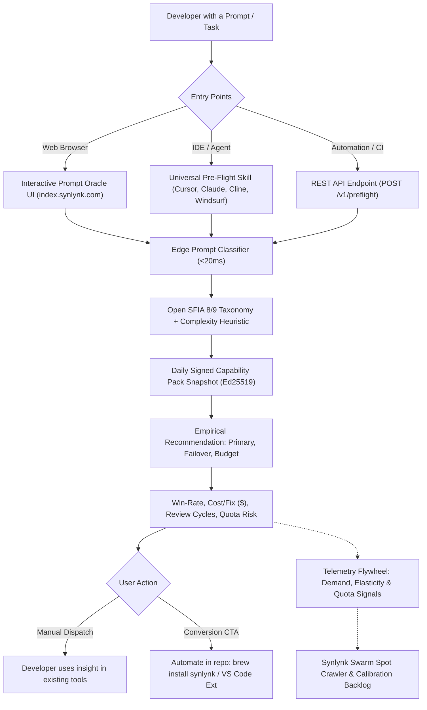
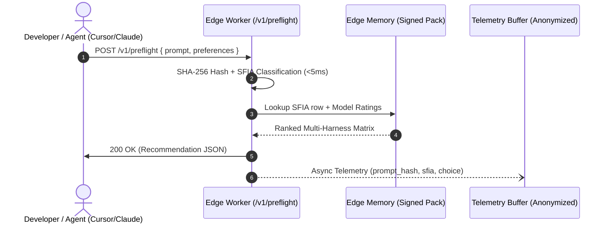
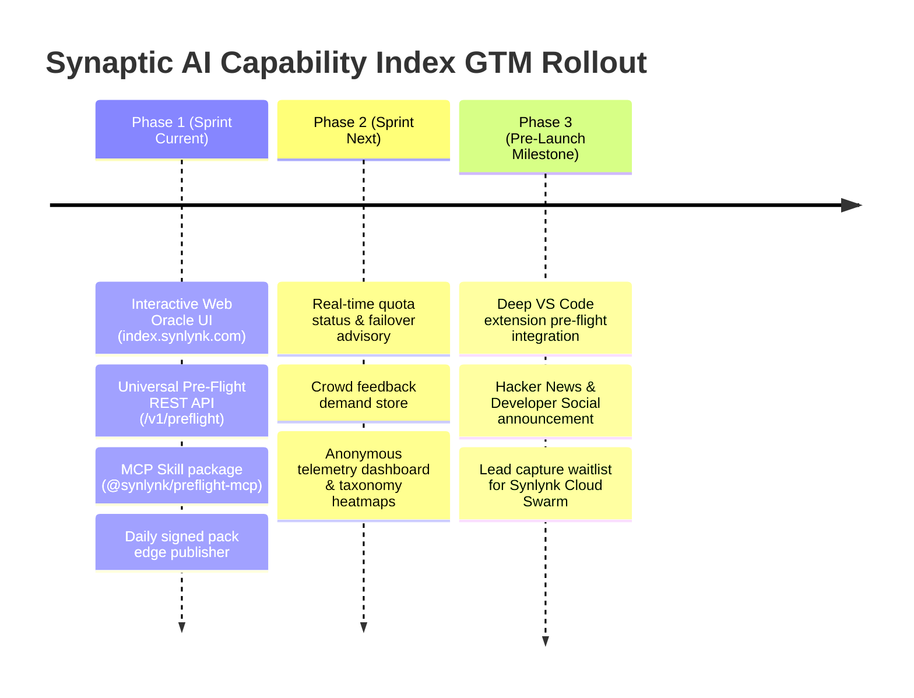

# Synaptic AI Capability Index: Standalone Public Service, Interactive Prompt Oracle, and Universal Pre-Flight Routing API

**Design Specification · GOVERNS Goal: `goal-20bb3987` · Story: `story-5eecdf01`**  
**Parent Goal:** `goal-aa48c456` (Keep the capability & cost metric real)  
**Parent GitHub Tracking Issue:** [#2431](https://github.com/nikhilsoman/synlynk/issues/2431)  
**Authors:** Synlynk Architecture Working Group, Product & GTM Strategy  
**Date:** 2026-10-19  
**Status:** Approved by Decide Panel (`dec-aee26f54`)

---

## 1. Executive Summary & GTM Thesis

### 1.1 The Developer Dilemma & High-Friction Adoption Barrier
The generative AI ecosystem has inundated software developers, engineering leads, and technical founders with dozens of rapidly shifting model variants (OpenAI GPT-4o/o3/Codex, Anthropic Claude 3.5/3.7/Fable, Google Gemini 2.0/Flash/Pro, xAI Grok 4.5/4.6, Meta Llama 3/Muse, and on-device oMLX models). Every release makes aggressive claims of superior benchmarks (SWE-bench, Chatbot Arena, HumanEval). 

Yet in day-to-day multi-agent engineering workflows, developers face two immediate, unaddressed pain points:
1. **The Tactical Routing Dilemma:** *"For this specific task (e.g., refactoring a legacy ORM, writing unit test suites with mocks, building glassmorphic CSS, or debugging race conditions), which harness and model actually produces verified, review-ready code with the fewest iterations and lowest cost?"*
2. **The Portfolio & Economic Dilemma:** *"Which subscriptions ($20/mo individual vs. $200/mo enterprise vs. direct API tokens) yield the highest empirical ROI without stranding developers on weekly quota cliffs?"*

Historically, autonomous developer platforms (including Synlynk) demand substantial upfront trust and configuration: granting repository write permissions, running local CLIs, managing API keys, configuring worktrees, and adopting new workflow disciplines. This creates high adoption friction.

### 1.2 The GTM Trojan Horse: Zero-Friction Public Utility
The **Synaptic AI Capability Index** decouples Synlynk’s empirical capability and cost intelligence from full workspace installation. By pre-launching the index as an independent, publicly accessible service (`index.synlynk.com`), Synlynk delivers immediate value to developers with **zero repository access, zero API keys, and zero setup time**:



This establishes Synlynk as the undisputed **empirical benchmark authority** for multi-agent software engineering before general launch, while creating a high-converting acquisition flywheel.

---

## 2. Interactive Prompt Oracle (`index.synlynk.com`)

### 2.1 User Experience & Interaction Design
The Prompt Oracle is designed as an ultra-fast, responsive web interface:
1. **Prompt / Task Input Box:** A clean text area supporting natural language task descriptions, GitHub issue bodies, or user stories.
2. **Instant Edge Classification:** As the user types or pastes, a lightweight client-side/edge classifier identifies the corresponding SFIA 8/9 discipline code (e.g., `PROG`, `TEST`, `REQM`, `DBDS`, `VISU`) and complexity tier (`low`, `medium`, `complex`).
3. **Multi-Vendor Recommendation Card:**
   - **Top Recommended (Balanced):** Harness + model maximizing verified fix success while minimizing cost.
   - **Quality Champion:** Highest ground-truth score regardless of price.
   - **Budget Champion:** Lowest dollar cost per completed task.
   - **Resilience / Failover Pick:** Highest availability with lowest probability of weekly quota exhaustion.
4. **Interactive Trade-Off Slider:** A 4-way preference slider allowing developers to adjust priority:
   - `Cost Efficiency` $\leftrightarrow$ `Maximum Quality / Zero Regressions` $\leftrightarrow$ `Execution Speed` $\leftrightarrow$ `Quota Protection`.
5. **Contextual Conversion Call-To-Action (CTA):**
   > *"Want your workspace to route, failover, verify, and commit these tasks automatically across all 4 harnesses?*  
   > `brew install synlynk` · [Get Synlynk for VS Code](https://marketplace.visualstudio.com/items?itemName=synlynk.synlynk-vscode)*"

### 2.2 Empirical Dimensions Displayed
Every recommendation card renders real empirical attributes derived from Synlynk's 2,700+ production task ledger:
- **Verified Fix Rate (%) & Average Quality Score (1.0–10.0):** Ground truth attested by non-authoring verifier agents.
- **Cost Per Verified Fix ($):** True blended dollar cost including prompt, reasoning, and tool tokens.
- **Median Review Cycles:** Number of QA/review rounds before clean merge.
- **Quota Health & Failover Warning:** Live probability of hitting rate limits (e.g. "Claude weekly cliff high; failover to Grok/Codex recommended").
- **Sample Provenance ($n$):** Transparent sample count ($n \ge 5$ threshold; cells under $n < 5$ marked explicitly as `Unmeasured`).

---

## 3. Universal Pre-Flight Routing API (`/v1/preflight`)

### 3.1 Architecture & Low-Latency Edge Service
The pre-flight API is hosted on Cloudflare Workers / Fastly Compute edge nodes to guarantee global response times under 20ms:
- **Zero Database Hot Path:** The edge worker holds the daily signed capability pack (`capability-pack-YYYY-MM-DD.json.gz`) in memory, validated via Ed25519 signature upon load.
- **Deterministic Hashing:** Prompts are stripped of extraneous whitespace, hashed (SHA-256), and classified into the SFIA vector.



### 3.2 Request & Response JSON Contract

#### Request (`POST /v1/preflight`):
```json
{
  "prompt": "Fix race condition in PostgreSQL connection pool during reconnection burst",
  "preferences": {
    "optimize_for": "quality",
    "budget_cap_usd": 1.00,
    "available_harnesses": ["claude", "codex", "grok", "agy", "local"]
  },
  "client": {
    "source": "cursor-extension",
    "version": "1.0.0"
  }
}
```

#### Response:
```json
{
  "task_classification": {
    "sfia_code": "PROG",
    "sfia_name": "Software Development",
    "complexity": "complex",
    "confidence": 0.94
  },
  "recommendations": {
    "primary": {
      "harness": "codex",
      "model": "gpt-5.6-terra",
      "quality_score": 9.04,
      "cost_per_verified_fix_usd": 0.52,
      "median_review_cycles": 1.1,
      "sample_size": 410,
      "failover_risk": "low"
    },
    "failover": {
      "harness": "grok",
      "model": "grok-4.6",
      "quality_score": 8.55,
      "cost_per_verified_fix_usd": 0.48,
      "median_review_cycles": 1.2,
      "sample_size": 176,
      "failover_risk": "low"
    },
    "budget": {
      "harness": "agy",
      "model": "gemini-3.8-flash",
      "quality_score": 7.58,
      "cost_per_verified_fix_usd": 0.08,
      "median_review_cycles": 1.6,
      "sample_size": 89,
      "failover_risk": "none"
    }
  },
  "quota_advisory": {
    "claude": "High risk of rate limit cliff (active weekly cooldown window); Codex or Grok recommended"
  },
  "snapshot_metadata": {
    "snapshot_id": "pack-2026-10-19-0200",
    "signature_verified": true,
    "source": "Synlynk Empirical Telemetry Ledger"
  },
  "cta": {
    "message": "Automate multi-agent routing, verification, and quota failovers in your codebase with Synlynk",
    "install_cmd": "brew install synlynk",
    "vscode_url": "https://marketplace.visualstudio.com/items?itemName=synlynk.synlynk-vscode"
  }
}
```

---

## 4. Universal Agent Skill & Model Context Protocol (MCP)

To eliminate friction in existing developer tools, the Capability Index provides a universal pre-flight skill compatible with any modern AI development environment:

### 4.1 MCP Server Integration (`@synlynk/preflight-mcp`)
A lightweight, zero-dependency MCP server exposed to Claude Desktop, Cursor, and Cline:
```json
{
  "mcpServers": {
    "synlynk-preflight": {
      "command": "npx",
      "args": ["-y", "@synlynk/preflight-mcp"]
    }
  }
}
```

### 4.2 CLI One-Liner
Developers can run a pre-flight probe directly from their terminal without installing full Synlynk:
```bash
npx synlynk-preflight "Design glassmorphic CSS theme for dashboard"
```

---

## 5. Privacy-First Security & Benchmark Integrity

### 5.1 Privacy Principles
1. **Zero Prompt Retention by Default:** Raw prompt text is processed ephemerally in edge worker memory during the request lifecycle. It is never persisted to disk, never stored in databases, and never used for model fine-tuning.
2. **Deterministic Cryptographic Hashing:** Only the one-way SHA-256 hash of the prompt and its extracted SFIA classification vector are logged for aggregate analytics.
3. **Local-Only Classification Option:** For strict enterprise environments, the pre-flight skill supports an offline local mode using an in-browser or on-device model (`local` oMLX) that sends only the anonymized SFIA code to the API.

### 5.2 Benchmark Credibility & Anti-Manipulation
1. **No Unverified Crowd Writes:** Crowd interactions and self-reported ratings land in an isolated demand store. They **never** modify the canonical `quality` or `quality_verified` ratings in the published capability pack.
2. **Real PR Verification Ground Truth:** The capability index is strictly derived from verified multi-agent pull request outcomes in real repositories, authenticated by Ed25519 cryptographic signatures.
3. **Sample Floor Protection ($n \ge 5$):** Any harness/model cell with fewer than 5 verified tasks is displayed with an unmeasured badge, maintaining strict statistical rigor.

---

## 6. Telemetry & Strategic Feedback Flywheel

User interactions with the public index generate unmatched strategic signals that directly refine Synlynk's core engine:

| Captured Signal | What It Measures | Impact on Synlynk Core Engine |
| :--- | :--- | :--- |
| **Prompt Taxonomy Distribution** | Percentage breakdown of real tasks across SFIA codes (e.g. 35% `PROG`, 25% `TEST`, 15% `GRAP`, 10% `DBDS`). | Informs priority weighting for the public repo Swarm crawler and test suite generation. |
| **Price vs. Quality Elasticity** | Position of user slider toggles across tasks. | Calibrates default fleet scheduling algorithms (`synlynk dispatch --auto-route`). |
| **Uncalibrated Model Demand** | Frequency of prompts explicitly targeting models not yet in the fleet matrix. | Auto-populates the model onboarding queue in `state.db`. |
| **Crowd Quota Failover Signals** | Real-time spikes in crowd reports of rate limits / provider downtime. | Ingests live failover hints into `quota_snapshots` for proactive routing around outages. |
| **Conversion Funnel Metrics** | Click-through rates on VS Code extension links and CLI installation commands. | Measures developer intent and validates messaging for the upcoming general release. |

---

## 7. Phased Implementation Roadmap



### Phase 1: MVP Public Service & Skill (Target: 7 Days)
- Build responsive single-page Prompt Oracle UI (`website/index-oracle/`).
- Deploy Cloudflare Worker edge API (`POST /v1/preflight`).
- Publish universal MCP tool (`@synlynk/preflight-mcp`).
- Link live daily export of `synlynk capability report` signed definition pack.

### Phase 2: Live Quota Intelligence & Crowd Demand Store (Target: 14 Days)
- Integrate crowd-reported quota limit signals into live failover advisories.
- Build anonymized telemetry aggregator tracking SFIA prompt demand curves.
- Connect demand queue directly to Swarm Spot Crawler backlog.

### Phase 3: General Pre-Launch Campaign (Target: General GA)
- Publish technical launch post ("The Empirical AI Coding Index: Which Model Really Writes Better Code?").
- Integrate pre-flight routing natively into the Synlynk VS Code client.
- Activate developer waitlist for private Synlynk Swarm beta.
