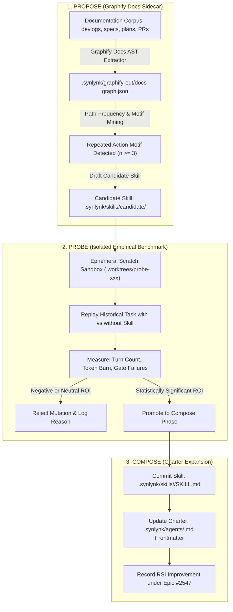

# Design Specification: Workspace Ceremonies Canon & Harness² Recursive Skill Synthesis

**Status:** Proposed  
**Date:** 2026-10-28  
**Author:** Agy (Home Conductor) & Nikhil Soman  
**Governing Goal:** `goal-a222b393` (*Agent Charter Framework: Composable Roles, Capabilities & Autonomous Persona Evolution*)  
**Associated Goals:** `goal-34c225e1` (*Docs Graph Sidecar*), `goal-eacab0dc` (*Universal GOVERNS Enforcement*), `goal-e3840370` (*Vizor Control Plane*)  
**Parent Epic:** #2458 | **Milestone Epic:** #2470 | **RSI Epic:** #2547  
**Canonical Implementation Reference:** `docs/process/release-implementation-protocol.md`  

---

## 1. Executive Summary & Philosophy

In human engineering teams, operational standards are not static dogma handed down from on high—they are **ceremonies born from repeated habits**. When developers execute a recurring sequence of actions (e.g. daily standup, post-incident triage, deployment verification, release cut), they formalize it into a named ritual, assign an explicit role to lead it (e.g. Release Manager, Incident Commander), and refine it over time.

In Synlynk, **a Skill is simply an often-repeated ceremony**.

Currently, Synlynk workspaces suffer from operational prompt taxation: every conductor handoff re-transmits thousands of tokens describing the same multi-phase protocols over and over. Furthermore, because different workspaces maintain different agent fleets with different responsibilities (e.g., a high-compliance fintech backend vs. a rapid-prototyping frontend), hardcoded harness instructions fail to adapt to local realities.

This specification designs the **Workspace Ceremonies Canon & Recursive Skill Synthesis Engine** for **v0.26.9**:
1. **The Workspace Ceremonies Canon (`.synlynk/skills/`):** A workspace-tailored suite of progressive-disclosure skills generated and adapted during onboarding (`synlynk init` / `synlynk scan`) to reflect the workspace's specific agent fleet and duties.
2. **Graphify Docs Graph Sidecar (`.synlynk/graphify-out/docs-graph.json`):** A zero-cost, offline Markdown AST extractor that parses devlogs, specs, plans, decision records, and PR histories into directed action-sequence graphs.
3. **Harness² Dual-Recursion (Propose-Probe-Compose):** Incorporates Google Research's Harness² architecture ([arXiv:2610.14224](https://arxiv.org/abs/2610.14224)) to autonomously detect recurring operational workflows (*Propose*), empirically benchmark candidate skills in isolated scratch sandboxes (*Probe*), and safely bind proven ceremonies to agent role charters (*Compose*).
4. **Inaugural Reference Ceremony:** Codifies the 6-phase release lifecycle into the production reference skill `release-conductor` bound to `pm` and `tpm` roles.

---

## 2. Theoretical Grounding: Harness² & RSI (Epic #2547)

Google Research's Harness² formalizes autonomous recursive self-improvement through the 8-component tuple:

$$\mathcal{H}^2 = \langle H_{cfg}, A_{rt}, E_{sbx}, T_{spec}, C_{asm}, V_{har}, M_{eng}, T_{trk} \rangle$$

In this system, Skill Synthesis is the literal, concrete realization of the **Propose-Probe-Compose** dual-recursion loop:

1. **PROPOSE:** The Graphify Docs Sidecar crawls past markdown devlogs, plans, and commit messages. Directed path analysis discovers that a 4-step or 6-step sequence recurs frequently without an existing named skill. A candidate skill is automatically drafted with an owner role recommendation.
2. **PROBE:** Before mutating workspace charters, Synlynk spins up an isolated git worktree (`$E_{sbx}$`). The Verification Harness ($V_{har}$) replays representative tasks, verifying that the candidate skill objectively reduces turns, saves context tokens, and avoids gate failures.
3. **COMPOSE:** Upon verified empirical improvement, the Mutation Engine ($M_{eng}$) commits the new skill to `.synlynk/skills/` and updates the designated agent's charter frontmatter. Telemetry ($T_{trk}$) records the efficiency delta under Epic `#2547`.

---

## 3. Subsystem Architecture

### 3.1 The Graphify Docs Graph Sidecar (`synlynk/docs_graph.py`)
Expanding on v0.26.5's code AST graph, Graphify parses all markdown documents into a directed knowledge graph:
- **Node Kinds:**
  - `Action` (`git worktree add`, `synlynk pr check`, `pytest`, `synlynk cost log`)
  - `Gate` (`test_four_point_attribution`, `policy check-merge`, `release --check-docs`)
  - `Artifact` (`design.md`, `plan.md`, `VERSION`, `CHANGELOG.md`)
  - `Role` (`pm`, `qa`, `architect`, `dev`, `tpm`, `maintainer`)
- **Directed Edges:**
  - `FOLLOWED_BY` (temporal sequencing within a session or checklist)
  - `PERFORMED_BY` (associated executing role)
  - `VERIFIED_WITH` (action verified by a specific test gate)
  - `TARGETS_SYMBOL` (bipartite bridge connecting documentation nodes to the Code AST graph)

### 3.2 Progressive-Disclosure Skill Architecture
To eliminate prompt bloat, all synthesized ceremonies follow a 3-tier progressive disclosure model:
- **Tier 0 (Ambient Catalog - ~40 tokens):** YAML frontmatter (`name` + `description`) present in tool indices.
- **Tier 1 (Execution Protocol - ~600 tokens):** Concise, action-oriented `SKILL.md` containing numbered steps, required composite CLI commands, and failure recovery.
- **Tier 2 (Deep Reference Docs - External Links):** Comprehensive policy documents, diff templates, and markdown schemas in `docs/process/` linked via URL, read only when necessary.

---

## 4. Empirical Hypothesis Test & Benchmark Spike

To prove that the Docs Graph Sidecar can heuristically identify repeated operational ceremonies without human supervision, we author a blind validation benchmark:

### 4.1 Test Dataset
- 60 days of historical `project-docs/devlogs/*.md`
- 100+ approved specs and plans in `docs/superpowers/specs/` and `docs/superpowers/plans/`
- Git commit message logs across v0.25.x–v0.26.x

### 4.2 Benchmark Success Criteria
The benchmark script (`tests/test_ceremony_discovery_spike.py`) executes automated motif mining over the historical corpus. The hypothesis is **confirmed** if the top 3 highest-frequency discovered path motifs autonomously reconstruct:
1. **The 6-Phase Release Protocol:** (`design spec` → `plan` → `worktree add` → `TDD` → `pr check` → `policy check-merge` → `version bump` → `tag` → `status rollup`).
2. **The Sentinel Triage Ritual:** (`sentinel alert` → `reproduction test` → `doctor fix` → `verify zero alerts`).
3. **The Worktree Salvage Ceremony:** (`audit dirty worktrees` → `salvage uncommitted diffs to docs/archive/` → `git worktree prune`).

---

## 5. Milestone Stories & Execution Plan for `v0.26.9`

| Story ID | Title | Domain | Scope |
| :--- | :--- | :---: | :--- |
| **`story-docs-graph-sidecar`** | Graphify Markdown AST & Docs Graph Sidecar | Backend | Implement `synlynk scan --docs` generating `.synlynk/graphify-out/docs-graph.json` with `FOLLOWED_BY` and `PERFORMED_BY` edges. |
| **`story-ceremony-miner`** | Heuristic Ceremony Discovery & Motif Miner | ML/Analysis | Traverse docs graph warm paths to detect repeated action sequences ($n \ge 3$) and propose candidate skills + role bindings. |
| **`story-ceremony-oracle-test`** | Empirical Ceremony Discovery Benchmark Spike | Testing | Run automated motif miner on historical devlogs/specs to empirically prove discovery of Release, Sentinel, and Salvage rituals. |
| **`story-ceremony-canon`** | Workspace Ceremonies Canon & Onboarding Engine | Platform | Update `synlynk init` / `synlynk onboard` to seed workspace-tailored ceremonies into `.synlynk/skills/` and agent charters. |
| **`story-release-conductor`** | Inaugural Reference Ceremony: `release-conductor` | Architecture | Formalize the 6-phase release implementation protocol into the first production ceremony skill bound to `pm`/`tpm`. |

---

## 6. Appendix A: Inaugural Reference Ceremony — `release-conductor`

*(See full standard at `docs/process/release-implementation-protocol.md`)*

The `release-conductor` skill encapsulates:
1. **Pre-flight Invariant:** Canonical state.db registration, task lease audit (`doctor --fix leases`), and checkpointing.
2. **Design-First Governance:** Brainstorm spec and plan with four-point YAML frontmatter (`goal`, `epic`, `milestone`, `arc`) committed before code.
3. **Worktree & TDD Isolation:** Dedicated git worktree per feature, attribution trailers, sandboxed execution, and taxonomy docs sync (`generate_command_docs.py`).
4. **Non-Author Review & Merge Gate:** Mandatory review dispatch to non-authoring QA/Architect role, `synlynk pr check`, and `synlynk policy check-merge`.
5. **Version Authority Ceremony:** Dedicated release branch, `VERSION` bump, `CHANGELOG.md`, `README.md` test counts, and `roadmap.md` status flip.
6. **Post-Release Invariant & Rollup:** Ephemeral worktree pruning, post-release `doctor` verification sweep, and long-form conversational status rollups on parent issues.
