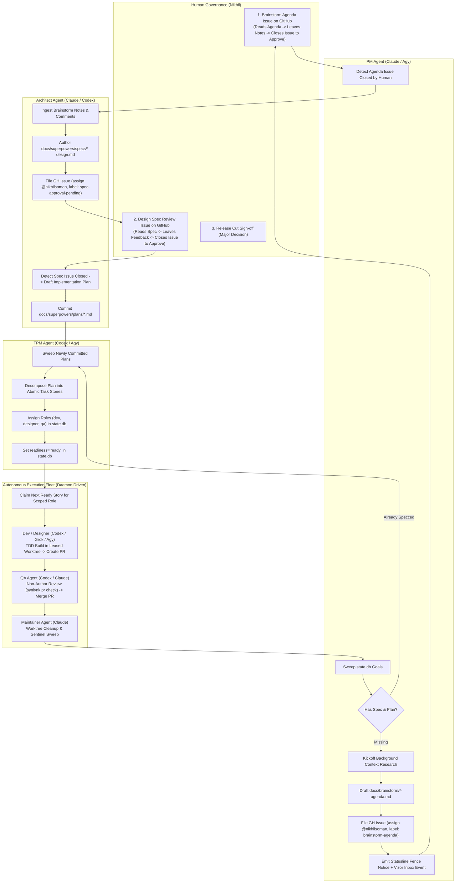

# Autonomous Workspace Agent Roles & GitHub-Centric Approval Network — Design

**Date:** 2026-11-02  
**Author:** Agy (AntiGravity CLI / Gemini)  
**Milestone:** v0.26.x closeout / v0.27.0 preparation  
**Related Epics/Issues:** #2458 (Autonomous GOVERNS SDLC), #2470 (Safe Autonomous Operations), #859 (Agent Role Charters), #2305 (Markdown-First Charters 2.0)  
**Status:** DRAFT — Pending Nikhil's formal sign-off

---

## 1. Intent & Problem Statement

Synlynk has established robust point-in-time components for agent roles (`roles.yaml`, `charters/`, `permission_profiles`), token circuit breakers, leased worktree isolation, and effect verification. However, the system currently requires interactive operator intervention to prompt each subsequent phase:
1. Active roadmap goals often lack design specs and implementation plans, remaining unaddressed until a human manually initiates a session.
2. Background autonomous runners (`tpm_sweep.py`) do not automatically dispatch ready stories according to their specific scoped roles without manual triggering.
3. Handoffs between PM (intake), Architect (design), TPM (planning/breakdown), Dev/Designer (implementation), QA (review/merge), and Maintainer (hygiene) lack a unified, asynchronous control surface.

This design establishes an **always-on, role-by-role autonomous execution network** anchored on a **GitHub-centric approval state machine**. The repo owner interacts with the fleet through standard GitHub issues, where **issue state transitions (e.g. closing an issue) serve as the deterministic approval trigger**, and issue comments provide instructions, constraints, and feedback.

---

## 2. Decision Record & Locked Constraints

Per alignment with Nikhil (2026-11-02):
1. **GitHub Assignment & Dual Surfacing:**
   * Agendas and approval tickets are assigned directly to Nikhil (`@nikhilsoman`).
   * PM concurrently emits a high-visibility task boundary fence notification in interactive CLI sessions and logs the event for the Vizor Tasks Inbox.
2. **Deterministic Issue State Trigger:**
   * Human approval is strictly triggered by **GitHub Issue state change (Issue Closed)**, providing an unambiguous, audit-trailed gate.
   * Comments on the issue are parsed for operator feedback, modification directives, and refinement context to be injected into downstream agent prompts.
3. **Brainstorm-First Invariant:**
   * No code is written without a committed plan.
   * No plan is written without an approved spec.
   * No spec is drafted without an aligned brainstorm agenda.
4. **Merge Authority Separation:**
   * Merging is restricted exclusively to the `qa` role (`can_merge: ["qa"]` in `.synlynk/policy.json`). Authors cannot merge their own PRs.

---

## 3. Architecture & End-to-End Role Lifecycle



---

## 4. Subsystem Specifications

### 4.1. PM Goal Sweeper & Brainstorm Agenda Generator (`synlynk/pm_sweep.py`)
* **Cadence:** Executes on every daemon autonomous loop tick (every 60 seconds).
* **Scan Logic:**
  1. Queries all active goals from `goals` table where `status = 'active'`.
  2. For each goal:
     * Validates whether an associated spec exists in `docs/superpowers/specs/` matching the goal slug or referencing `<!-- goal:<goal_id> -->`.
     * Validates whether an associated plan exists in `docs/superpowers/plans/`.
  3. If missing:
     * Checks if an open agenda ticket already exists in `approval_tickets` table for `action='goal_brainstorm'` to avoid duplicate issue creation.
     * If none exists, runs an unbuffered background research probe (`synlynk/agent_store.py`) to gather codebase symbols, relevant docs, and dependencies.
     * Authors `docs/brainstorm/YYYY-MM-DD-<goal-slug>-agenda.md`.
     * Calls `synlynk gh` to create a GitHub issue:
       * **Title:** `[Brainstorm] Agenda: <Goal Outcome>`
       * **Body:** Formatted brief referencing the agenda file, listing key trade-offs, and specifying:
         > *"To approve this agenda and trigger Architect spec drafting, review any open questions, leave directives in comments, and **close this issue**."*
       * **Assignee:** `@nikhilsoman`
       * **Labels:** `brainstorm-agenda`, `pm-intake`
     * Inserts ticket record into `approval_tickets` with `status='open'`.
     * Emits a task boundary fence message to terminal stdout and records a notification in `.synlynk/viz-inbox.json`.

### 4.2. GitHub State-Driven Approval Oracle (`synlynk/approval_gate.py`)
* **Polling Protocol:**
  * Uses `synlynk gh` under role identity `synlynk-bot` or host auth to inspect open approval issues.
  * Queries `gh issue view <issue-id> --json state,comments,closedAt`.
* **State Transition Rules:**
  * **Approved:** If `state == "CLOSED"`, the gate marks the ticket `resolved` in `approval_tickets`.
  * **Feedback Extraction:** All comments posted on the issue prior to closure are extracted, cleaned, and stored in `approval_tickets.resolution_context`.
  * **Rejection / Cancellation:** If the issue is closed with label `wontfix` or explicit comment `/reject`, the ticket is marked `cancelled` and the goal is parked.

### 4.3. Architect Spec & Plan Generation
* When an agenda ticket resolves:
  1. Daemon triggers `architect` role with prompt containing:
     * Path to `docs/brainstorm/YYYY-MM-DD-<goal-slug>-agenda.md`.
     * Operator comments and feedback extracted from the closed issue.
  2. Architect generates `docs/superpowers/specs/YYYY-MM-DD-<topic>-design.md`.
  3. Architect commits the spec to branch `docs/architect/<topic>-spec` and raises a GitHub Spec Approval Issue:
     * **Title:** `[Spec Review] <Topic> Design Spec`
     * **Assignee:** `@nikhilsoman`
     * **Labels:** `spec-approval-pending`, `architect`
     * **Body:** Spec summary, invariant contracts, diff link, and sign-off instructions (*"Close issue to approve"*).
  4. Upon spec issue closure by Nikhil:
     * Architect is triggered to produce `docs/superpowers/plans/YYYY-MM-DD-<topic>.md`.
     * Commits the implementation plan directly to the tracking branch.

### 4.4. TPM Plan Decomposition & Story Provisioning
* Once an implementation plan is committed:
  1. TPM parses the markdown checkboxes (`- [ ] Task N: ...`).
  2. Creates corresponding rows in `stories` table:
     * `story_id`: Generated deterministic hash.
     * `title`: Extracted task title.
     * `goal_id`: Parent goal ID.
     * `role`: Assigned by task classification (`dev` for backend/logic, `designer` for CSS/templates, `qa` for verification).
     * `readiness`: Set to `'ready'`.
     * `phase`: Linked roadmap phase.

### 4.5. Fully Autonomous Multi-Agent Worker Loop (`synlynk/tpm_sweep.py`)
* The worker sweep scans for stories with `readiness = 'ready'` and dispatches without waiting for an interactive CLI session:
  1. **Claiming:** Sets active claim lock in `.synlynk/active_claims.json` and transitions story status to `in_progress`.
  2. **Worktree Provisioning:** Spawns an isolated git worktree via `worktree_lease.py`.
  3. **Role-Harness Dispatch:**
     * `dev` -> `codex` (default) or `grok` (infra/canvas).
     * `designer` -> `agy` (CSS/HTML).
  4. **Verification & PR Creation:**
     * Dispatched worker executes code changes and runs unit tests.
     * If tests pass, pushes branch `feat/<role>/<story-id>` and opens a pull request.
     * Handoff: Updates story role to `qa` and flags PR for review.
  5. **QA Review & Merge:**
     * `qa` agent (running on `claude` or `codex`) checks out the PR in a dedicated review worktree.
     * Runs `synlynk pr check` (ensuring non-authoring and cross-harness review constraints).
     * Posts formal approval review (`gh pr review --approve`).
     * Executes `gh pr merge --squash` under `merge_authority`.
  6. **Maintainer Closeout:**
     * Cleans up the PR worktree.
     * Syncs project documentation ledgers.
     * Records telemetry in `state.db`.

---

## 5. State Machine & Schema Updates

### 5.1. `approval_tickets` Table Schema (existing, verified sufficient)
```sql
CREATE TABLE IF NOT EXISTS approval_tickets (
    id INTEGER PRIMARY KEY AUTOINCREMENT,
    story_id TEXT,
    action TEXT,
    issue_url TEXT,
    status TEXT, -- 'open', 'resolved', 'cancelled'
    resolution_context TEXT, -- JSON holding human comments / directives
    created_at TIMESTAMP DEFAULT CURRENT_TIMESTAMP,
    resolved_at TIMESTAMP
);
```

### 5.2. New Event Types in `synlynk/events.py`
* `brainstorm_agenda_raised`: Fired when PM publishes a brainstorming issue.
* `brainstorm_approved`: Fired when Nikhil closes the brainstorming issue.
* `spec_review_raised`: Fired when Architect publishes a design spec review issue.
* `spec_approved`: Fired when Nikhil closes the spec review issue.
* `plan_decomposed`: Fired when TPM populates ready stories from an approved plan.

---

## 6. Implementation Stages & Verification Contracts

### Stage 1: PM Goal Sweeper & Brainstorm Agenda (`synlynk/pm_sweep.py`)
* Implement goal inspection against `docs/superpowers/specs/`.
* Implement agenda formatting and GitHub issue creation via `gh_role.py`.
* **Contract:** Running `synlynk goal sweep` in a repo with an unspecced goal creates the agenda markdown file and files a GitHub issue assigned to `@nikhilsoman`.

### Stage 2: GitHub State Oracle (`synlynk/approval_gate.py`)
* Implement issue closure polling and comment extraction.
* **Contract:** Given an open approval ticket, closing the issue on GitHub causes `check_approval_tickets()` to mark the ticket `resolved` and return the comments.

### Stage 3: Architect & TPM Pipeline Integration
* Wire agenda ticket resolution to Architect spec dispatch.
* Wire spec ticket resolution to TPM plan decomposition.
* **Contract:** Closing a brainstorm issue automatically queues the Architect spec job; closing the spec issue automatically populates ready stories in `state.db`.

### Stage 4: Daemon Autonomous Loop Integration (`synlynk/daemon.py`)
* Wire `pm_sweep` and `poll_github_approval_tickets` into `_run_autonomous_loop_tick()`.
* Ensure end-to-end execution without manual interactive commands.
* **Contract:** An end-to-end test (`tests/test_autonomous_sdlc_loop.py`) verifying the complete autonomous cycle from goal to merged PR.

---

## 7. Review & Sign-Off

* **Author:** Agy (AntiGravity CLI / Gemini)
* **Target PR:** `feat/agy/autonomous-roles-github-approvals`
* **Sign-off Required:** Nikhil Soman (@nikhilsoman)
