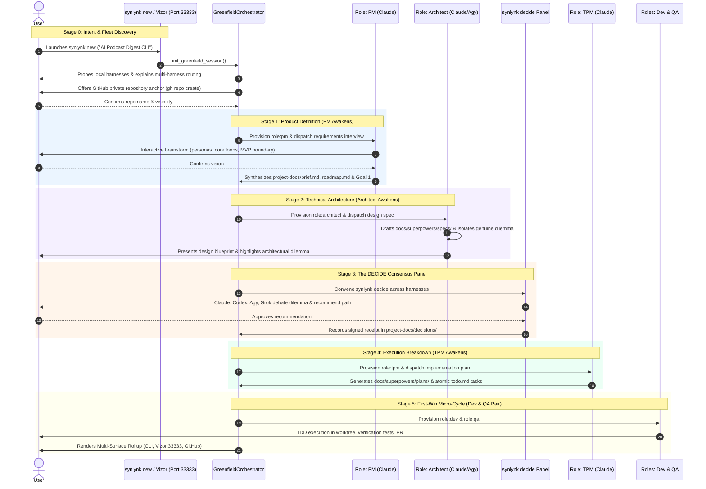
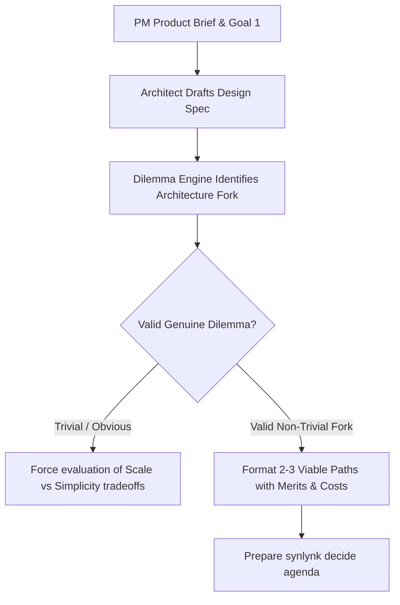
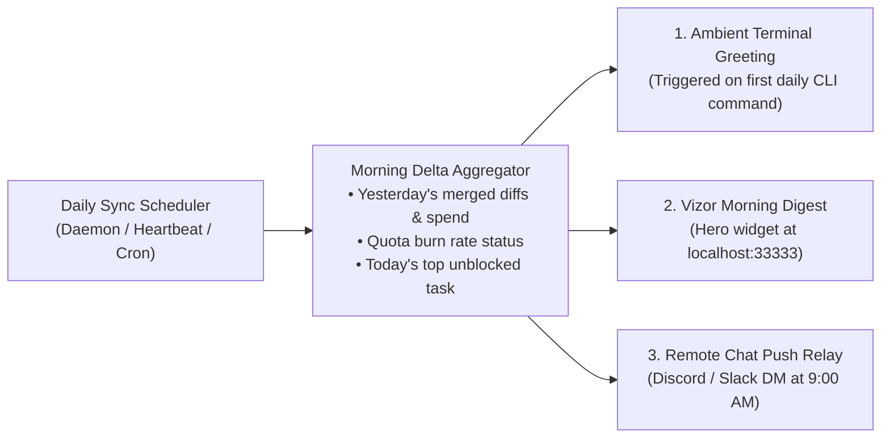

# Greenfield Guided Onboarding & Progressive Fleet Assembly Engine

## 1. Executive Summary & Intent

Existing Synlynk onboarding pathways (`synlynk quickstart`, `synlynk start`, and the 10-stage headless FTUE state machine) are structurally **brownfield-biased**. They assume an existing code repository to discover, score, and group—inspecting manifest files (`package.json`, `Cargo.toml`), counting git commits, and scanning directory topology.

For a developer starting with a **greenfield idea from scratch**, there is no topology to discover. Dropping a greenfield user into dependency matrices or prompting them to dispatch an arbitrary task on an empty directory introduces cognitive friction, bypassing the strategic core of the platform: **product definition, architecture design, and governance-driven execution**.

This design introduces the **Greenfield Guided Onboarding & Progressive Fleet Assembly Engine** (`synlynk new` / `synlynk start --guided`). Rather than a static checklist, Greenfield onboarding is an interactive **Genesis Cycle**:
1. **Fleet Discovery & Education:** Demonstrates the asymmetric advantages of running multiple specialized AI harnesses (Claude, Codex, Agy, Grok) and explains how capability ratings and cost routing optimize throughput.
2. **Progressive Role Awakening:** As the project takes shape, specialized agents awaken sequentially:
   - **`role:pm`** synthesizes user intent into a product brief and `Goal 1`.
   - **`role:architect`** produces a system design spec and identifies a **genuine, non-trivial architectural dilemma**.
   - **`synlynk decide` panel** convenes across harnesses (Claude, Codex, Agy, Grok) to debate the dilemma live and record a formal signed decision.
   - **`role:tpm`** breaks the approved spec into an atomic implementation plan and `todo.md` tasks.
   - **`role:dev` and `role:qa`** execute a test-driven, non-author-verified First-Win micro-cycle in an isolated worktree.
3. **Universal Fast-Forward:** Developers can trigger `[Fast Forward]` at any point after vision confirmation, autonomously completing planning and rendering a multi-surface rollup across CLI, Vizor (`http://localhost:33333`), and GitHub.
4. **Multi-Channel Daily Sync:** Sustains user engagement by delivering a hybrid morning briefing across the ambient terminal greeting, Vizor digest card, and Discord/Slack push DMs.

---

## 2. Problem Statement: Brownfield-Biased vs. Greenfield Reality

| Dimension | Current Brownfield FTUE | Greenfield Reality |
|:---|:---|:---|
| **Entry State** | Existing repo with code, tests, and git history | Blank directory, 0 commits, unformed concept |
| **Discovery Step** | Scans filesystem boundaries, manifests, and monorepo roots | Fails or returns meaningless empty topology |
| **User Mindset** | "How does Synlynk integrate into my existing project?" | "Help me design, architect, and build my new idea" |
| **Fleet Exposure** | All roles presented simultaneously in abstract documentation | High cognitive load; roles feel redundant or theoretical |
| **Immediate Need** | Safe, isolated testing against existing code | Ideation, tech stack selection, and tradeoff resolution |

---

## 3. The Progressive Fleet Awakening Lifecycle

The engine guides the developer through 6 discrete stages, awakening roles on-demand:



---

## 4. Stage 0: Fleet Discovery & Asymmetric Multi-Harness Routing

Before code is written, the engine probes installed CLIs (`claude`, `codex`, `agy`, `grok`, `local/oMLX`) and introduces the developer to Synlynk's core operating thesis:

```
┌─────────────────────────────────────────────────────────────────────────────┐
│ ⚡ Synlynk Fleet Discovery: Probing your development environment...          │
│                                                                             │
│   • Claude CLI   [Anthropic]  ──► Found ✓  (Role: PM / System Architect)     │
│   • Codex CLI    [OpenAI]     ──► Found ✓  (Role: Dev / Refactoring)        │
│   • Agy CLI      [Google/Gemini]─► Found ✓ (Role: QA / High-Context Docs)   │
│   • Grok CLI     [xAI]        ──► Found ✓  (Role: Fast Canvas / Infra)       │
│   • Local Models [oMLX/Llama] ──► Not detected (Optional: Zero-cost tasks)  │
└─────────────────────────────────────────────────────────────────────────────┘
```

### 4.1 The Three Asymmetric Advantages
1. **Domain Specialization:** No single model excels across every software discipline:
   - **Claude:** Optimal for strategic requirement elicitation, nuance in product trade-offs, and system-level architecture design.
   - **Codex:** Optimal for surgical code generation, strict typing contracts, and test implementations.
   - **Agy (Gemini):** Optimal for large-context documentation synthesis, cross-file verification, and compliance auditing.
   - **Grok:** Optimal for real-time ecosystem intelligence, infrastructure scripting, and high-throughput execution.
2. **True Non-Author Governance:** When the same model implements code and verifies its own PR, self-confirmation bias causes hallucinations to slip through. Synlynk enforces that `dev` (implementer) and `qa` (reviewer) run on **separate harnesses**.
3. **Dynamic Capability & Cost Routing (More Work, Lower Cost):**
   - Synlynk tracks empirical capability ratings (`capability_ratings` table in `state.db`) alongside token burn rates.
   - High-volume, low-risk operations (lint audits, test runs, markdown documentation) route to cost-efficient models (Agy/Gemini Flash or local oMLX) at near-zero cost.
   - High-stakes architectural pivots route to frontier models (Claude Opus/Sonnet, OpenAI o1/Codex).
   - Results are logged transparently to `project-docs/costs.md`.

---

## 5. Stage 1: Intent Capture, GitHub Private Anchor & PM Awakening

### 5.1 Intent Capture
The user provides their raw project thesis:
```bash
$ synlynk new
What would you like to build? An AI podcast digest CLI that fetches RSS feeds, transcribes audio with Whisper, and generates structured executive summaries.
```

### 5.2 GitHub Private Repository Anchor
Establishing an early GitHub repository instills commitment and enables authentic multi-agent collaboration:
1. Prompts: *"Would you like to initialize a private GitHub repository for this project? [Y/n]"*.
2. Executes: `gh repo create <repo-name> --private --source=. --remote=origin`.
3. Auto-provisions GitHub App bot credentials (`syn-{owner}-{repo}-pm`, `syn-{owner}-{repo}-dev`, `syn-{owner}-{repo}-qa`) in `.synlynk/github_apps/` with `0600` permissions.

### 5.3 PM Awakening (`role:pm`)
The PM engages in a concise, multi-turn interview:
- **Target Audience:** Who is using this CLI and what is their primary terminal environment?
- **Core Loop:** What is the primary single command? (e.g., `podcast digest <feed-url>`).
- **Milestone 1 Scope Boundary:** What features are deferred to v2? (e.g. streaming audio playback, speaker diarization).
- **Generated Artifacts:**
  - `project-docs/brief.md`: Executive problem statement and user personas.
  - `project-docs/roadmap.md`: Strategic Arc (`Arc 1: Core Digest Engine`) and `Goal 1` registered in `state.db`.

---

## 6. Stage 2: Architect Awakening & The Genuine Dilemma Engine

With the product scope established, `role:architect` awakens to produce the technical architecture spec.

### 6.1 The Dilemma Isolation Contract
To demonstrate why engineering governance matters, the Architect is prompted with a strict constraint:
> **"Identify one genuine, non-trivial engineering fork inherent in this system. It must NOT have an obvious answer. Both options must have legitimate technical trade-offs regarding storage, latency, reliability, or complexity."**



### 6.2 Dilemma Archetypes by Project Category
- **CLI Utilities:** SQLite WAL embedded ledger vs. Flat JSON/YAML dotfiles (Query power & crash recovery vs. zero-dependency git readability).
- **Backend Services:** Asynchronous NATS/Redis queue vs. In-process multi-worker queue (Infinite scale vs. single-node operational simplicity).
- **Data/Media Apps:** Local chunked filesystem cache with SHA-256 manifests vs. Cloud object storage with pre-signed URLs (Offline velocity vs. team synchronicity).
- **AI Agent Systems:** Out-of-process subprocess sandboxing vs. In-memory async worker pool (Security isolation & leak immunity vs. IPC overhead).

---

## 7. Stage 3: The DECIDE Consensus Panel & Decision Receipt

The Dilemma Engine hands off to `synlynk decide`, convening the multi-agent consensus panel:

```
┌─────────────────────────────────────────────────────────────────────────────┐
│ ⚖️ synlynk decide: Deliberating Architectural Dilemma                       │
│ Topic: Local Transcription Cache Architecture (SQLite vs Content-Addressed)  │
│                                                                             │
│ [Claude - Architect]  "Recommend SQLite WAL: enables structured indexing    │
│                        and transactional crash safety during large downloads"│
│ [Codex - Dev]         "Agreed: SQLite sqlite3 standard library has zero     │
│                        external pip dependencies, keeping packaging clean"   │
│ [Agy - QA]            "Deterministic testing is simpler with SQLite testbed;│
│                        in-memory :memory: databases allow sub-second tests" │
│ [Grok - Infra]        "Low write contention expected; WAL mode prevents any │
│                        read locks during transcription playback"             │
│                                                                             │
│ ─────────────────────────────────────────────────────────────────────────── │
│ PANEL CONSENSUS: Option A (Embedded SQLite WAL Storage) — 4-0 Approved     │
│ [Enter] Accept Recommendation · [O] Override with Option B                  │
└─────────────────────────────────────────────────────────────────────────────┘
```

### 7.1 Decision Receipt Protocol
Upon user approval, the engine commits an immutable decision artifact:
- **Path:** `project-docs/decisions/YYYY-MM-DD-<topic>.md` (e.g., `dec-b472e91a`).
- **Trailer:** Signed with model IDs (`claude-3-5-sonnet`, `codex-davinci`, `gemini-1.5-pro`, `grok-2`).
- **State DB Link:** Registered in `state.db` under `decisions` and cross-linked to `Goal 1`.

---

## 8. Stage 4: TPM Awakening & Atomic Execution Breakdown

With architecture approved and the dilemma resolved, `role:tpm` awakens to operationalize the build:
1. **Implementation Plan:** Drafts `docs/superpowers/plans/YYYY-MM-DD-<topic>.md` specifying step-by-step code changes, test suites, and expected outputs.
2. **Work Breakdown Structure:** Seeds `project-docs/todo.md` with atomic, dependency-ordered tasks tagged with target roles:
   - Task 1: Initialize Python CLI skeleton and entrypoint `podcast` [dev]
   - Task 2: Implement SQLite cache schema and migration [dev]
   - Task 3: Feed ingestion & RSS parser with verification fixtures [dev]
   - Task 4: Audio chunker and Whisper API wrapper [dev]
   - Task 5: End-to-end integration test suite and error contracts [qa]

---

## 9. Stage 5: Dev & QA Awakening & First-Win Micro-Cycle

To complete the onboarding orientation, `role:dev` and `role:qa` execute the first atomic task live:
1. **Isolated Worktree:** Creates a dedicated branch and directory (`.worktrees/feat-dev-scaffold`).
2. **Test-Driven Implementation (TDD):** Dev writes unit test contracts *before* writing application logic.
3. **Execution & CI Verification:** Runs tests locally and verifies green passes.
4. **Non-Author QA Review:** `role:qa` inspects the diff using `synlynk pr check`, verifies invariants, and runs `synlynk policy check-merge --role qa`.
5. **Clean Merge:** Merges PR #1 to `main` with commit trailers:
   `Co-Authored-By: Codex <noreply@openai.com>`
   `Co-Authored-By: AGY <noreply@antigravity.dev>`

---

## 10. Universal Fast-Forward & Visual Rollup Engine

At any point after Stage 1 (Product Vision Confirmation), the user can toggle **Fast-Forward**:

```
[Enter] Continue Guided Step-by-Step · [F] Fast-Forward to Working Code
```

### 10.1 Autonomous Execution Under Fast-Forward
When `[F]` is pressed:
- The Architect completes the spec using best-practice conventions.
- The DECIDE panel deliberates autonomously, adopts the consensus recommendation, and writes the decision receipt.
- The TPM decomposes the plan into `todo.md`.
- Dev and QA implement, test, and merge Task 1.

### 10.2 The Multi-Surface Rollup Card
Upon completion, the user receives an integrated multi-surface summary:

```
┌─────────────────────────────────────────────────────────────────────────────┐
│ 🚀 PROJECT GENESIS COMPLETE                                                  │
│                                                                             │
│ • Local Workspace:   /Users/username/dev/podcast-digest (branch: main)      │
│ • GitHub Repository: https://github.com/my-org/podcast-digest               │
│ • Vizor HUD (Local): http://localhost:33333/overview                        │
│                                                                             │
│ 📁 Generated Governance Artifacts:                                          │
│   ├── project-docs/brief.md        (Product Thesis & Scope)                 │
│   ├── project-docs/roadmap.md      (Arc 1 & Goal 1)                         │
│   ├── project-docs/todo.md         (5 Execution Tasks)                      │
│   ├── docs/superpowers/specs/      (System Design Spec)                     │
│   └── project-docs/decisions/      (Signed Decision dec-b472e91a)           │
│                                                                             │
│ ⚡ Next Step: Run 'synlynk dispatch' or open Vizor to start Task 2!         │
└─────────────────────────────────────────────────────────────────────────────┘
```

---

## 11. Multi-Channel Daily Sync Engine (Keeping Users Coming Back)

To ensure sustained daily momentum, Synlynk establishes a **hybrid morning standup across all enabled channels**:



### 11.1 Channel 1: Ambient Terminal Greeting
Runs automatically on the user's first terminal session of the day:
```bash
$ synlynk status
☕ Good morning! Synlynk Daily Sync — Nov 5, 2026
──────────────────────────────────────────────────────────────────────
• Yesterday: Shipped Task 1 (CLI skeleton + SQLite schema). Burn: $0.24.
• Up Next:   Story-c821 "RSS Feed Ingestion" is ready for dispatch.
• Action:    Run 'synlynk dispatch' to start today's work.
```

### 11.2 Channel 2: Vizor Morning Digest Widget
At `http://localhost:33333`:
- Highlights overnight progress and active worktrees.
- Displays token spend against daily quota.
- Provides a prominent 1-click button: `[ Dispatch Next: Story-c821 ]`.

### 11.3 Channel 3: Remote Push Relay (Discord / Slack)
Leverages the Companion v2.1 bridge:
- Delivered at the user's preferred standup hour (default: 9:00 AM local time).
- Rich Embed with interactive action buttons: `[Approve Next Task]`, `[View in Vizor]`, `[Pause Autonomous Runs]`.

---

## 12. Persistence Model & Schema (`state.db`)

Genesis session state is tracked in SQLite table `greenfield_sessions`:

```sql
CREATE TABLE IF NOT EXISTS greenfield_sessions (
    session_id TEXT PRIMARY KEY,
    project_name TEXT NOT NULL,
    raw_intent TEXT NOT NULL,
    github_repo TEXT,
    current_stage TEXT NOT NULL,        -- 'S0_FLEET', 'S1_PM', 'S2_ARCH', 'S3_DECIDE', 'S4_TPM', 'S5_DEV_QA', 'COMPLETED'
    fast_forwarded INTEGER DEFAULT 0,
    dilemma_topic TEXT,
    dilemma_decision_id TEXT,
    daily_sync_channels TEXT,          -- JSON list: ["cli", "vizor", "discord"]
    daily_sync_hour INTEGER DEFAULT 9,
    created_at REAL NOT NULL,
    updated_at REAL NOT NULL,
    completed_at REAL
);
```

---

## 13. CLI Surface & Flags

```bash
# Start interactive greenfield genesis wizard
synlynk new

# Start greenfield genesis with pre-supplied intent prompt
synlynk new "Build a real-time markdown synchronization CLI"

# Fast-track genesis to working scaffold
synlynk new "Build a real-time markdown sync CLI" --fast-forward

# Global toggle for guided mode during routine execution
synlynk config set guided_mode true|false

# Manually trigger or preview the Daily Sync briefing
synlynk sync
```

---

## 14. Compatibility & Safety Invariants

1. **Strictly Non-Destructive:** If launched in a directory with existing uncommitted files, `synlynk new` fails closed and redirects to `synlynk init` (brownfield).
2. **Canonical Vizor Port Authority:** All UI links strictly bind to `http://localhost:33333` per `synlynk/viz/constants.py`.
3. **Fail-Safe Fast-Forward:** Fast-forwarding never skips test execution or non-author QA verification; it only automates consensus approvals using panel majorities.
4. **Dual-Skin Parity:** The entire flow emits structured JSON events consumed identically by the terminal TUI and the Vizor browser UI.

---

## 15. Testing & Verification Matrix

- `tests/test_greenfield_orchestrator.py`: Unit tests verifying session creation, stage transitions, and fast-forward completion.
- `tests/test_greenfield_dilemma_engine.py`: Tests that the Dilemma Engine extracts non-trivial forks and properly invokes `synlynk decide`.
- `tests/test_greenfield_daily_sync.py`: Verifies morning standup aggregation logic across CLI formatters, Vizor JSON endpoints, and Discord embeds.
- `tests/test_greenfield_e2e.py`: End-to-end integration test creating a temporary git repository, executing the 6-stage lifecycle, and verifying PR #1 merge.
