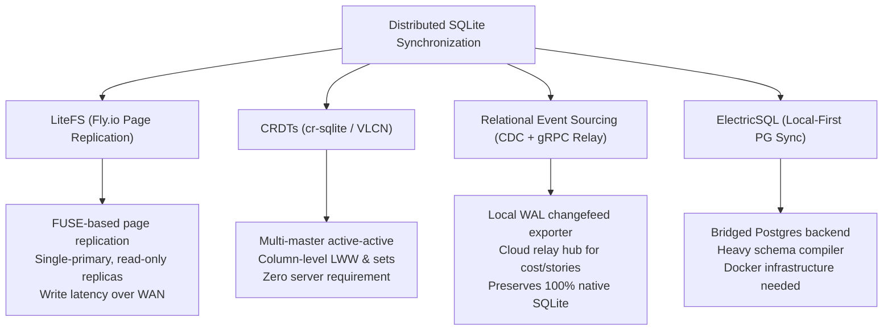

# Architectural Research: Distributed state.db Synchronization Protocols and Enterprise Cost Aggregation

## 1. Executive Summary & Problem Formulation

Synlynk’s architectural backbone is a local-first SQLite relational database (`state.db`), which serves as the canonical source of truth for:
- Story task states, roles, and readiness (`stories` table)
- GOVERNS lifecycle goals and phases (`goals`, `phases` tables)
- Empirical harness capability ratings and quality scores (`capability_ratings` table)
- Granular token usage, estimated costs, and actual billing metrics (`cost_entries` table)
- Sentinel health alerts and operational incident logs (`sentinel_alerts` table)

In single-developer environments, SQLite WAL mode provides unbeatable ergonomics: sub-millisecond reads/writes, zero operational infrastructure, and seamless offline execution. 

However, as Synlynk expands into **team and enterprise multi-agent workflows**, local-only state creates severe operational friction:

1. **Siloed Team State & Fragmented Backlogs:**
   Each developer machine maintains an isolated `state.db`. If Developer A dispatches an agent to solve a bug on branch `feat/a`, Developer B cannot see active story claims or in-flight job reservations, risking duplicate work and split-brain planning.
2. **Enterprise FinOps Blind Spot:**
   Enterprise engineering leadership requires centralized visibility into cumulative AI expenditure across harnesses (Claude, OpenAI, Gemini, Grok). Currently, aggregating costs requires scraping scattered `costs.md` git diffs across dozens of pull requests.
3. **Capability Calibration Data Scarcity:**
   Harness capability scoring requires empirical sample sizes ($n \ge 5$) per task type. When scores are isolated to individual laptops, individual developers struggle to accumulate enough samples to optimize model-aware routing, whereas a team-wide shared ledger could calibrate the optimal model family in hours.
4. **The Centralized Anti-Pattern:**
   Replacing SQLite with a centralized cloud database (e.g. cloud PostgreSQL) destroys Synlynk’s core identity: it introduces network latency on every CLI keystroke, requires remote credentials for basic commands, and breaks offline development on flights and trains.

### Goal Alignment
This research satisfies **`goal-d8cb407d`** (*"Enterprise team workspace state synchronization and multi-tenant billing"*), architecting a local-first distributed synchronization engine and federated cost aggregation protocol.

---

## 2. Comparative Analysis of Distributed SQLite Protocols



### 2.1 LiteFS (Fly.io)

**Mechanism:**  
LiteFS is a distributed file system implementing page-level physical replication for SQLite using FUSE and Raft consensus.

**Evaluation:**
- **Strengths:** Transparent to applications; 100% compatible with all SQLite queries and extensions.
- **Weaknesses for Multi-Developer CLI:** LiteFS requires a single designated primary node for all writes. If Developer A is the primary, Developer B cannot commit a task while offline or experiencing high latency. Furthermore, running a FUSE daemon on developer workstations introduces significant platform friction on macOS.

---

### 2.2 Conflict-Free Replicated Data Types (cr-sqlite / VLCN)

**Mechanism:**  
`cr-sqlite` converts SQLite tables into multi-master CRDTs (Conflict-free Replicated Data Types) via an in-process C extension. Changes generate delta change sets (`crsql_changes`) containing clock vectors, column names, and row identifiers.

**Evaluation:**
- **Strengths:**
  - True active-active multi-master: Any developer can write to their local database while completely offline.
  - Automatic convergence: When nodes reconnect, deltas sync peer-to-peer or via an untrusted relay, converging deterministically using Last-Write-Wins (LWW) or additive counter semantics.
- **Weaknesses:**
  - Requires compiling and distributing native C extensions across macOS (ARM64/x86_64) and Linux distributions.
  - Schema migrations are complex and require explicit CRDT table annotations.

---

### 2.3 Relational Event Sourcing & CDC Relay (The Cloud Wedge Protocol)

**Mechanism:**  
Leverages SQLite's native session extension (`sqlite3_session`) or WAL Change Data Capture (CDC) triggers to record committed mutations as signed, tamper-evident transaction packs. 

Transactions are asynchronously forwarded via HTTP/SSE or gRPC to the Synlynk Relay Hub (`synlynk relay` / Cloud Wedge).

**Evaluation:**
- **Strengths:**
  - **100% Native SQLite:** Zero FUSE daemons, zero external C extensions, zero risk of local database corruption.
  - **Zero Read/Write Latency Penalty:** Local CLI commands interact with plain SQLite at native speeds ($< 1\text{ ms}$).
  - **Selective Synchronization:** The workspace can partition tables:
    - *Enterprise Shared (Synced):* `cost_entries`, `stories`, `capability_ratings`, `goals`.
    - *Device Private (Local Only):* `approval_tickets`, `daemon_jobs`, local worktree paths.
  - **Full Offline Resilience:** Changes queue locally in a WAL outbox and stream to the relay once network connectivity is re-established.

---

## 3. Comparative Evaluation Matrix

| Metric / Requirement | LiteFS | cr-sqlite (CRDT) | CDC Event Relay (Cloud Wedge) | Centralized Postgres |
| :--- | :--- | :--- | :--- | :--- |
| **Local Read Latency** | $< 1\text{ ms}$ | $< 1\text{ ms}$ | **$< 1\text{ ms}$ (Native)** | 25–150 ms (Network) |
| **Local Write Latency** | 30–200 ms (WAN) | $< 2\text{ ms}$ | **$< 1\text{ ms}$ (Native)** | 30–150 ms (Network) |
| **Offline Writes** | No (Primary only) | **Yes (Multi-master)** | **Yes (Outbox Queue)** | **No (Hard Fail)** |
| **Daemon / Kernel Overhead** | **FUSE Daemon** | Native C library | **Zero (Native Python/SQLite)**| External DB server |
| **macOS Native Support** | Poor (FUSE/SIP) | Good (Precompiled) | **100% Native** | Docker / Remote |
| **Cross-Seat Cost Aggregation** | Replicated DB | CRDT counters | **Aggregated FinOps Stream** | Relational SQL |
| **Team Conflict Resolution** | Raft election | Column LWW | **Domain-Specific Rules** | Row-level locking |

---

## 4. Proposed Architecture: The Federated Edge-Relay Sync Engine

Synlynk should adopt the **Federated Edge-Relay Sync Engine**, pairing local native SQLite with an asynchronous Change Data Capture (CDC) outbox:

```mermaid
flowchart TD
    subgraph Developer A (Local Machine)
        A1["CLI / Agent Execution"] --> A2["Local state.db (Native WAL)"]
        A2 --> A3["SQLite CDC Session Outbox"]
    end
    
    subgraph Developer B (Local Machine)
        B1["CLI / Agent Execution"] --> B2["Local state.db (Native WAL)"]
        B2 --> B3["SQLite CDC Session Outbox"]
    end
    
    subgraph Cloud Wedge / Enterprise Relay
        R["Synlynk Relay Hub (gRPC / HTTP3)"]
        R --> DB[("Enterprise Unified Ledger (Postgres / LiteFS)")]
        R --> F["FinOps Enterprise Dashboard"]
        R --> C["Global Capability Benchmark Index"]
    end
    
    A3 -- "Async Signed CDC Pack" --> R
    B3 -- "Async Signed CDC Pack" --> R
    R -- "Downstream State Updates" --> A2
    R -- "Downstream State Updates" --> B2
```

### 4.1 Tier 1: Local Outbox & SQLite Session Capture
1. Using Python's standard `sqlite3` hooks or lightweight SQLite audit triggers, mutations to synced tables (`cost_entries`, `stories`, `goals`) insert an entry into `_sync_outbox`:
   ```sql
   CREATE TABLE IF NOT EXISTS _sync_outbox (
       seq_id INTEGER PRIMARY KEY AUTOINCREMENT,
       table_name TEXT NOT NULL,
       action TEXT NOT NULL, -- 'INSERT', 'UPDATE', 'DELETE'
       record_id TEXT NOT NULL,
       payload_json TEXT NOT NULL,
       committed_at TIMESTAMP DEFAULT CURRENT_TIMESTAMP,
       synced_at TIMESTAMP NULL
   );
   ```
2. When offline, writes accumulate safely in the outbox.

### 4.2 Tier 2: Background Relay Synchronization (`synlynk/sync.py`)
1. The existing `synlynk daemon` background tick checks network availability to the configured relay (`SYNLYNK_RELAY_URL`).
2. It pushes batched outbox records and receives remote updates using timestamped Lamport clocks.
3. Inbound story updates from teammates are applied locally with conflict resolution:
   - `status='in_progress'`: Claims by active agents take precedence.
   - `cost_entries`: Append-only, guaranteeing zero conflict loss across the enterprise.

### 4.3 Tier 3: Enterprise FinOps Aggregator
1. The enterprise relay processes `cost_entries` from all developer seats in real time.
2. Tracks team-wide burn rates, budgets by department or project tag, and warns when enterprise subscription quotas (e.g. pooled OpenAI or Anthropic org tiers) approach exhaustion.
3. Computes the **Unified Capability Index**: aggregating ratings across 500+ daily runs to provide statistically bulletproof routing weights.

---

## 5. Implementation Roadmap & File Touch Surface

| Module | Planned Modifications |
| :--- | :--- |
| `synlynk/db_schema.py` | Add `_sync_outbox` table and trigger definitions for synced tables. |
| `synlynk/cdc.py` | Change Data Capture serializer: formats JSON change sets and applies remote delta patches. |
| `synlynk/relay.py` | Transport layer: gRPC/HTTPS client streaming change sets to Synlynk Relay / Cloud Wedge. |
| `synlynk/costs.py` | Enterprise FinOps export: `synlynk cost export --enterprise` formatting multi-tenant rollups. |
| `tests/test_sync_cdc.py` | Test suite verifying offline queueing, idempotent patch application, and conflict reconciliation. |

---

## 6. Verification Invariants & Architectural Contract

1. **Zero-Latency Invariant:** Local read and write queries to `state.db` MUST remain $< 2\text{ ms}$ regardless of network connectivity or relay state.
2. **Offline-First Invariant:** All CLI commands (`story`, `task`, `dispatch`, `cost`) must function 100% identically without network access.
3. **Lossless Cost Accounting Invariant:** Cost entries generated across multiple machines must never overwrite each other; all billing records merge additively into the enterprise ledger.
4. **Idempotent Ingestion Invariant:** Applying the same CDC change set multiple times must result in identical database state without duplicate rows.

---

## 7. Recommendation & Conclusion

Adopting the **Federated Edge-Relay Sync Engine** provides the ideal balance: developers retain the blazing speed and offline resilience of local SQLite, while enterprise organizations gain unified backlog coordination, cross-team capability calibration, and real-time FinOps governance.

This completes the architectural research foundation for milestone **v0.32.4**.
