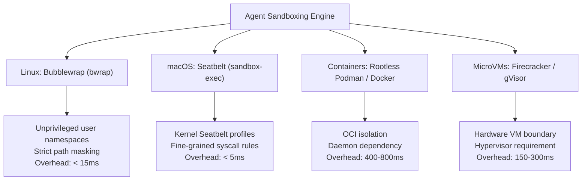
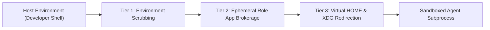

# Architectural Research: OS-Level Sandboxing and Credential Isolation for Autonomous Agent Execution

## 1. Executive Summary & Problem Formulation

As Synlynk expands multi-agent autonomous execution across core harnesses (Claude, Agy, Codex, Grok), agents are routinely granted tool privileges to execute terminal commands, install dependencies, run build scripts, and invoke test runners.

Without kernel-enforced sandboxing, dispatched worker processes inherit the full user permissions of the host developer or CI daemon. This introduces critical security risks:

1. **Host Credential Exfiltration:**
   Unsandboxed commands have access to `~/.ssh/id_*`, `~/.aws/credentials`, `~/.gitconfig`, `~/.gnupg`, macOS Keychain, and browser cookies. A compromised third-party package or hallucinated script could inadvertently read or exfiltrate private credentials.
2. **Out-of-Workspace Filesystem Mutation:**
   Commands executed by agents can accidentally touch, delete, or overwrite files outside the designated workspace worktree (e.g. `rm -rf /tmp/...`, modifying host system dotfiles, or corrupting other project repositories).
3. **Internal Network Probing:**
   Dispatched processes can open raw sockets to probe developer local services (e.g. `localhost:8080`, internal Kubernetes clusters, Redis instances, or cloud metadata endpoints like `169.254.169.254`).
4. **Denial-of-Service & Resource Exhaustion:**
   Runaway sub-processes (e.g. fork bombs, unbounded memory allocations, infinite loops) can lock up host developer machines.

### Goal Alignment
This research addresses **`goal-abecd18c`** (*"Containerized and OS-level agent execution sandboxing"*), establishing a concrete blueprint for cross-platform, sub-100ms sandbox containment with zero developer friction.

---

## 2. Comparative Analysis of Sandboxing Technologies



### 2.1 Linux Bubblewrap (`bwrap`)

**Mechanism:**  
Bubblewrap uses unprivileged Linux user namespaces (`CLONE_NEWUSER`, `CLONE_NEWNS`, `CLONE_NEWNET`, `CLONE_NEWPID`) to create isolated container environments without requiring root privileges or setuid binaries.

**Capabilities:**
- **Filesystem Masking:** Mounts the entire host root as read-only (`--ro-bind / /`), masks sensitive user directories (`--tmpfs ~`), and bind-mounts only the designated workspace as read-write (`--bind <workspace> <workspace>`).
- **Network Namespaces:** Isolates networking (`--unshare-net`) or redirects via a userspace proxy (`slirp4netns`).
- **Process Isolation:** Runs with an isolated PID namespace (`--unshare-pid`), preventing agents from observing or signaling host processes.
- **Seccomp Filters:** Can enforce strict seccomp BPF filters restricting dangerous syscalls (e.g. `ptrace`, `kexec`).

**Performance:** Provisioning overhead is exceptionally low ($< 15\text{ ms}$).

---

### 2.2 macOS Seatbelt (`sandbox-exec`)

**Mechanism:**  
macOS includes a kernel-enforced sandboxing framework (historically exposed via `/usr/bin/sandbox-exec` and the `sandbox(7)` C API). Seatbelt evaluates execution policies written in Scheme-like Profile Language (SBPL).

**Capabilities:**
- **Default-Deny Architecture:** Profiles begin with `(version 1) (deny default)`, blocking all file access, network activity, and IPC by default.
- **Path Whitelisting:**
  ```scheme
  (allow file-read*)
  (allow file-write* (subpath "/Users/developer/dev/synlynk/.worktrees/..."))
  (allow file-write* (subpath "/private/tmp"))
  (deny file-read* (subpath "/Users/developer/.ssh"))
  (deny file-read* (subpath "/Users/developer/.aws"))
  ```
- **Network Mediation:** Can restrict socket binding and outbound connections:
  ```scheme
  (deny network*)
  (allow network-outbound (remote tcp "*:443"))
  ```

**Evaluation on Modern macOS (Sequoia / Sonoma):**  
While Apple labels `/usr/bin/sandbox-exec` as deprecated in favor of App Sandbox entitlements, `sandbox-exec` remains fully functional across macOS 14 & 15. For non-bundled CLI tools, Seatbelt profiles provide the only zero-privilege, $<5\text{ ms}$ kernel sandbox available on macOS without requiring virtual machines.

---

### 2.3 Rootless Containers & MicroVMs (Podman, Docker, Firecracker)

**Mechanism:**  
Spawning an OCI container (rootless Podman) or MicroVM (Firecracker/gVisor) per task dispatch.

**Trade-offs:**
- **Strengths:** Near-perfect isolation; reproducible hermetic runtime environments.
- **Weaknesses for Interactive Daily CLI Driver:**
  - Spin-up latency: Starting a container takes 500ms–2,000ms; starting Firecracker takes 150ms–300ms.
  - Filesystem synchronization: Volume mounts across macOS host and Linux container VM (via virtiofs) suffer from severe I/O penalties when running Python test suites (e.g. reading 3,000+ test files).
  - Heavy memory overhead: Running 4 concurrent agents each in a VM consumes 4–8 GB of RAM.

---

## 3. Credential Isolation & Environment Masking

Even inside a filesystem sandbox, environment variables present an immediate leak vector. Dispatched subprocesses frequently inherit all environment variables exported in the developer's shell session (`GITHUB_TOKEN`, `AWS_SECRET_ACCESS_KEY`, `OPENAI_API_KEY`, `ANTHROPIC_API_KEY`).

### 3.1 The 3-Tier Credential Shield



1. **Tier 1: Deterministic Environment Allowlist:**
   Instead of passing `os.environ` into `subprocess.Popen`, Synlynk enforces a strict allowlist:
   - System variables: `PATH`, `TMPDIR`, `TERM`, `LANG`, `LC_ALL`, `USER`.
   - Tooling variables: `PYTHONPATH`, `NODE_PATH`, `VIRTUAL_ENV`.
   - All host keys (`*_API_KEY`, `*_TOKEN`, `AWS_*`, `SSH_*`) are purged from the child environment unless explicitly injected by the dispatch profile.

2. **Tier 2: Role App Token Brokerage (Verified in #5220):**
   Agent GitHub operations never receive the developer's personal access token. Synlynk dynamically injects role-specific GitHub App tokens (`.synlynk/github_apps/<role>.token.json`) and sets:
   ```bash
   GH_CONFIG_DIR=".synlynk/github_apps/tmp_gh_<role>_<pid>"
   GITHUB_TOKEN="<scoped_installation_token>"
   ```

3. **Tier 3: Virtual `HOME` Redirection:**
   Dispatched processes are executed with `HOME` set to an ephemeral scratch directory (`/tmp/synlynk_sandbox_<job_id>/home`).
   This prevents agents, git, or compilers from reading or writing:
   - `~/.gitconfig`
   - `~/.ssh/`
   - `~/.netrc`
   - `~/.config/gh/hosts.yml`

---

## 4. Proposed Synlynk Sandboxing Architecture

We propose a unified, platform-adaptive sandbox driver implemented in `synlynk/sandbox.py`:

```python
class SandboxBackend(Enum):
    MAC_SEATBELT = "mac_seatbelt"  # macOS sandbox-exec
    LINUX_BWRAP = "linux_bwrap"    # Linux bubblewrap
    ENV_ONLY = "env_only"          # Fallback environment & HOME isolation
```

### 4.1 Dynamic Profile Generation
The engine automatically compiles task-tailored sandbox policies based on the agent's role and permission profile (`policy.json`):

```python
def build_sandbox_command(
    cmd: list[str],
    workspace_path: str,
    allow_network: bool = False,
    allow_subpaths: list[str] | None = None,
) -> list[str]:
    ...
```

- **Read Access:** Host system binaries (`/usr`, `/bin`, `/opt/homebrew`, `/Library/Developer`), Python virtualenvs, and the repository root.
- **Write Access:** Strictly limited to `workspace_path` and a private `/tmp/synlynk_job_<id>` directory.
- **Network Policy:**
  - `dev` and `test` roles: `allow_network = False` (fail-closed; prevents secret exfiltration and network side effects).
  - `review` and `gh_write` roles: Limited strictly to TCP 443 outbound.

---

## 5. Implementation Roadmap & File Touch Surface

| Module | Planned Modifications |
| :--- | :--- |
| `synlynk/sandbox.py` | Core sandbox abstraction: `run_sandboxed()`, macOS Seatbelt compiler, Linux `bwrap` builder, and credential scrubber. |
| `synlynk/dispatch.py` | Wrap all worker subprocess executions (`_run_agent_process`) in `synlynk.sandbox`; enforce `permission_profiles` from `policy.json`. |
| `synlynk/gh_role.py` | Maintain isolated `GH_CONFIG_DIR` per dispatched subprocess. |
| `synlynk/tpm_sweep.py` | Support approved proposal tracking in `post_proposal_interim_rollup` across `status IN ('open', 'resolved')`. |
| `tests/test_sandbox.py` | Test suite verifying: 1) Trapped access to `~/.ssh`, 2) Blocked writes outside workspace, 3) Purged environment credentials. |

---

## 6. Acceptance Invariants & Formal Verification

1. **Credential Inaccessibility Invariant:** Any command executed inside the sandbox attempting to read `~/.ssh`, `~/.aws`, or host `~/.gitconfig` must receive `EACCES (Permission denied)`.
2. **Workspace Containment Invariant:** Attempts to write or delete files outside `<workspace_path>` or `<tmpdir>` must fail immediately.
3. **Sub-20ms Launch Latency Invariant:** Sandbox compilation and wrapper overhead must add $< 20\text{ ms}$ to process spawn time.
4. **Hermetic Environment Invariant:** Host API keys (`OPENAI_API_KEY`, `ANTHROPIC_API_KEY`, personal `GITHUB_TOKEN`) must not appear in the child process's environment.

---

## 7. Recommendation & Conclusion

For Synlynk's multi-agent autonomous fleet, combining **macOS Seatbelt** on Darwin and **Bubblewrap (`bwrap`)** on Linux provides immediate, zero-privilege, sub-20ms kernel isolation. Coupled with the 3-Tier Credential Shield, this completely neutralizes credential theft and filesystem corruption vectors without impeding high-velocity test execution.
