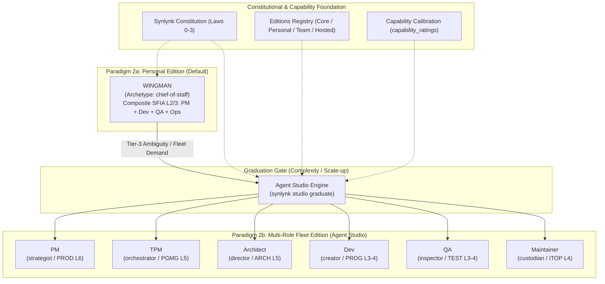
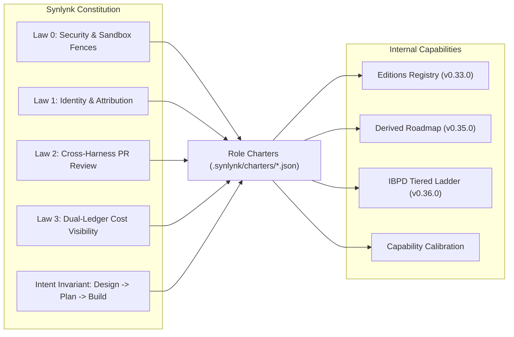

# Design Spec: SFIA Charter Archetypes, Autonomous Coordination & The Wingman Gateway

- **Author:** Agy (Home Conductor / Lead Architect)
- **Collaborator / Approver:** Nikhil Soman [@nikhilsoman]
- **Date:** 2026-11-15
- **Status:** Draft (Proposed Architecture for Operator Review)
- **Governing Goals:** `goal-a222b393` (Agent Charter Framework), `goal-658aa384` (Agent Studio), `goal-ecffdaaf` (Master Roadmap Pivot)
- **Target Milestone:** **v0.38.0 (Agent Studio & Charter Architecture Epic)**

---

## 1. Executive Summary & Problem Statement

### 1.1 The Operational Context
Synlynk was designed to orchestrate autonomous multi-agent engineering workflows. Across the recent implementation of the Master Roadmap Pivot (`v0.33.0` Editions, `v0.34.0` Constitution, `v0.35.0` Derived Roadmap, and `v0.36.0` IBPD Engine), operational audits surfaced four structural deficiencies in how agent roles are chartered and executed:

1. **Role Compression & Identity Erosion:** Interactive Home Conductors frequently collapse into monolithic execution—writing code, performing reviews locally, and running ceremonies inline—bypassing the domain-specific agent fleet (Codex for dev, Grok for review, Claude for architecture).
2. **Ad-Hoc Role Definitions:** Charters currently consist of freeform Markdown instructions and loose JSON files without machine-verifiable behavioral bounds, standardized autonomy levels, or formal interaction contracts.
3. **The Personal Edition vs. Fleet Dichotomy:** While Personal Edition operates on a solo builder paradigm (Paradigm 2a) and Agent Studio operates on an autonomous multi-role fleet (Paradigm 2b), there is no formal bridge or graduation pathway connecting them.
4. **Unmined Collateral & Ambient Dead-Ends:** High-value collateral (dozens of approved specs, plans, and decisions) sits idle on disk because the autonomous intake loop does not actively crawl them, while high-complexity ambiguity stalls silently instead of triggering multi-agent consensus panels.

### 1.2 The Core Solution: The Archetype-SFIA Charter Engine
This specification establishes a unified, constitutional agent charter framework across Synlynk and Agent Studio:
1. **The 7 Core Archetypes:** Standardizes every agent role into one of seven structural archetypes with strict invariant boundaries, deterministic lifecycle state machines, and verifiable evidence contracts.
2. **The SFIA Behavioral Layer:** Infuses the global **Skills Framework for the Information Age (SFIA)** into charters to govern competency, responsibility levels (Levels 1–7), complexity ceilings, and autonomy ratings.
3. **The WINGMAN Role & Graduation Gateway:** Formalizes the `chief-of-staff` archetype as the single-operator Personal Edition default—providing a lightweight composite of PM + Dev + QA + Ops that respects all constitutional invariants and serves as the organic preview/onboarding ramp to Agent Studio.
4. **Constitutional & Capability Alignment:** Hard-binds every charter to the Synlynk Constitution (Laws 0–3) and integrates them with the Editions Registry (`v0.33.0`), Derived Roadmap (`v0.35.0`), IBPD Ladder (`v0.36.0`), and empirical Capability Calibration.



---

## 2. The 7 Core Archetypes: Structural Invariants

Every agent role in Synlynk inherits one of seven structural archetypes. While a charter specifies role-specific tools and instructions, its archetype defines its **immutable operational fences**.

| Archetype | Standard Roles | Mandate | Invariant Boundaries (What it NEVER does) | Evidence / Verification Contract |
| :--- | :--- | :--- | :--- | :--- |
| **`orchestrator`** | `tpm` | Traffic control, work-graph flow, milestone packaging, and role delegation. | **Never** writes application code, modifies schemas directly, or hand-edits docs. | Milestone proposals, unblocked stories, clean worktree hygiene. |
| **`strategist`** | `pm`, `product-owner` | Portfolio goal alignment, user intent capture, and governance sign-offs. | **Never** introduces novel unapproved scope without operator gate; never writes code. | Approved brainstorm agendas, ratified goals, user feedback rollups. |
| **`director`** | `architect`, `lead` | Systems design, technical specs, decide panel consensus, and plan decomposition. | **Never** skips Design $\to$ Plan sequence; never approves own design specs. | Approved design specs (`docs/superpowers/specs/`), decide panel records. |
| **`creator`** | `dev`, `designer` | Surgical code implementation, component styling, and test generation. | **Never** merges own PR; never bypasses TDD reproduction test before implementation. | Passing test suite, green `synlynk pr check`, valid commit trailers. |
| **`inspector`** | `qa`, `secops` | Independent verification, security audits, and formal PR reviews. | **Never** approves authoring PR from same harness or persona (Law 2 compliance). | Formal review checklist (`gh pr review --approve` / `REQUEST_CHANGES`). |
| **`custodian`** | `maintainer`, `infra` | Substrate hygiene, worktree cleanup, sentinel triage, and policy drift audit. | **Never** executes destructive actions without policy check; never touches product logic. | Pruned worktrees/branches, triaged sentinel alerts, clean WAL checkpoints. |
| **`chief-of-staff`** | `wingman` | Single-operator co-pilot, intent capture, surgical fixes, and Agent Studio gateway. | **Never** executes un-fenced Tier-3 changes unilaterally; never relaxes constitutional laws. | Goal linkage (`GOVERNS`), local test pass, cost log entry, worktree clean. |

---

## 3. The SFIA Behavioral Layer: Competency & Autonomy

While the Archetype provides the *structural skeleton*, the **Skills Framework for the Information Age (SFIA)** provides the *behavioral descriptors, autonomy levels, and competency rubrics*.

### 3.1 SFIA Levels of Responsibility (Levels 1–7)
Charters are classified against standard SFIA autonomy and responsibility levels:
- **Level 1 (Follow):** Works under direct supervision; little discretion; requires structured step-by-step guidance.
- **Level 2 (Assist):** Operates under routine direction; uses minor discretion in resolving operational queries.
- **Level 3 (Apply):** Works under general direction; uses discretion in identifying and resolving complex problems (`dev`, `qa`).
- **Level 4 (Enable):** Exercises substantial personal responsibility; allocates tasks; reviews quality (`maintainer`, senior `dev`).
- **Level 5 (Ensure / Advise):** Influences organization; formulates architectural plans; balances schedule, cost, and quality (`tpm`, `architect`).
- **Level 6 (Initiate / Influence):** Defines strategy; makes decisions critical to project success (`pm`).
- **Level 7 (Set Strategy / Inspire):** Reserved for Human Operator / Executive Authority.

### 3.2 Role-to-SFIA Mapping Matrix

```json
{
  "roles": {
    "tpm": {
      "archetype": "orchestrator",
      "sfia_code": "PGMG",
      "sfia_title": "Program Management",
      "sfia_level": 5,
      "autonomy_level": "L2_GATED",
      "complexity_ceiling": 3
    },
    "pm": {
      "archetype": "strategist",
      "sfia_code": "PROD",
      "sfia_title": "Product Management",
      "sfia_level": 6,
      "autonomy_level": "L2_GATED",
      "complexity_ceiling": 3
    },
    "architect": {
      "archetype": "director",
      "sfia_code": "ARCH",
      "sfia_title": "Solution Architecture",
      "sfia_level": 5,
      "autonomy_level": "L3_AUTONOMOUS",
      "complexity_ceiling": 3
    },
    "dev": {
      "archetype": "creator",
      "sfia_code": "PROG",
      "sfia_title": "Software Development",
      "sfia_level": 3,
      "autonomy_level": "L3_AUTONOMOUS",
      "complexity_ceiling": 2
    },
    "qa": {
      "archetype": "inspector",
      "sfia_code": "TEST",
      "sfia_title": "Testing",
      "sfia_level": 3,
      "autonomy_level": "L3_AUTONOMOUS",
      "complexity_ceiling": 2
    },
    "maintainer": {
      "archetype": "custodian",
      "sfia_code": "ITOP",
      "sfia_title": "IT Operations",
      "sfia_level": 4,
      "autonomy_level": "L3_AUTONOMOUS",
      "complexity_ceiling": 2
    }
  }
}
```

---

## 4. The WINGMAN Archetype (`chief-of-staff`): Solo Builder & Studio Gateway

### 4.1 Concept & Mandate
**Wingman** is the default agent role bundled into **Personal Edition**. It embodies Paradigm 2a (the solo full-stack builder).
- **Core Problem It Solves:** A solo developer or small team does not want to manage an 8-agent org chart for simple scripts or surgical tasks. However, relaxing rules or skipping tests introduces catastrophic technical debt.
- **The Wingman Balance:** Wingman executes as a **Composite Generalist**. It wears multiple hats sequentially at a bounded depth (SFIA Level 2/3 across BAPM, PROG, TEST, and ITOP) while strictly upholding all constitutional invariants.

### 4.2 Composite Hat Sequencing
1. **Hat 1 (Intent & Triage):** When the operator provides a prompt, Wingman captures it into a lightweight GOVERNS goal (`synlynk intent capture`).
2. **Hat 2 (Surgical Implementation):** Writes the minimal code, test, or documentation required.
3. **Hat 3 (Sanity Verification):** Executes `pytest` and verifies clean outputs before committing.
4. **Hat 4 (Substrate Hygiene):** Prunes feature worktrees and logs session token costs.

### 4.3 The "Graduation to Fleet" Gate
Wingman includes an explicit **Escalation Boundary**:
- If a task has `complexity_tier >= 3`, introduces database migrations, alters security policies, or impacts multi-subsystem architecture, Wingman **halts** and advises:
  ```text
  [Wingman Notice]: This task exceeds Tier-2 complexity bounds (touches schema triggers and authentication).
  Recommendation: Graduate this goal to Agent Studio fleet via:
    $ synlynk studio graduate --story <id>
  This will decompose the work and dispatch specialized Architect + Codex Dev + Grok QA roles.
  ```

---

## 5. Architectural State Machines: TPM & Wingman

### 5.1 The Generalized TPM Milestone State Machine
The TPM wake cycle operates as a deterministic, closed-loop state machine:

```
[1. INTAKE & MINING]
  ├── Crawl docs/superpowers/plans/ for un-tracked plans -> Parse task checkboxes -> Create stories
  ├── Crawl project-docs/decisions/ for unlinked decisions
  ├── Ingest GitHub issues & Maintainer Sentinel alerts
  └── Deduplicate & Fingerprint items
         │
[2. AMBIGUITY GATE]
  ├── Goal aligned & Tier 1/2? -> Proceed to Proposal Packaging
  └── Missing goal OR Tier 3? -> Trigger `synlynk decide "<topic>" --panel claude,agy,codex --record`
         │
[3. PACKAGE PROPOSAL]
  ├── Group 3-5 cohesive stories for single version milestone (e.g. v0.37.0)
  ├── Format proposal issue with today/horizon bookends and token budgets
  └── Surface to Operator -> Await `/approve`
         │
[4. ROLE DISPATCH (Strictly via --as-agent)]
  ├── Dev tasks -> Dispatched to Codex (`--as-agent dev`)
  ├── Content/Docs tasks -> Dispatched to Agy (`--as-agent designer/content`)
  └── Architecture tasks -> Dispatched to Claude (`--as-agent architect`)
         │
[5. CROSS-HARNESS REVIEW GATE]
  └── Dispatched PRs must receive formal review from a different harness under role QA (Grok/Claude)
         │
[6. POST-MERGE CEREMONY (Automated Release SOP)]
  ├── Milestone Completion Verifier detects all PRs merged
  ├── Release Runner (`dev`) -> Creates git tag & publishes GitHub Release
  ├── Marketing (`marketing`) -> Compiles canonical PDF docs & updates website/
  └── Onboarding Verifier -> Syncs getting-started guides for new CLI verbs
         │
[7. HOUSEKEEPING & BOOKKEEPING GATE]
  ├── Maintainer (`custodian`) prunes merged worktrees and branches
  ├── Telemetry writes token costs to `costs.md`
  ├── Capability ratings and review multipliers recorded
  └── Close milestone ticket as `shipped`
```

---

## 6. Constitutional Fences & Capability Association

Every charter is bound by the **Synlynk Constitution** ([synlynk/constitution.py](file:///Users/nikhilsoman/dev/synlynk/synlynk/constitution.py)):



1. **Law 0 (Security Fences):** Every charter specifies an explicit sandbox mode (`sandbox: workspace-write`) and network dependency whitelist.
2. **Law 1 (Identity & Attribution):** Enforces dedicated GitHub App role credentials, unique Git trailers (`Co-Authored-By`), and strict segregation between author and reviewer logins.
3. **Law 2 (PR Review Discipline):** Hard-blocks merges if reviewer login equals PR author or if review was not performed cross-harness.
4. **Law 3 (Dual-Ledger Cost Visibility):** Demands token usage and amortized spend logging before any task status transitions to `done`.
5. **Editions Integration (`v0.33.0`):** Personal Edition unlocks Wingman; Team/Hosted Editions unlock the full multi-agent Agent Studio fleet.
6. **IBPD Ladder Integration (`v0.36.0`):** Client trust progression across Tier 1 (Self-Serve) $\to$ Tier 2 (Assisted) $\to$ Tier 3 (Managed) is governed by verified charter adherence.
7. **Empirical Calibration (`capability_ratings`):** LLM models are benchmarked against SFIA skill rubrics. If a model scores $<8.5$ on SFIA PROG Level 3, the dispatcher refuses to assign it the `creator` charter.

---

## 7. Implementation Plan & Deliverables

### Phase 1: Charter Schema & Archetype Engine (`synlynk/charter_schema.py`)
- Add `VALID_ARCHETYPES` support for `chief-of-staff`.
- Add schema validation for `sfia_mapping`, `boundaries`, `evidence_contracts`, and `lifecycle_state_machine`.
- Bundle `synlynk/sfia_taxonomy.json` containing standard SFIA codes (PGMG, PROD, ARCH, PROG, TEST, ITOP, BAPM).

### Phase 2: Canonical Charters Corpus Update (`.synlynk/charters/`)
- Update `tpm.json`, `pm.json`, `architect.json`, `dev.json`, `qa.json`, and `maintainer.json` with archetype invariants and SFIA Level mappings.
- Author `.synlynk/charters/wingman.json` establishing the canonical Personal Edition Chief-of-Staff role.

### Phase 3: Autonomous Intake & Ambiguity Engine (`synlynk/tpm_sweep.py`)
- Implement active plan and spec crawler: automatically parse committed markdown plans in `docs/superpowers/plans/` into atomic stories.
- Implement ambiguity resolver: wire Tier-3 complexity and unaligned goals directly to `synlynk decide "<topic>" --panel claude,agy,codex --record`.
- Implement recurring backlog burndown arc for the 500+ GitHub issues.

### Phase 4: Agent Studio Graduation CLI & Inspection Surface
- Add CLI commands:
  - `synlynk charter define <role> --archetype <type> --sfia <code@level>`
  - `synlynk charter verify` (constitutional linting across all active charters)
  - `synlynk studio graduate --story <id>` (decomposes Wingman task into multi-agent fleet stories).
- Surface role interaction graphs and RACI boundaries in the Vizor dashboard.

---

## 8. Verification & Test Contracts

1. **Schema Validation Tests (`tests/test_charter_schema_archetypes.py`):**
   - Verify every charter strictly validates against archetype boundaries and SFIA mappings.
   - Verify that invalid archetypes or missing invariant boundaries fail closed.
2. **Wingman Invariant Tests (`tests/test_wingman_charter.py`):**
   - Test that Wingman can execute surgical edits and local tests under Personal Edition.
   - Verify that Tier-3 tasks trigger graduation advice and refuse unilateral execution.
3. **TPM State Machine Tests (`tests/test_tpm_autonomous_coordination.py`):**
   - Test plan/spec crawling and story creation from markdown files.
   - Test automatic invocation of `synlynk decide` on unaligned/Tier-3 tasks.
   - Test milestone completion detection and hand-off to release and marketing runners.
