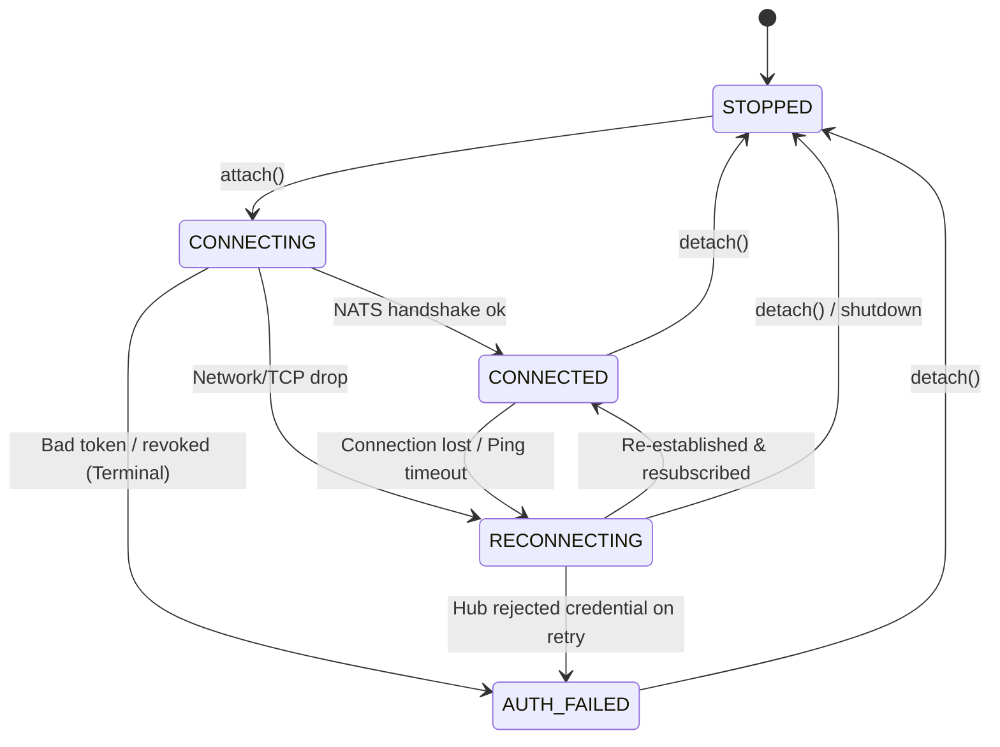

# Personal Relay Hardening: Reconnect Backoff, Hub Status Observability, and Managed Service Handshake — Design Spec

**Status:** Draft, awaiting user review  
**Issue:** gh:#2918 (Parent: gh:#5123, Goal: `goal-f4ce526a`)  
**Date:** 2026-11-18  
**Author:** AGY (`agy-2.x`, Mode A Home Conductor)  
**Co-Authored-By:** AGY <noreply@antigravity.dev>

---

## 1. Summary & Intent

The baseline Personal-Use Hosted Relay (`synlynk/relay_hub.py`, ~50KB, 208 passing unit tests) established the core mechanics of bridging a user's local `RelayBroker` to a private NATS JetStream hub:
- Subject taxonomy (`synlynk.<workspace_id>.<category>.*`)
- Scoped bearer credentials (`authorization { users: [...] }`)
- Durable JetStream streams with independent category retention
- Bounded document preview channels (`docs/superpowers/specs/`, `plans/`, `brainstorm/`)
- Subscription pattern filtering (`synlynk relay subscribe/unsubscribe`)

However, as documented in `docs/personal-hosted-relay.md` and tracked under **gh:#2918**, three major operational gaps prevent production robustness:
1. **Fragile Connection Lifecycle:** When the NATS hub restarts, network blips occur, or a laptop changes Wi-Fi networks, the `HubAdapter` marks `last_error` and does not execute an automated exponential-backoff reconnect loop. Outbound forwarding either stalls or aborts.
2. **Observability Black Hole:** `synlynk relay status` only checks if the local HTTP endpoint (`127.0.0.1:7432/events`) responds. It surfaces nothing about whether a hub is attached, whether the NATS connection is live, degraded, or reconnecting, what subjects are actively subscribed, or whether a sync gap occurred.
3. **Unvalidated Managed Connect Stub:** `synlynk relay hub connect` only writes a local static `hub.json` stub with the notice *"Managed service connection and device registration are not implemented; no service was contacted"*, leaving managed-tier users without validation, handshake checks, or token health monitoring.

This specification details the architecture, state transitions, CLI interfaces, and verification requirements to harden the Personal Relay into a resilient, observable substrate ready for multi-device operations.

---

## 2. Scope & Non-Goals

### In Scope
- **Automated Reconnect with Exponential Backoff & Jitter:** Self-healing connection loop in `HubAdapter` handling transient network drops, server restarts, and DNS failures.
- **Local Event Lifecycle Emissions:** Publishing local `hub_disconnected` and `hub_reconnected` events through the local broker so CLI, daemon, and Vizor can react in real time.
- **Unified Relay Status CLI (`synlynk relay status`):** Dual-tier output reporting local broker health, hub adapter lifecycle state, subscription patterns, device identity, and sequence sync status, with `--json` support.
- **Managed Hub Handshake & Preflight:** Verifying connectivity, token validity, and tenant access during `synlynk relay hub connect` before persisting configuration.
- **Fail-Closed Security on Authentication Rejection:** Distinguishing transient network errors from permanent authorization/revocation failures (NATS auth error, HTTP 401/403) to halt futile reconnect loops and alert the operator.

### Non-Goals
- **Multi-Tenant State DB Reconciliation:** Divergent local `state.db` files remain outside the relay's scope (tracked separately under research issue gh:#1402).
- **Persistent Outbound Spooling on Infinite Hub Outage:** The relay does not become an unbounded disk-backed message queue for offline publishing; local brokers maintain their bounded ring buffer, and durable replaying is owned by the hub's JetStream consumers upon re-establishing connection.
- **Billing / Stripe Integration:** Account entitlement validation is validated via signed JWT/bearer claims, but payment processing and checkout pipelines belong to `synlynk.com` web services.

---

## 3. Architecture & Subsystems

```
                                  +------------------------------------+
                                  |     Remote NATS JetStream Hub      |
                                  |  (Self-Hosted or synlynk.com Hub)  |
                                  +-----------------+------------------+
                                                    ^
                                                    | Outbound TLS/TCP
                                                    | (with Backoff Reconnect)
                                                    v
+---------------------------------------------------+------------------------------------+
| Local Machine / Device Workspace                                                       |
|                                                                                        |
|  +--------------------+        +---------------------+        +---------------------+  |
|  |  Local Agent / CLI | <----> | Local Relay Broker  | <----> |     HubAdapter      |  |
|  |  (127.0.0.1:7432)  |  HTTP  |  (synlynk/relay.py) | In-Mem |(synlynk/relay_hub.py|  |
|  +--------------------+        +----------+----------+        +----------+----------+  |
|                                           |                              |             |
|                                           v                              v             |
|                                   [relay_events]              [Lifecycle State &       |
|                                   (Local state.db)             Backoff Supervisor]     |
+----------------------------------------------------------------------------------------+
```

### 3.1 Reconnect & Backoff Supervisor

The `HubAdapter` is upgraded with an internal asynchronous/threaded connection supervisor (`ConnectionSupervisor`).

#### State Machine



#### Backoff Algorithm
The supervisor uses truncated exponential backoff with full jitter to avoid thundering-herd reconnect storms against the hub:
- **Base Interval ($t_0$):** 1.0 second
- **Multiplier ($m$):** 1.5
- **Max Interval ($t_{\max}$):** 60.0 seconds
- **Jitter Formula:**
  $$\text{delay} = \text{random.uniform}(0, \min(t_{\max}, t_0 \times m^{\text{attempt}}))$$

#### Terminal vs Retriable Failures
1. **Retriable Errors (enter `RECONNECTING`):**
   - Socket connection refused / timeout / reset
   - DNS resolution temporary failure
   - Server unavailable / draining
   - Incomplete TLS handshake due to network drop
2. **Terminal Errors (enter `AUTH_FAILED`, halt loop):**
   - NATS `Authorization Violation` error
   - Invalid or revoked device credential
   - Explicit workspace mismatch error
   - Action: Emits `hub_disconnected` event with `reason="authentication_failed"`, sets `last_error="credential_revoked"`, and exits reconnect loop to prevent log spam and account lockouts.

#### Lifecycle Events Emitted
When transitioning states, the adapter publishes synthetic local events onto the local broker:
- `hub_disconnected`:
  ```json
  {
    "event_type": "hub_disconnected",
    "payload": {
      "origin_device_id": "laptop-m3",
      "reason": "connection_lost",
      "retry_attempt": 2,
      "next_retry_seconds": 2.25,
      "terminal": false
    }
  }
  ```
- `hub_reconnected`:
  ```json
  {
    "event_type": "hub_reconnected",
    "payload": {
      "origin_device_id": "laptop-m3",
      "downtime_seconds": 14.8,
      "reconnect_attempt": 3,
      "resumed_streams": ["job", "agent", "sentinel", "doc", "custom"]
    }
  }
  ```

---

### 3.2 Unified Relay Status Observability

The command `synlynk relay status` is expanded to provide full transparency into both local broker and hub layers.

#### Human-Readable Output Format

```text
✦ synlynk relay status
  Broker:
    status: running (200 OK)
    endpoint: http://127.0.0.1:7432
    pid: 84920
    buffered_events: 1,420
  
  Hub Bridge:
    configured: yes (self-hosted)
    state: CONNECTED
    hub_url: nats://hub.internal:4222
    workspace_id: personal
    device_id: laptop-m3
    subscriptions: 3 active [job.>, sentinel.>, doc.>]
    sync_status: healthy (last seq: 4,921 | gap detected: no)
```

If the hub is currently reconnecting:
```text
  Hub Bridge:
    configured: yes (managed)
    state: RECONNECTING (attempt 3, next retry in 4.2s)
    hub_url: tls://relay.synlynk.com:4222
    workspace_id: ws-prod-881
    device_id: dev-box-1
    last_error: ConnectionRefusedError [2026-11-18 00:45:10 UTC]
```

If the credential was revoked:
```text
  Hub Bridge:
    configured: yes (self-hosted)
    state: AUTH_FAILED (terminal)
    last_error: NatsAuthError (device credential rejected by hub)
    action: Re-authenticate device with 'synlynk relay device add' or re-init hub
```

#### Machine-Readable Output (`--json`)
Running `synlynk relay status --json` produces structured JSON:
```json
{
  "broker": {
    "running": true,
    "status_code": 200,
    "endpoint": "http://127.0.0.1:7432",
    "pid": 84920
  },
  "hub": {
    "configured": true,
    "mode": "self-hosted",
    "state": "CONNECTED",
    "hub_url": "nats://hub.internal:4222",
    "workspace_id": "personal",
    "device_id": "laptop-m3",
    "subscriptions": ["job.>", "sentinel.>", "doc.>"],
    "sync_gap": false,
    "last_error": null,
    "retry_attempt": 0
  }
}
```

---

### 3.3 Managed Hub Handshake & Preflight

When connecting to a managed hub via `synlynk relay hub connect`:
```sh
synlynk relay hub connect <workspace-token> --workspace-id <ws_id> [--url <managed_url>]
```

#### Handshake Protocol
1. **Preflight Probe:** Prior to writing `hub.json`, the CLI performs an HTTPS preflight request to `<managed_url>/v1/hub/preflight`:
   - Header: `Authorization: Bearer <workspace-token>`
   - Payload: `{"workspace_id": ws_id, "device_name": local_hostname, "client_version": "0.38.1"}`
2. **Response Contract:**
   - On success (`200 OK`):
     ```json
     {
       "status": "authorized",
       "nats_url": "tls://relay.synlynk.com:4222",
       "device_id": "dev-mac-01",
       "allowed_subjects": ["synlynk.ws-prod.*"],
       "expires_at": "2027-11-18T00:00:00Z"
     }
     ```
   - On rejection (`401 Unauthorized` / `403 Forbidden`): Returns explicit human error (e.g., `"Invalid workspace token or account expired"`). No config is written.
3. **Atomic Storage:** Writes validated settings to `~/.synlynk/relay/hub.json` with permissions `0600`.

---

## 4. Database & Event Schema Changes

### 4.1 Event Whitelist (`synlynk/events.py`)
Add `hub_reconnected` to `RELAY_EVENT_TYPES`:
```python
RELAY_EVENT_TYPES = (
    # existing types...
    "hub_disconnected",
    "hub_reconnected",  # New: signals successful recovery after drop
    "sync_gap_detected",
    "doc_drafted",
    "doc_updated",
)
```

### 4.2 Hub State Snapshot (`synlynk/relay_hub.py`)
Add an in-memory observable status accessor `HubAdapter.get_status()` returning a `HubStatusSnapshot` dataclass:
```python
@dataclass
class HubStatusSnapshot:
    configured: bool
    mode: str  # "self-hosted" | "managed" | "unconfigured"
    state: str  # "STOPPED" | "CONNECTING" | "CONNECTED" | "RECONNECTING" | "AUTH_FAILED"
    hub_url: str | None
    workspace_id: str | None
    device_id: str | None
    subscriptions: list[str]
    last_error: str | None
    retry_attempt: int
    next_retry_seconds: float | None
    sync_gap: bool
```

---

## 5. Security & Safety Invariants

1. **Secret Redaction:** Passwords, bearer tokens, and nkey secrets must NEVER appear in:
   - Exception traces or `last_error` strings
   - `synlynk relay status` console output or `--json` payloads
   - Broker event envelopes or persisted `relay_events` logs
2. **File Permissions:** Any written `hub.json` or `.creds` file must strictly enforce file mode `0600` and directory mode `0700`.
3. **Dial Outbound Only:** The hub adapter strictly dials outbound to the hub; it never binds local external listening ports, preserving firewall/NAT traversal safety.
4. **Local Broker Independence:** Failure, latency, or complete shutdown of the remote hub must never stall or block the local broker (`http://127.0.0.1:7432`). Dispatches and local agents proceed normally in degraded mode.

---

## 6. Implementation Stages & Task Breakdown

### Stage 1: Event Schema & Supervisor Foundation
- Add `hub_reconnected` to `synlynk/events.py`.
- Implement `ConnectionSupervisor` with truncated exponential backoff, jitter calculation, and state machine in `synlynk/relay_hub.py`.
- Unit tests: verify backoff delay boundaries, jitter randomness, and state transitions.

### Stage 2: HubAdapter Reconnect Wiring
- Wire `ConnectionSupervisor` into `HubAdapter.attach()` and transport error callbacks.
- Distinguish terminal auth errors from retriable network errors.
- Emit `hub_disconnected` and `hub_reconnected` local events on state changes.
- Unit tests: simulate disconnects, verify backoff execution, and verify delivery resumption.

### Stage 3: Relay Status Command & JSON Output
- Extend `cmd_relay_status` in `synlynk/relay.py` and `cli.py` to inspect local hub configuration (`hub.json` / running bridge).
- Implement human-readable dual-tier rendering (Broker + Hub Bridge).
- Implement `--json` flag output.
- Unit tests: verify text and JSON outputs for all 5 hub states.

### Stage 4: Managed Hub Handshake & Preflight
- Implement preflight probe in `cmd_relay_hub_connect` with timeout and certificate validation.
- Enforce fail-closed handling on HTTP 4xx/5xx responses.
- Unit tests: mock server responses (200 success, 401 failure, network timeout).

### Stage 5: Full Integration & Regression Coverage
- Run full relay test suite:
  ```sh
  python3 -m pytest tests/test_relay_hub.py tests/test_relay.py tests/test_relay_p2p.py -v
  ```
- Execute regression checks against existing CLI contracts.

---

## 7. Verification Evidence & Acceptance Criteria

- [ ] `tests/test_relay_hub.py` passes all existing 208 tests + new reconnect, backoff, and status tests.
- [ ] `synlynk relay status` outputs both local broker health and detailed hub bridge state.
- [ ] `synlynk relay status --json` yields valid JSON schema parseable by external scripts and Vizor.
- [ ] Transient connection failure triggers exponential backoff without crashing the local broker.
- [ ] Invalid / revoked credentials immediately halt retries with `AUTH_FAILED` state.
- [ ] Full regression suite passes cleanly across Python 3.10 and 3.12.
