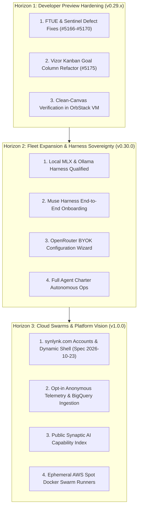

# Authoritative Roadmap & Capabilities Strategic Reconciliation

- **Date:** 2026-11-08
- **Milestone Context:** Developer Preview v0.29.0 Post-Release / v0.30.0 Roadmap Realignment
- **Author:** Agy (AntiGravity / Gemini)
- **Status:** Ratified via Decide Panel `dec-71b3e9a5`

---

## 1. Executive Summary & Inventory Accounting

A comprehensive cross-subsystem audit was conducted across the file-based knowledge repository, SQLite state store (`state.db`), and active worktrees. The ledger reflects:

| Subsystem / Artifact | Total Count | Active / Open | Completed / Done | Superseded / Parked |
| :--- | :--- | :--- | :--- | :--- |
| **Stories (`state.db`)** | **2,343** | 861 (`open`) + 33 (`execute`) + 126 (`visualize`) | 1,280 (`sustain`) + 13 (`release`) + 26 (`notify`) | 4 (`goal`) |
| **Goals (`state.db`)** | **71** | 49 (`active`) | 15 (`done`) | 7 (`superseded`) |
| **Design Specs (`docs/superpowers/specs/`)** | **307** | — | — | — |
| **Implementation Plans (`docs/superpowers/plans/`)** | **270** | — | — | — |
| **Decision Records (`project-docs/decisions/`)** | **83** | — | 83 approved | — |
| **Active GitHub Issues** | **#5163 – #5175** | 6 open priority tickets | 6 merged PRs in v0.29.0 | — |

---

## 2. Deep Dive: Accounting for "Misplaced" Strategic Capabilities

Four high-value capability areas were specced and partially prototyped, but became stranded across feature worktrees during the rapid v0.26–v0.29 sprint to ship the Developer Preview:

### 2.1 Local Harness Onboarding (Ollama / MLX / oMLX)
* **Design Specs:**
  - `docs/superpowers/specs/2026-10-16-local-harness-operationalization-design.md`
  - `docs/superpowers/specs/2026-10-20-local-pilot-rebaseline-design.md`
  - `docs/superpowers/specs/2026-10-21-local-pilot-operational-resume-design.md`
* **Implementation Plans:**
  - `docs/superpowers/plans/2026-10-21-local-pilot-operational-resume.md`
* **Current State:**
  - `synlynk status` marks local execution as `local: unavailable`.
  - The driver exists in `scripts/local_pilot_run.py`, but automatic probe and dispatch (`synlynk dispatch local`) fail because the local profile qualification worktree (`feat/qualify-local-harness-profiles`) was never merged into `main`.
* **Action to Unblock:**
  - Rebase and merge `feat/qualify-local-harness-profiles` into `main`.
  - Wire `Ollama` / Apple Silicon `MLX` socket detection into `synlynk probe local`.

### 2.2 Muse Harness Onboarding
* **Design Specs:**
  - `docs/superpowers/specs/2026-10-23-muse-capability-readiness-design.md`
* **Implementation Plans:**
  - `docs/superpowers/plans/2026-10-23-muse-capability-readiness.md`
  - `docs/superpowers/plans/2026-09-11-cluster-d-muse-harness-onboarding.md`
* **Current State:**
  - Detected during `synlynk init`, but reported as `✗ muse — check API key / install`.
  - Target milestone was `v0.27.3` (`Cross-harness onboarding verification including Muse`), which was deferred during the v0.28 truth ledger sprint.
* **Action to Unblock:**
  - Implement the Muse execution adapter in `synlynk/dispatch.py` following the approved spec.
  - Add Muse test fixtures to `tests/test_muse_harness.py`.

### 2.3 OpenRouter BYOK (Bring Your Own Key)
* **Design Specs & Plans:**
  - `docs/superpowers/plans/2026-10-04-openrouter-dispatch.md`
  - Goal: `story-ec2802d6` (`BS-15: Harness independence — home/away paradigm, OpenRouter direct API`)
* **Current State:**
  - OpenRouter is already hooked as a fallback execution engine in `synlynk/openrouter.py`.
  - However, the user-facing BYOK setup wizard is missing from `synlynk configure`.
* **Action to Unblock:**
  - Add `synlynk configure --openrouter-key` and expose OpenRouter model mapping in `.synlynk/config.json`.

### 2.4 Swarms & Cloud Autonomous Execution
* **Design Specs & Plans:**
  - `docs/superpowers/specs/2026-10-18-governs-autonomy-control-plane-design.md`
  - `docs/superpowers/specs/2026-09-02-ephemeral-swarm-cloud-runners-design.md`
  - Goal: `story-d5323df6` (`Autonomous Capability Crawler & AWS Spot Docker Swarm Driver`)
* **Current State:**
  - The local autonomous loop (leased worktrees, circuit breakers, `tpm_sweep.py`, GitHub approvals) is functional.
  - Multi-node cloud swarm execution was parked under post-v0.29 enterprise cloud infrastructure.
* **Action to Unblock:**
  - Re-activate `story-d5323df6` as part of the `synlynk.com` platform infrastructure roadmap.

---

## 3. The Three-Horizon Strategic Roadmap

### Horizon 1: Developer Preview Hardening (v0.29.x — Immediate)
* **Goal:** Zero friction for any developer from `pipx install synlynk` to their first completed merge.
* **Deliverables:**
  1. Fix `synlynk status` missing database crash ([#5166](https://github.com/nikhilsoman/synlynk/issues/5166)).
  2. Fix `synlynk migrate` untracked files crash ([#5167](https://github.com/nikhilsoman/synlynk/issues/5167)).
  3. Fix `.synlynk/instructions.json` timestamp churn ([#5168](https://github.com/nikhilsoman/synlynk/issues/5168)).
  4. Fix `CONTEXT_BUILD_DEGRADED` invalid SQL query ([#5169](https://github.com/nikhilsoman/synlynk/issues/5169)).
  5. Fix `VIZOR_DAEMON_CRASHLOOP` launchd environment resolution ([#5170](https://github.com/nikhilsoman/synlynk/issues/5170)).
  6. Fix Vizor Kanban board Goal column & GitHub linking ([#5175](https://github.com/nikhilsoman/synlynk/issues/5175)).

### Horizon 2: Fleet Expansion & Harness Sovereignty (v0.30.0 — Next Sprint)
* **Goal:** Complete harness parity across cloud providers and zero-cost local silicon.
* **Deliverables:**
  1. Merge Local MLX / Ollama harness driver (`synlynk dispatch local`).
  2. Complete Muse execution adapter and qualification suite.
  3. Deliver OpenRouter BYOK configuration command.
  4. Activate autonomous agent charters (`dev`, `qa`, `maintainer`) with zero human terminal intervention.

### Horizon 3: Cloud Swarms & Platform Vision (v1.0.0 — Platform Milestone)
* **Goal:** Launch `synlynk.com` platform services, hosted relay, and public capability benchmarks.
* **Deliverables:**
  1. Deploy `synlynk.com` dynamic shell, user accounts, and workspace registry per Spec `2026-10-23`.
  2. Deploy the Opt-In Anonymous Telemetry pipeline (GA4 + BigQuery).
  3. Publish the live public **Synaptic AI Capability Index**.
  4. Launch ephemeral cloud swarm runners on AWS Spot Docker.
