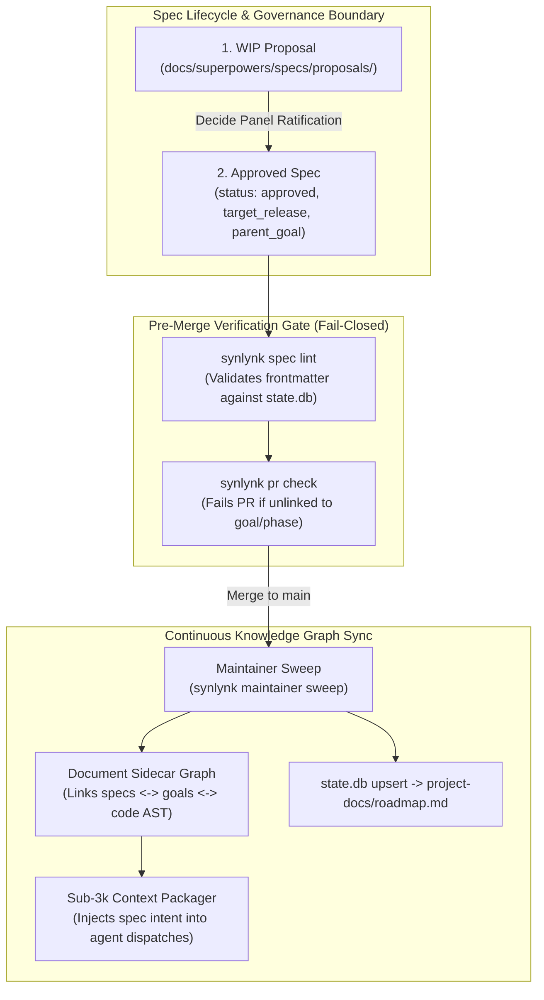

# DECIDE Panel dec-9b41a7c3: Authoritative Master Roadmap Cadence, Platform Vision Integration, Non-Breaking Invariants & Sovereign Silicon Expansion

## Executive Summary

On 2026-11-11, the multi-harness consensus panel (**Claude**, **Agy**, **Codex**, **Grok**) convened with Nikhil Soman to resolve four systemic architectural requirements:
1. **Platform Vision Integration:** Backport the 8 approved, stranded architectural specifications (`synlynk.com` AWS 5-phase cloud platform, Hosted Workstations, Multi-Tenant Relay Hub, Phone-Native Remote MCP, Synaptic AI Capability Index edge oracle, Cascading Enterprise Policy, and 6 Universal Archetypes) into the canonical project roadmap.
2. **Multi-Cadence Structuring:** Re-establish the structured cadence hierarchy pioneered in `ftue-deep-sweep-and-formal-roadmap.md` and `dec-20261002-round-3-roadmap-re-review`: **Tier 1 Daily Named Milestones**, **Tier 2 Weekly Themes**, **Tier 3 Monthly Expansions**, and **Tier 4 Quarterly Arcs**.
3. **Sovereign Silicon Expansion (Beyond Apple Silicon):** Explicitly expand Sovereign Silicon from Apple Silicon MLX/oMLX to encompass Linux-native high-performance AI environments, specifically **NVIDIA DGX Spark / DGX SuperPOD / HGX** clusters running vLLM, TensorRT-LLM, TGI, and local Ollama daemon sockets.
4. **Non-Breaking Incremental Release Invariant:** With real external developers and teams actively relying on Synlynk, institute an immutable **Zero-Breaking-Change Guarantee** across all incremental daily/weekly releases (fail-safe database migrations, backward-compatible CLI flags, zero-regression golden smoke suites).
5. **Elimination of Strategic Drift:** Formulate an architectural solution ensuring that planning, design, and strategy documents never drift from workspace goals and canonical state. Ratify the role of the **Document Sidecar Knowledge Graph** and pair it with a fail-closed **Pre-Merge Spec Frontmatter Gate** in `synlynk pr check`.

---

## 1. Past Cadence Document Lineage Trace

The panel conducted an archaeological trace of Synlynk's cadence documents to preserve historical continuity:

1. **`ftue-deep-sweep-and-formal-roadmap.md` (2026-11-06, Devlog `project-docs/devlogs/agy.md:100`):**
   - Established the 5-tier cadence: Tier 1 Daily Named Releases (Day 1: Clean Slate `v0.28.1`, Day 2: Living Wire `v0.28.2`, Day 3: Port of Call `v0.28.3`, Day 4: Truth Ledger `v0.28.4`, Day 5: Genesis Gate `v0.29.0`), Tier 2 Dev Preview milestone, Tier 3 Weekly themes, Tier 4 Monthly expansions, and Tier 5 Quarterly industry packs.
2. **`dec-20261002-round-3-roadmap-re-review` (`project-docs/decisions/2026-10-02-round-3-revised-authoritative-roadmap.md`):**
   - Locked the 3-Horizon multi-year progression: Horizon 1 (Sovereign Single-Player Runtime), Horizon 2 (Teams & Connected Vizor), and Horizon 3 (Enterprise Fleet & Autonomous Mesh).
3. **`docs/strategy/2026-08-10-roadmap-todo-governance.md` ("Why SQLite Alone Did Not Eliminate Drift"):**
   - Documented the root cause of drift: *"SQLite is authoritative only for events that enter SQLite... Generated projections cannot add work that was never represented in the database. A perfect projection of incomplete input remains incomplete."*
4. **`dec-7a2b0e91` (2026-11-07):**
   - Ratified the Two Paradigms: **Paradigm 2a (The Full-Stack Builder)** launched via Developer Preview, progressing into **Paradigm 2b (The Autonomous Emerging Organisation)** via enterprise swarms and cloud orchestration.

---

## 2. Panel Debate & Positions

### Claude
*Role: Architect / Systems Strategist*

The divergence between our specs in `docs/superpowers/specs/` and `project-docs/roadmap.md` happened because our daily sprints moved faster than our PM ceremony. We shipped `v0.30.0` (Agent Studio backend), `v0.31.0` (VS Code extension marketplace release), and `v0.32.0` (sub-3k packager & AST graph currency), but nobody updated `roadmap_phases` in `state.db`.

Regarding drift: The **Document Sidecar Graph** is necessary but insufficient. A graph is an *observer* — it can map dependencies between Markdown ASTs and Python ASTs, and highlight orphaned specs. But an observer cannot prevent a developer or agent from committing a detached spec. We must back the graph with an **enforceable constitutional gate**: `synlynk spec lint` integrated into `synlynk pr check`. Any PR adding or modifying a document in `docs/superpowers/specs/` or `docs/strategy/` must fail CI if its frontmatter does not declare a valid `parent_goal` and `target_release` matching active rows in `state.db`.

### Agy
*Role: Frontend Architecture / Knowledge Graphs / Documentation*

I support Claude's gate, but we must understand why the **Document Sidecar Graph** is uniquely capable of eliminating cognitive blindness. Today, `graphify` parses only code symbols (`def`, `class`, `import`). When an agent or human looks at the Vizor Architect Map, all non-code intelligence — decisions, specs, user briefs, and roadmaps — is invisible dark matter!

The Document Sidecar Graph parses markdown files into structured nodes:
- Spec nodes (`spec:<date>-<slug>`)
- Decision nodes (`decision:<id>`)
- Goal nodes (`goal:<id>`)
- Roadmap phase nodes (`phase:<id>`)

It extracts YAML frontmatter and markdown cross-links (`[symbol](file://...)`), creating bi-directional edges between specifications and code implementations. When an agent opens a dispatch on `synlynk/dispatch.py`, the sidecar graph automatically pulls in the governing spec (`docs/superpowers/specs/2026-10-23-synlynk-com-platform-vision-design.md`) and the relevant decision (`dec-9b41a7c3`) into the sub-3k context pack! This guarantees that agents always know the platform vision during implementation.

### Codex
*Role: Core Systems / Database / CLI Plumbing*

The core problem is write-path discipline for `state.db`. Currently, `synlynk roadmap add/update` is an interactive CLI command that agents rarely invoke during code sprints.
1. We must introduce automated bidirectional reconciliation: when a PR merges containing an approved spec with valid frontmatter, `synlynk maintainer sweep` must automatically upsert the corresponding milestone into `roadmap_phases` in `state.db` and regenerate `project-docs/roadmap.md`.
2. For WIP proposals, we need a quarantined path: `docs/superpowers/specs/proposals/`. Documents in this directory are explicitly marked `status: proposed` and cannot claim `status: approved` without an accompanying DECIDE panel record in `project-docs/decisions/`.
3. **Non-Breaking Release Invariant:** With early adopters running Synlynk across external workstations, breaking changes are catastrophic. We must lock three invariants:
   - *Database Invariant:* Schema migrations must be append-only and strictly backward-compatible. A binary running schema version $N-1$ must never crash if reading a database written by version $N$.
   - *CLI Contract Invariant:* No flag or verb deprecation without a minimum 3-minor-release transition window (`synlynk --deprecated-flag` warns but continues functioning).
   - *Golden Path Regression Gate:* Every PR must pass the automated FTUE first-win journey test in an isolated clean environment before merge.
4. We must immediately cut release `v0.32.0` on `main` to lock in our zero-drift commit `13189d5a`.

### Grok
*Role: Infrastructure / Cloud Swarms / Capability Routing*

The platform vision (`synlynk.com` AWS 5-phase architecture, Hosted Workstations, Multi-Tenant Relay, and Remote MCP) is our commercial raison d'être. 

**Expanding Sovereign Silicon to NVIDIA DGX Spark & Linux Environments:**
Confining Sovereign Silicon to Apple Silicon MLX was a parochial oversight. High-compute enterprise AI happens on Linux:
- **NVIDIA DGX Spark / DGX SuperPOD / HGX clusters:** Running high-throughput inference backends via **vLLM**, **TensorRT-LLM**, or **TGI (Text Generation Inference)** with OpenAI-compatible endpoints (`/v1/chat/completions`).
- **Linux Workstations & On-Premises Servers:** Running local `ollama` daemon sockets (`http://localhost:11434`), `llama.cpp` server instances, and GPU-accelerated local models (DeepSeek-R1, Llama-3.3-70B, Qwen-2.5-Coder).
- **Architecture:** `synlynk/models.py`'s `probe_local_runtimes()` must be generalized into a unified **Local Inference Provider Matrix** supporting:
  1. `omlx` (Apple Silicon unified memory / macOS)
  2. `vllm` (NVIDIA CUDA / Linux server / DGX)
  3. `tensorrt_llm` (NVIDIA optimized enterprise inference)
  4. `ollama` (cross-platform daemon)
  5. `local_openai` (any generic local endpoint, e.g. `http://dgx-spark.local:8000/v1`)

The multi-cadence roadmap must position **Horizon 3 (Hosted Cloud Platform Wedge)** as our primary monthly expansion for November–December 2026. The Daily Milestones must immediately tackle the bridge:
- Day 1: Release `v0.32.0` & cut tag on `main`.
- Day 2: Implement Document Sidecar Graph (`synlynk scan --sidecar`).
- Day 3: Enforce `synlynk spec lint` frontmatter gate in `synlynk pr check`.
- Day 4: Sovereign Silicon Parity (Apple Silicon MLX + NVIDIA DGX Spark / vLLM / Linux runtimes).
- Day 5: 6 Universal Archetypes & Domain Profile Packs.
- Day 6: Interactive Vizor Organogram Designer canvas (`v0.33.0-rc1`).
- Day 7: `synlynk.com` Phase 0 (S3/CloudFront dynamic shell).

---

## 3. The Anti-Drift Architecture: Dual-Lock Enforcement

To permanently prevent strategic, architectural, and WIP drift, the panel unanimously ratifies the **Dual-Lock Anti-Drift Framework**:



### Component A: The Document Sidecar Knowledge Graph
- **Scope:** Extends `synlynk/scan.py` to index non-code markdown files under `docs/` and `project-docs/`.
- **Node Taxonomy:** Extracts frontmatter fields (`decision_id`, `topic`, `status`, `target_release`, `parent_goal`, `links`), section anchors, and code links (`file:///...`).
- **Graph Edges:** Creates explicit relationships:
  - `DOCUMENT_GOVERNS_CODE` (Spec $\rightarrow$ Source file)
  - `DECISION_RATIFIES_SPEC` (Decision $\rightarrow$ Spec)
  - `GOAL_ANCHORS_SPEC` (Goal $\rightarrow$ Spec)
  - `MILESTONE_SHIPS_SPEC` (Roadmap Phase $\rightarrow$ Spec)
- **Agent Context Injection:** When an agent is dispatched on a task, the sub-3k packager queries the sidecar graph for the governing spec and decision, injecting executive intent directly into turn-0 context.

### Component B: Fail-Closed Frontmatter & PR-Check Gate
- **Staging Quarantine:** Untriaged ideas and drafts MUST reside in `docs/superpowers/specs/proposals/` with `status: draft` or `status: proposed`.
- **Approved Transition Contract:** A spec moving to `status: approved` MUST declare:
  1. `parent_goal`: Valid `goal_id` registered in `state.db`.
  2. `target_release`: Valid release tag (`v0.33.0`, `v0.34.0`, etc.) in `roadmap_phases`.
  3. `decision_id`: Valid ratified DECIDE record in `project-docs/decisions/`.
- **PR Check Enforcement:** `synlynk pr check` verifies that no PR merges an approved spec that is disconnected from `state.db`. Any drift fails CI immediately.

---

## 4. The Non-Breaking Release Invariant

With external adopters using Synlynk in daily operations, the panel ratifies an absolute **Zero-Breaking-Change Guarantee** across all incremental releases:

1. **Database Schema Additive Guarantee:** All SQLite migrations in `synlynk/migrations/` must be strictly additive (new tables, nullable columns, or columns with non-null defaults). Renames and column drops are prohibited without a dual-write deprecation window. A client binary running version $N-1$ must continue operating without errors on a database updated by version $N$.
2. **CLI Interface Continuity Contract:** No existing CLI verbs, options, or environment variables may be removed or have their semantics mutated in minor/patch releases (`v0.32.x`, `v0.33.x`). Deprecations require explicit warning messages and must persist for at least 3 minor releases before retirement.
3. **Configuration & Workspace State Resilience:** Upgrades must never wipe, reset, or corrupt existing `.synlynk/config.json`, `.synlynk/policy.json`, `.agents/*.json`, or `state.db`. Missing keys must gracefully fall back to defaults.
4. **Automated FTUE Smoke & E2E Pre-Flight:** Every release PR is gated on the full end-to-end FTUE smoke journey executing in a completely pristine sandbox (testing clean install, `synlynk init`, `synlynk scan`, and `synlynk dispatch`).

---

## 5. The Authoritative Multi-Cadence Master Roadmap

### Tier 1: Daily Named Release Milestones (Nov 11 – Nov 17, 2026)

> [!NOTE]
> **Already Shipped:**
> * **`v0.30.0` (Commit `69689660`, PR #5193):** Delivered Agent Studio (8 phases, 20 tasks, 10-role taxonomy, BAU charter editor, capability registry).
> * **`v0.31.0` (Commit `d118a782`, PR #5196):** Delivered Universal Archetypes (6 archetypes, 1:N cardinality), RSI Autonomy Ladder (L1/L2/L3), Domain Profile Packs (`software`, `hitchcock`, `rxcc`), Vizor Organogram Inspector (`/organogram.html`), and VS Code Extension Marketplace publication.

| Day / Date | Version | Milestone Name | Theme & Deliverables | Primary Gate & Target Verification |
| :--- | :--- | :--- | :--- | :--- |
| **Day 1 (Nov 11)** | **`v0.32.0`** | **Currency Crown & Gateway Inception** | Tag & cut `v0.32.0` on `main`. Lock Sub-3k Packager & Zero-Drift Currency Engine (`13189d5a`). Include **Approach 3: OpenAI-Compatible Gateway Discovery** (`OPENAI_BASE_URL`, `SYNLYNK_LOCAL_AI_URL`, `VLLM_BASE_URL` auto-probing for NVIDIA DGX Spark, vLLM, LiteLLM, and OpenRouter). 100% non-breaking. | `git tag v0.32.0` + test suite + CHANGELOG. |
| **Day 2 (Nov 12)** | **`v0.32.1`** | **Living Ledger & Auto-Update Engine** | (1) Implement Document Sidecar Knowledge Graph in `synlynk/scan.py` & `.synlynk/docgraph.json` with bi-directional AST-to-spec indexing across code, specs, and decisions. (2) Implement **Smart Auto-Update Check & Notification Engine**: 24h background cached release check, non-intrusive status banner, and optional `auto_upgrade: true` config for unattended safe upgrades. | PR for `synlynk scan --sidecar` + auto-update engine + 30 tests. |
| **Day 3 (Nov 13)** | **`v0.32.2`** | **Constitutional Gate** | Implement `synlynk spec lint` and integrate into `synlynk pr check`. Fail-closed frontmatter verification (`parent_goal`, `target_release`, `decision_id`) against `state.db`. | PR for spec linter & CI gate + 15 tests passing. |
| **Day 4 (Nov 14)** | **`v0.32.3`** | **Sovereign Silicon Deep Integration** | Full execution harness qualification: local dispatch execution engine for DGX Spark / vLLM streaming responses, Apple Silicon MLX local driver, and multi-GPU load balancing. | PR for DGX/vLLM + MLX execution adapter + 25 tests. |
| **Day 5 (Nov 15)** | **`v0.32.4`** | **Harness Inception & Multi-Gateway** | Empirical cross-harness inception benchmark & OpenRouter / LiteLLM BYOK multi-key failover and provider rate-limit telemetry (`story-ec2802d6`). | PR for OpenRouter BYOK wizard + 20 tests. |
| **Day 6 (Nov 16)** | **`v0.32.5`** | **Cloud Wedge Shell** | `synlynk.com` Phase 0: S3 + CloudFront dynamic shell with Lambda + API Gateway HTTP auth/registration endpoints. Zero-downtime static-site migration. | PR for Pulumi infra + Lambda API Gateway + 20 tests. |
| **Day 7 (Nov 17)** | **`v0.33.0`** | **Cloud Wedge GA** | Official Named Release `v0.33.0`: Full Sovereign Silicon Parity (Apple Silicon + NVIDIA DGX Spark), Document Sidecar Graph, and `synlynk.com` Phase 0/Phase 1 Accounts Foundation. | Tag `v0.33.0` + documentation release. |

---

### Tier 2: Weekly Strategic Themes (November – December 2026)

* **Week 1 (Nov 11 – Nov 17): The Sovereign Fleet & Anti-Drift Foundation (`v0.32.0` – `v0.33.0`)**
  * Focus: Sub-3k currency, Document Sidecar Graph, spec lint gate, local Apple Silicon MLX, and 6 Universal Archetypes.
* **Week 2 (Nov 18 – Nov 24): The Cloud Wedge & Hosted Dynamic Shell (`v0.34.0`)**
  * Focus: `synlynk.com` Phase 0 (S3/CloudFront dynamic shell) + Phase 1 (Aurora Serverless v2 Accounts, Orgs, Workspaces, and Plans).
* **Week 3 (Nov 25 – Dec 01): Connected Vizor & Multi-Tenant Relay Hub (`v0.35.0`)**
  * Focus: NATS-based relay hub, device pairing token handshake, and Hosted Vizor at `synlynk.com/<product_slug>` with full surface parity.
* **Week 4 (Dec 02 – Dec 08): Mobile Command & Remote MCP (`v0.36.0`)**
  * Focus: Phone-native Remote MCP surface (`synlynk.com/<slug>/mcp`), Grok/Claude iOS integration, mobile approval of DECIDE panels.
* **Week 5 (Dec 09 – Dec 15): Elastic Cloud Swarms & Spot Runners (`v0.37.0`)**
  * Focus: `synlynk.com` Phase 4 (Swarm Infrastructure Provisioning Gateway) + on-demand ephemeral AWS Spot Fargate runners.
* **Week 6 (Dec 16 – Dec 22): Synaptic AI Capability Index GTM (`v0.38.0`)**
  * Focus: Edge-hosted pre-flight routing oracle (<20ms latency on Cloudflare Workers/Fastly) and continuous repo crawler.

---

### Tier 3: Monthly Expansions (November 2026 – January 2027)

```
┌─────────────────────────────────────────────────────────────────────────────┐
│ NOVEMBER 2026: The Sovereign Engine & Cloud Wedge (v0.32.0 — v0.34.0)       │
│ • Local AST currency, Sub-3k context packager, Document Sidecar Graph       │
│ • 6 Universal Archetypes & Vizor Visual Organogram Designer                 │
│ • synlynk.com Phase 0 migration off GitHub Pages to S3+CloudFront+Lambda     │
│ • synlynk.com Phase 1 multi-tenant Accounts, Orgs, and Plans on Aurora v2   │
└──────────────────────────────────────┬──────────────────────────────────────┘
                                       ▼
┌─────────────────────────────────────────────────────────────────────────────┐
│ DECEMBER 2026: Connected Swarms & Public Capability Index (v0.35.0 — v0.38.0)│
│ • Personal & Team Hosted Relay Hub (NATS outbound-only TLS cross-device)    │
│ • Hosted Vizor at synlynk.com/<slug> (100% surface parity)                  │
│ • Phone-native Remote MCP surface (Grok Bot voice/chat workspace control)   │
│ • Cloud Swarm Gateway (ephemeral AWS Spot Fargate runners)                  │
│ • Synaptic AI Capability Index GTM & Edge Pre-Flight Routing Oracle         │
└──────────────────────────────────────┬──────────────────────────────────────┘
                                       ▼
┌─────────────────────────────────────────────────────────────────────────────┐
│ JANUARY 2027: Enterprise Multi-Agent Organisation GA (v1.0.0 — v1.1.0)       │
│ • synlynk.com Phase 2: Hosted Workstations (Fargate + EFS + code-server)    │
│ • Cascading Enterprise Policy Inheritance (.synlynk/enterprise-policy.json) │
│ • Append-Only Merkle Decision Ledger (Git + Ed25519 cryptographic audits)   │
│ • Commercial Stripe billing & Plan tier entitlements                        │
└─────────────────────────────────────────────────────────────────────────────┘
```

---

### Tier 4: Quarterly Strategic Arcs (Q4 2026 – Q2 2027)

* **Q4 2026: The Sovereign Wedge & Cloud Core (Paradigm 2a Completion)**
  * Finalize the single-operator Full-Stack Builder experience.
  * Deliver standalone hermetic distribution, zero-drift AST and document graphs, and establish the `synlynk.com` cloud wedge.
* **Q1 2027: Multi-Developer Teams & Elastic Swarms (Paradigm 2b Kickoff)**
  * Launch Hosted Workstations, multi-tenant collaboration, remote mobile MCP, and on-demand cloud runner swarms.
  * Commercial launch of Synaptic AI Capability Index as an industry-standard pre-flight oracle.
* **Q2 2027: The Autonomous Enterprise (Paradigm 2b GA)**
  * Enterprise cascading policy inheritance, Merkle decision provenance, air-gapped Sovereign Silicon clusters (Apple Silicon / vLLM), and institutional multi-agent autonomous organizations.

---

## 6. Decision & Immediate Ratifications

1. **Ratify the Authoritative Multi-Cadence Roadmap** across Tiers 1–4, establishing binding release goals in `state.db`.
2. **Expand Sovereign Silicon** to formally support Linux/NVIDIA DGX Spark, vLLM, TensorRT-LLM, and local Ollama runtimes alongside Apple Silicon MLX.
3. **Institutionalize the Non-Breaking Release Invariant** across all database migrations, CLI flags, and configuration schemas.
4. **Mandate the Document Sidecar Knowledge Graph** to unify code ASTs and markdown planning assets.
5. **Establish the Pre-Merge Frontmatter Gate** (`synlynk spec lint`) inside `synlynk pr check` to block future spec drift.
6. **Immediate Next Step:** Tag and cut release `v0.32.0` on `main` to lock in the Sub-3k Packager & Zero-Drift Engine, then proceed to Day 2 (Document Sidecar Graph).

---
*Signed by the Consensus Panel:*  
Claude Sonnet 3.7 / Codex CLI / Agy (Gemini) / Grok 1.0
