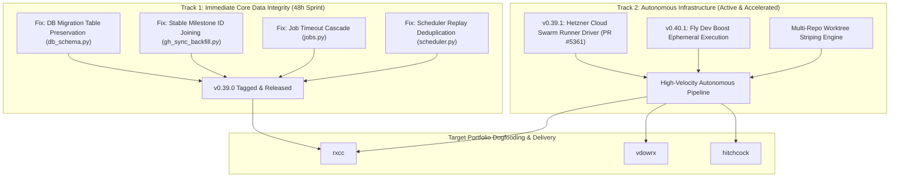

# Decision Record: dec-a741f92e

**Topic:** Roadmap Pacing vs. Acceleration: Balancing Data Integrity & Breaking-Fix Remediation with Autonomous Infrastructure Velocity for Target Products (rxcc, vdowrx, hitchcock)  
**Date:** 2026-11-23  
**Panel:** Claude Sonnet (Chair), Agy (Gemini), Codex, Grok  
**Status:** Approved  

---

## 1. Executive Summary & Authoritative Decision

```
Decision:
Adopt Dual-Track Acceleration: Concurrently land surgical TDD fixes for the 6 core data integrity liabilities within 48 hours to unblock the v0.39.0 release cut, while immediately advancing Hetzner Cloud Runners (v0.39.1) and autonomous multi-repo infrastructure. Deploy high-velocity autonomous pipelines across target products (rxcc, vdowrx, hitchcock) protected by Synlynk's 4 Constitutional Invariants.
```

---

## 2. Background & Strategic Context

An external product, market, and architecture review on 2026-11-21 ([Review Evidence Register](file:///Users/nikhilsoman/dev/synlynk/worktrees/product-review-2026-11-21/docs/reviews/2026-11-21-review-evidence-register.md) and [Product Review](file:///Users/nikhilsoman/dev/synlynk/worktrees/product-review-2026-11-21/docs/reviews/2026-11-21-product-and-architecture-review.md)) audited synlynk's 109 canonical goals and revealed:
1. **6 High/Medium Technical Liabilities:** Database migration dropping legacy tables, positional milestone joins corrupting roadmap alignment, dependency gate child job deadlock on parent timeouts, and schedule replay double reservations.
2. **Competitive Risk:** Rapid advances by GitHub Agent HQ, Anthropic Agent Teams, and OpenAI Symphony.
3. **The Recommended Conservative Pivot:** The external review recommended deferring cloud swarms, Hetzner runners, and Fly Dev Boost until v0.44–v0.47, focusing exclusively on a local-first Task Receipt & Handover Ledger.

The User raised a strategic counter-thesis: **pacing and deferring infrastructure risks irrelevance as the AI landscape commoditizes.** Synlynk needs infrastructure *now* to drive high-velocity software engineering across its target products (`rxcc`, `vdowrx`, `hitchcock`). The panel was convened to evaluate the relative benefits of pacing vs. accelerating the rollout.

---

## 3. Harness Panel Submissions

### Claude (Chair / Product Strategy & Architecture)
> **Position:** Reject artificial pacing. Adopt Dual-Track Acceleration: patch breaking liabilities as immediate blocker PRs within 48 hours, while keeping Hetzner runner infrastructure and multi-repo dispatch on the active fast track to accelerate delivery across `rxcc`, `vdowrx`, and `hitchcock`.
> 
> A linear waterfall that stalls infrastructure behind a local-only GA creates an existential market vulnerability. Synlynk cannot compete as a desktop-bound CLI receipt viewer. High velocity and safety are reconciled through our 4 Constitutional Invariants: Sandboxing (Law 0), Attribution (Law 1), PR Review Separation (Law 2), and FinOps Telemetry (Law 3).

### Agy (QA, Test Implementation & Dogfooding)
> **Position:** Accelerate the rollout. Fix the 6 breaking cases immediately through aggressive TDD verification, unblock Hetzner Cloud Swarm Runner (`v0.39.1`), and point autonomous multi-agent pipelines directly at `rxcc`, `vdowrx`, and `hitchcock`.
> 
> Local single-workstation orchestration causes disk and process contention. Dogfooding synlynk on real multi-repo products (`rxcc`, `vdowrx`, `hitchcock`) is the fastest path to surfacing and hardening real runtime edge cases. The 6 liabilities are discrete code bugs that can be verified and fixed via TDD in 24–48 hours.

### Codex (CLI Plumbing, Core Subsystems & Git Write Authority)
> **Position:** Accelerate. Land the 4 core plumbing fixes directly onto `main` as `v0.39.0-rc` patches, keep `v0.39.1` (Hetzner Cloud Swarm Runner) and remote dispatch in active build, and leverage the multi-repo worktree engine to accelerate engineering across `rxcc`, `vdowrx`, and `hitchcock`.
> 
> The 6 liabilities total under 200 lines of surgical fixes across `db_schema.py`, `gh_sync_backfill.py`, `jobs.py`, and `scheduler.py`. Halting the entire company's roadmap for 200 lines of bug fixes is a major overreaction. Remote runners run in isolated worktrees and do not contaminate local SQLite migration logic.

### Grok (Infrastructure, Concurrency & FinOps)
> **Position:** Unconditional acceleration. Keep Hetzner cloud runners and distributed swarm execution immediately adjacent to the core fixes. High velocity across target products (`rxcc`, `vdowrx`, `hitchcock`) is the primary validation of the platform.
> 
> The risk of moving slowly is fatal in the agentic AI market. The Hetzner runner driver and Fly Dev Boost unlock the compute throughput needed to run continuous parallel agent swarms. Law 3 (FinOps spend caps and wallet telemetry) acts as the deterministic circuit breaker against cost blowups.

---

## 4. Synthesis & Re-Aligned Release Roadmap



### Detailed Roadmap Cuts

1. **v0.39.0 — Hardened FTUE & Core Data Integrity (In Progress — 48h Gate)**
   - Hardened FTUE Wizard & Vizor HUD (Stories 1–6 merged).
   - Blocker PR 1: Safe transactional database migration verifying arc/phase record retention.
   - Blocker PR 2: Stable milestone foreign-key joining in schema views and `gh_sync_backfill.py`.
   - Blocker PR 3: Terminal-state cascade in job dependency reconciliation (`jobs.py:6337`).
   - Blocker PR 4: Scheduler atomic reservation constraint (`scheduler.py:71`).

2. **v0.39.1 — Hetzner Cloud Swarm Runner Driver & Vertical Host Orchestration (Restored P0)**
   - Hetzner Cloud Swarm Runner Driver scaffolding, server provisioning, teardown watchdogs, and CLI wiring ([PR #5361](https://github.com/nikhilsoman/synlynk/pull/5361) / [PR #5362](https://github.com/nikhilsoman/synlynk/pull/5362)).
   - Offloads autonomous execution from developer laptops to dedicated cloud compute.

3. **v0.40.0 — Core + Personal GA & Task Receipt Handover Ledger**
   - Clean-VM onboarding verification across 1 to 5 harnesses.
   - First-class Task Receipt & Handover Ledger (the tamper-evident provenance artifact).
   - Single-harness frictionless experience; GOVERNS and Agent Studio dark by default.

4. **v0.40.1+ — Autonomous Multi-Repo Engineering Pipeline**
   - Multi-repo orchestration powering concurrent development across `rxcc`, `vdowrx`, and `hitchcock`.
   - Autonomous task dispatch, non-author review pairing, and automated PR generation bounded by the Synlynk Constitution.
