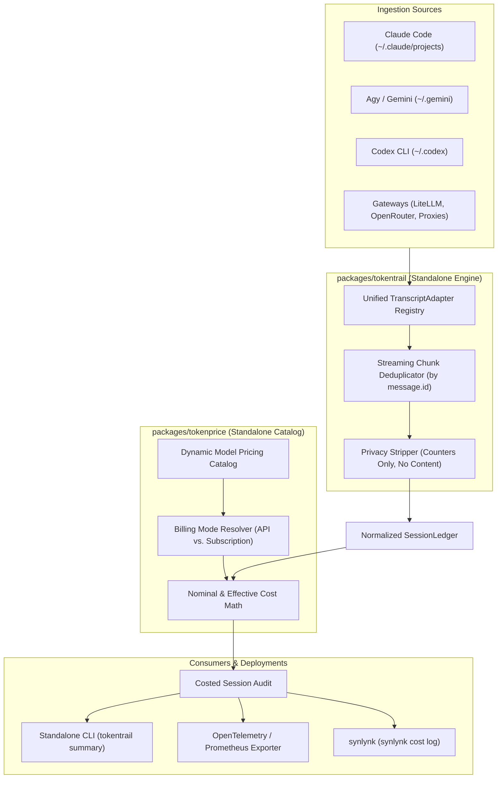

# Decision Record: dec-f39b1a08

**Topic:** Architecture of Standalone `tokentrail` & `tokenprice` Packages: Multi-Harness Session Extraction, Gateway Interop, and Decoupled Pricing Engine  
**Date:** 2026-11-23  
**Panel:** Claude Sonnet (Chair), Agy (Gemini), Codex, Grok  
**Status:** Approved  

---

## 1. Executive Summary & Authoritative Decision

```
Decision:
Approve the standalone dual-package architecture:
1. `packages/tokenprice`: Zero-dependency, high-speed pricing catalog, discount resolver, and token valuation engine.
2. `packages/tokentrail`: Universal agent transcript extractor and stream observer supporting local CLIs (Claude Code, Agy, Codex, Cursor) and proxies/gateways (OpenRouter, LiteLLM) via a standardized TranscriptAdapter protocol.
Author formal Design Spec and Plan adhering strictly to these standalone boundaries with zero synlynk core dependencies.
```

---

## 2. Strategic Context & Motivation

In investigating Sev1 RCA [LIVE-35](file:///Users/nikhilsoman/dev/synlynk/docs/rca/2026-11-23-LIVE-35-native-session-cost-capture.md), the founder directed that the session extraction and cost engine be engineered not merely as an internal synlynk utility, but as a **reusable, standalone open-source library and CLI tool** (`tokentrail`) with an independent lifecycle and PyPI publication target.

Additionally, the panel was tasked with evaluating:
1. Whether the **Model Billing & Pricing Engine** should also be an independent standalone package (`tokenprice`).
2. How the architecture can cleanly scale to many agent harnesses, IDEs (Cursor/VSCode), and API Gateways (OpenRouter, LiteLLM, vLLM, custom corporate proxies).
3. What **other components in synlynk** represent candidates for extraction into independently maintained packages.

---

## 3. Harness Panel Positions

### Claude (Chair / System Architecture)
> **Position:** Strongly endorse the dual-package boundary (`tokentrail` + `tokenprice`).
> 
> Ingestion and pricing have completely different lifecycles and operational environments:
> - `tokenprice` is a pure mathematical calculation: `f(usage, model, billing_mode, timestamp) -> CostResult`. It has zero dependencies, runs in sub-milliseconds, and can be embedded inside ultra-low-latency HTTP proxy routers (like LiteLLM or Envoy).
> - `tokentrail` is an observational I/O layer: it tails files, parses JSONL event streams, resolves subagent sidechains, and handles streaming message chunk deduplication.
> Keeping them independent allows developers to use `tokenprice` for budgeting without needing file parsers, and allows `tokentrail` to extract raw tokens even without pricing data.

### Agy (QA, Test Invariants & Developer Experience)
> **Position:** Endorse standalone library design with strict testing fixtures.
> 
> The central technical liability in transcript parsing is format drift across agent CLI versions. `tokentrail` must maintain a dedicated suite of real transcript fixtures from Claude Code, Agy/Gemini, and Codex CLI. We must enforce two strict invariants:
> 1. **Deduplication Invariant:** Ensure progress chunks for streaming turns collapse to the exact terminal `message.id` usage count (preventing the 2x overcounting flaw in `calc_costs.py`).
> 2. **Privacy Invariant:** Verify with 100% certainty that `tokentrail` extracts only token counters, model IDs, and timestamps, completely stripping prompt text and source code.
> Standalone CLI commands (`tokentrail summary --last`, `tokentrail inspect`) will make this an indispensable developer utility.

### Codex (CLI Plumbing & Storage Contracts)
> **Position:** Endorse `packages/` repository layout with decoupled `pyproject.toml`.
> 
> `tokentrail` must define a formal `TranscriptAdapter` protocol:
> ```python
> class TranscriptAdapter(Protocol):
>     def detect(self, source: Any) -> bool: ...
>     def parse(self, source: Any) -> SessionLedger: ...
> ```
> Built-in adapters:
> - `ClaudeCodeAdapter`: parses `~/.claude/projects/**/*.jsonl`.
> - `AgyAdapter`: parses `~/.gemini/antigravity-cli/brain/**/transcript*.jsonl`.
> - `CodexCLIAdapter`: parses `~/.codex/sessions/**/*.jsonl`.
> - `GatewayAdapter`: parses standard OpenAI/OpenRouter/LiteLLM usage response envelopes.
> Synlynk itself will simply import `tokentrail` and `tokenprice`, storing the resulting `SessionLedger` into `state.db` as an external consumer.

### Grok (Concurrency, Gateway Interop & Standalone Candidates)
> **Position:** Endorse with priority on LiteLLM/OpenRouter gateway interop and dual accounting.
> 
> Organizations routing agents through LiteLLM or OpenRouter need accurate nominal vs. effective cost tracking:
> - `nominal_cost`: Public API token price (useful for chargeback and market comparison).
> - `effective_cost`: Actual cash out (accounting for flat subscriptions or negotiated enterprise discounts).
> 
> **Other Standalone Package Candidates Identified in Synlynk:**
> 1. **`synlynk-worktree` (`packages/worktree-lease`):** High-reliability atomic git worktree leasing, isolation, and auto-cleanup engine ([synlynk/worktree.py](file:///Users/nikhilsoman/dev/synlynk/synlynk/worktree.py)).
> 2. **`synlynk-harness-spec` (`packages/harness-spec`):** Protocol for detecting, probing, and sandboxing CLI coding agents ([synlynk/probe.py](file:///Users/nikhilsoman/dev/synlynk/synlynk/probe.py)).
> 3. **`synlynk-circuit-breaker` (`packages/token-breaker`):** Active in-flight token circuit breaker and budget limiter ([synlynk/circuit_breaker.py](file:///Users/nikhilsoman/dev/synlynk/synlynk/circuit_breaker.py)).

---

## 4. Synthesis & Ratified Architecture



### Approved Package Boundaries

1. **`packages/tokenprice`:**
   - Independent `pyproject.toml`.
   - Zero external dependencies (pure Python standard library).
   - Exports: `calculate_cost()`, `get_model_rates()`, `BillingMode`, `PricingCatalog`.
2. **`packages/tokentrail`:**
   - Independent `pyproject.toml`.
   - Minimal dependencies (`tokenprice`, optional `rich` for CLI output).
   - Exports: `parse_session()`, `detect_transcripts()`, `TranscriptAdapter`, `SessionLedger`, `TokenTurn`.
   - Ships with standalone CLI: `tokentrail audit`, `tokentrail summary --last`, `tokentrail watch`.
